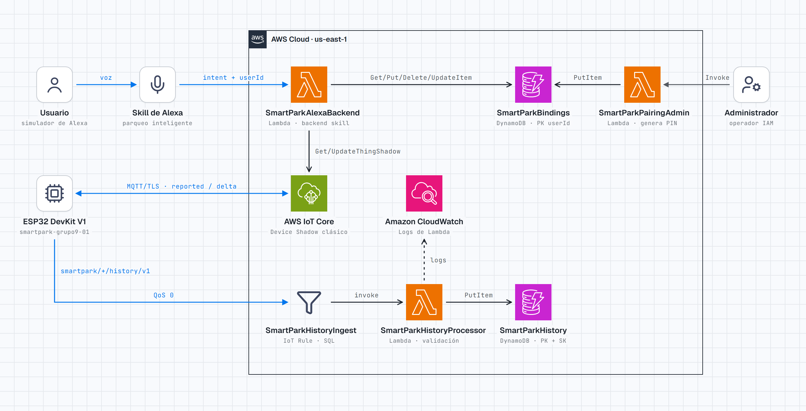

# Práctica 4 — Procesamiento, Almacenamiento y Lógica de Negocio de Objetos Inteligentes con AWS y Alexa

**SmartPark — Integración de un objeto inteligente con AWS (IoT Core, IoT Rules, Lambda y DynamoDB) y Alexa, con procesamiento, almacenamiento y lógica de control en el Edge y/o en la Nube**

**Asignatura:** Internet de las Cosas [SIS-234]

**Semestre:** 2-2026

**Grupo:** 9

**Integrantes:**

- Carlos Eduardo Iriarte Rodriguez
- Isabella Catherine Montes Iñiguez
- Henry Alejandro Rivera Mendez

---

## Documentación

- **Informe técnico de la Práctica 4:** [docs/informe-practica-4.md](docs/informe-practica-4.md)
- Firmware V2 (plazas, circuito, control local y Shadow): [docs/firmware-v2.md](docs/firmware-v2.md)
- Histórico en AWS (regla de IoT, Lambda y DynamoDB): [docs/historial-aws-practica-4.md](docs/historial-aws-practica-4.md)
- Skill de Alexa (intents y despliegue): [docs/alexa-practica-4.md](docs/alexa-practica-4.md)

Esta práctica extiende la Práctica 3: [repositorio de la Práctica 3](https://github.com/HenryRiveraM/smartpark-practica-3).

---

## Descripción del proyecto

SmartPark controla un parqueo de cuatro plazas con barrera de entrada. El objeto inteligente (Thing `smartpark-grupo9-01`, ESP32) detecta la ocupación de cada plaza, muestra la disponibilidad en LEDs y en una LCD, mueve la barrera y aplica una regla automática en el Edge: en modo `automatico` no abre la barrera si no hay plazas libres. El estado se sincroniza con el Device Shadow de AWS IoT Core, cada evento se guarda en DynamoDB a través de una regla de IoT y una Lambda, y una skill de Alexa consulta y controla el parqueo escribiendo solo en `desired`.

Caso de uso, actores y ampliación respecto a la Práctica 3: [sección 1.1 del informe](docs/informe-practica-4.md#11-caso-de-uso-y-ampliación-respecto-a-la-práctica-3).

## Hardware utilizado

| Componente | Cantidad | Uso |
|---|---|---|
| ESP32 DOIT DevKit V1 | 1 | Controlador del objeto inteligente |
| Sensor IR de reflexión (salida digital) | 4 | Ocupación de cada plaza |
| Sensor ultrasónico HC-SR04 | 1 | Distancia y presencia de un vehículo frente a la barrera |
| Servo SG90 | 1 | Barrera (0° cerrada, 90° abierta) |
| LED rojo y LED verde | 8 (2 por plaza) | Indicación local de ocupación |
| LCD 16×2 con adaptador I²C PCF8574 | 1 | Resumen de ocupación, modo, barrera y bloqueo |

Pines, adaptación de niveles y alimentación: [sección 2.3 del informe](docs/informe-practica-4.md#23-diagrama-de-circuito) y [`include/config.example.h`](include/config.example.h). La justificación de cada componente está en la [sección 1.2](docs/informe-practica-4.md#12-justificación-de-los-sensores-y-actuadores).

## Arquitectura



Hay dos flujos que solo se encuentran en AWS IoT Core: el de control (Alexa → `SmartParkAlexaBackend` → Shadow → ESP32) y el de histórico (ESP32 → `smartpark/<thingName>/history/v1` → regla `SmartParkHistoryIngest` → `SmartParkHistoryProcessor` → tabla `SmartParkHistory`). Descripción completa en la [sección 2.2 del informe](docs/informe-practica-4.md#22-diagrama-de-arquitectura).

## Funcionalidades principales

- Detección de la ocupación por plaza con antirrebote configurable (50–1000 ms) y medición de distancia frente a la barrera.
- Indicación local con LEDs y LCD, también sin conexión.
- Modos `manual` y `automatico`; en `automatico` el Edge bloquea la apertura cuando no quedan plazas libres. El cierre siempre se acepta y una orden remota de más de 30 s no mueve la barrera.
- Sincronización con el Device Shadow: reporte por evento y respaldo cada 30 s; aplicación de `desired` (barrera, modo y antirrebote).
- Histórico de lecturas y cambios de barrera validado por una Lambda y guardado en DynamoDB; los mensajes inválidos se descartan.
- Skill de Alexa con vinculación por PIN temporal, consultas de sensores y plazas, control de la barrera y cambio de modo y antirrebote por voz.
- Mockups de reportes construidos a partir de consultas a `SmartParkHistory`.

Requerimientos completos y trazabilidad: [secciones 1.3 a 1.5 del informe](docs/informe-practica-4.md#13-requerimientos-funcionales). Lógica de control y ubicación Edge / Nube: [sección 2.6](docs/informe-practica-4.md#26-lógica-de-control-diagrama-de-estados-y-ubicación-edge--nube).

## Tecnologías

- **Firmware:** C++ con Arduino sobre PlatformIO (`espressif32@7.1.0`, placa `esp32doit-devkit-v1`), FreeRTOS, ESP32Servo 1.1.2, PubSubClient 2.8 y ArduinoJson 6.21.5 ([`platformio.ini`](platformio.ini)).
- **AWS:** IoT Core (Device Shadow, MQTT sobre TLS con certificados X.509, IoT Rules), Lambda con Python 3.13 y DynamoDB.
- **Alexa:** Alexa Skills Kit con ASK SDK para Python, idioma `es-US`.

## Configuración

Los archivos con valores reales no se versionan: `include/config.h` e `include/secrets.h` están excluidos en [`.gitignore`](.gitignore). Se crean a partir de las plantillas:

```sh
cp include/config.example.h include/config.h
cp include/secrets.example.h include/secrets.h
```

- En `include/config.h`: `AWS_IOT_ENDPOINT` (endpoint de datos del dispositivo de la cuenta), `THING_NAME` y, si hace falta, pines, `PARKING_CAPACITY` y tiempos.
- En `include/secrets.h`: `WIFI_SSID`, `WIFI_PASSWORD` y los tres PEM (Amazon Root CA 1, certificado del dispositivo y clave privada).

Recursos de AWS, plantillas de políticas y permisos: [sección 3.2 del informe](docs/informe-practica-4.md#32-configuraciones-en-aws-y-permisos-asignados). Configuración de la skill: [sección 3.3](docs/informe-practica-4.md#33-configuraciones-en-alexa).

## Compilar, cargar y probar

Firmware:

```sh
pio run                 # compilar
pio run -t upload       # cargar en el ESP32
pio device monitor      # monitor serie a 115200 baudios
```

En el monitor serie se aceptan los comandos `OPEN`, `CLOSE`, `STATUS`, `DISTANCE`, `SLOT1`, `LCDRESET` (reinicializa la LCD sin mover el servo) y `HELP` ([`include/SerialCommands.h`](include/SerialCommands.h)). Para aislar una falla de la pantalla existe el entorno de diagnóstico `pio run -e lcd-diagnostico -t upload` ([`src/lcd_diagnostico.cpp`](src/lcd_diagnostico.cpp)); `pio run` solo compila el firmware principal.

Pruebas automáticas:

```sh
sh test/run_host_tests.sh    # firmware con dobles en el host

cd lambda
AWS_EC2_METADATA_DISABLED=true python -m unittest discover -s tests    # Lambdas
```

En Windows, las pruebas de las Lambdas necesitan `PYTHONUTF8=1` para leer el modelo de Alexa. Empaquetado de las Lambdas: `sh scripts/build.sh` desde `lambda/` ([`lambda/README.md`](lambda/README.md)).

Las salidas de la última ejecución están en [`docs/evidencias/pruebas-automaticas/`](docs/evidencias/pruebas-automaticas/) y su resultado en la [sección 4.5 del informe](docs/informe-practica-4.md#45-pruebas-automáticas). El despliegue en AWS, las pruebas con el hardware y las pruebas en el simulador de Alexa siguen el plan de la [sección 4.1](docs/informe-practica-4.md#41-plan-de-pruebas-y-hojas-de-registro); sus resultados se registran en el informe junto con la evidencia correspondiente.

## Ejemplos de frases de Alexa

Invocación: **"Alexa, abre parqueo inteligente"**. Frases tomadas de [`alexa/es-US.smartpark-v2.final.json`](alexa/es-US.smartpark-v2.final.json):

| Intent | Frase de ejemplo |
|---|---|
| `VincularParqueoIntent` | "vincula mi parqueo con el codigo {codigo}" |
| `CambiarVinculacionIntent` | "cambia mi vinculacion con el código {codigo}" |
| `ConsultarDisponiblesIntent` | "cuántos espacios hay disponibles" |
| `ConsultarOcupadosIntent` | "cuántas plazas están ocupadas" |
| `ConsultarEstacionamientoIntent` | "está libre la plaza {espacio}" |
| `ConsultarVehiculoIntent` | "hay un auto frente a la barrera" |
| `ConsultarDistanciaIntent` | "consulta la distancia" |
| `AbrirBarreraIntent` | "abrir" |
| `CerrarBarreraIntent` | "cerrar" |
| `EstadoBarreraIntent` | "consulta el estado de la barrera" · "consultar estado" |
| `ConsultarModoIntent` | "en qué modo está el parqueo" |
| `ActivarModoAutomaticoIntent` | "activa el modo automático" |
| `ActivarModoManualIntent` | "activa el modo manual" |
| `ConsultarAntirreboteIntent` | "consulta el antirrebote" |
| `CambiarAntirreboteIntent` | "ajusta el antirrebote a {milisegundos} milisegundos" |
| `DesvincularParqueoIntent` | "elimina la vinculación de mi parqueo inteligente" · "desvincula mi parqueo" |

Intents, slots y respuestas: [sección 2.11 del informe](docs/informe-practica-4.md#211-diseño-de-la-skill-de-alexa).