# Práctica 4 — Procesamiento, Almacenamiento y Lógica de Negocio de Objetos Inteligentes con AWS y Alexa

**SmartPark — Integración de un objeto inteligente con AWS (IoT Core, IoT Rules, Lambda y DynamoDB) y Alexa, con procesamiento, almacenamiento y lógica de control en el Edge y/o en la Nube**

**Carrera:** Ingeniería de Sistemas

**Docente:** Eduardo Enrique Marin Garcia

**Asignatura:** Internet de las Cosas [SIS-234]

**Semestre:** 2-2026

**Grupo:** 9

**Integrantes:**

- Carlos Eduardo Iriarte Rodríguez
- Isabella Catherine Montes Iñiguez
- Henry Alejandro Rivera Mendez

---

## Índice

1. [Caso de Uso y Requerimientos](#1-caso-de-uso-y-requerimientos)
2. [Análisis y Diseño](#2-análisis-y-diseño)
3. [Desarrollo e Implementación](#3-desarrollo-e-implementación)
4. [Pruebas y Validaciones](#4-pruebas-y-validaciones)
5. [Resultados](#5-resultados)
6. [Conclusiones](#6-conclusiones)
7. [Recomendaciones](#7-recomendaciones)
8. [Anexos](#8-anexos)

Antes de la sección 1: [Resumen del informe](#resumen-del-informe).

---

## Resumen del informe

**Estado de la evidencia.** El diseño y la implementación (secciones 1 a 3) están en el repositorio y se enlazan al código con número de línea. Las pruebas automáticas se ejecutaron el 2026-11-23 sobre el commit `ad5d377` (4.5). La sesión de pruebas en vivo del 22/11/2026 dejó videos, hojas de cálculo, un PDF de mediciones y exportaciones de DynamoDB, todos transcritos o analizados en [`docs/evidencias/`](evidencias/); no dejó log serie ni exportación de CloudWatch, y las mediciones que dependían de ellos se declaran como no ejecutadas (4.1). Cada resultado que no cumple tiene una ficha de diagnóstico en 4.4.

**Convención de estados.** Se usa una sola en todo el informe y en los README de evidencia.

| Estado | Significado |
|---|---|
| ✅ Cumple | La evidencia en vivo demuestra el requisito y alcanza el valor declarado |
| ⚠️ Cumple parcial | La evidencia en vivo cubre una parte; el resto está verificado con pruebas automáticas o no se midió |
| ❌ No cumple | El valor medido no alcanza el declarado en 1.4 |
| No ejecutada (motivo) | No hay medición; se indica por qué |
| Verificada con PA-0X | Sin prueba en vivo; la cubre la prueba automática indicada |
| No aplica | El requisito no corresponde al diseño (con justificación) |

**Resumen de resultados** (detalle en [5.1](#51-matriz-de-cumplimiento)).

| Estado | RF (15) | Reglas E1–E4 (4) | RNF (13 filas) |
|---|---:|---:|---:|
| ✅ Cumple | 8 | 0 | 2 |
| ⚠️ Cumple parcial | 7 | 2 | 2 |
| ❌ No cumple | 0 | 0 | 5 |
| No ejecutada | 0 | 0 | 2 |
| Verificada con PA-02/PA-03 | 0 | 2 | 1 |
| No aplica | 0 | 0 | 1 |

Todos los RF tienen evidencia en vivo total o parcial. Los RNF que no se cumplen (estabilidad, respuesta por voz, reconexión, integridad y latencia del histórico) tienen causa identificada en 4.4 y corrección en 7.6. PA-01, PA-02 (6/6) y PA-03 (108/108) pasan.

---

## 1. Caso de Uso y Requerimientos

### 1.1 Caso de uso y ampliación respecto a la Práctica 3

**Problema.** Un parqueo pequeño de acceso controlado, con **cuatro plazas** y una barrera de entrada, necesita tres cosas que un guardia resuelve hoy a ojo: saber cuántas plazas quedan libres, no dejar entrar vehículos cuando el parqueo está lleno y registrar cómo se usa el parqueo para decidir horarios, tarifas o ampliaciones.

**Base heredada (Práctica 3).** El objeto inteligente `smartpark-grupo9-01` (ESP32) medía la distancia con un HC-SR04 frente a la barrera y movía un servo SG90 solo por voz, a través del Device Shadow, con una skill multiusuario y vinculación por PIN temporal. Código e informe de la P3: <https://github.com/HenryRiveraM/smartpark-practica-3>.

**Ampliación en la Práctica 4.**

| Ámbito | Práctica 3 | Práctica 4 (este repositorio) |
|---|---|---|
| Sensores | HC-SR04 | HC-SR04 + **4 sensores IR, uno por plaza** ([`SLOT_PINS`](../include/config.example.h)) |
| Actuadores e indicadores | SG90 | SG90 + **8 LEDs** (rojo/verde por plaza) + **LCD 16×2 I²C** ([`ParkingDisplay`](../src/ParkingDisplay.cpp)) |
| Lógica de control | Ninguna: la barrera solo se mueve por orden | **Modos `manual` / `automatico`**; en automático el Edge **bloquea la apertura sin plazas confirmadas libres** ([`Parking::State::openingBlocked()`](../include/Parking.h#L15)) |
| Parámetros remotos | — | `modo` y `parametros_auto.antirrebote_ir_ms`, persistidos en NVS ([`applyDesired()`](../src/AwsIoTManager.cpp#L247)) |
| Histórico | — | Tópico `smartpark/<thingName>/history/v1` → regla `SmartParkHistoryIngest` → Lambda `SmartParkHistoryProcessor` → tabla `SmartParkHistory` |
| Skill | Barrera, distancia, vehículo, vinculación | + plazas disponibles/ocupadas, estado por plaza, modo y antirrebote (RF14) |
| Reportes | — | 4 mockups para el administrador (2.12) |

**Actores.**

| Actor | Rol |
|---|---|
| Conductor | Llega a la barrera; ocupa y libera plazas (detectado por los IR). |
| Usuario de Alexa (encargado) | Consulta disponibilidad, abre/cierra la barrera y cambia modo y antirrebote por voz. |
| Administrador | Genera el PIN de vinculación con `SmartParkPairingAdmin` y consulta los reportes de 2.12. |
| Objeto inteligente | Thing `smartpark-grupo9-01`: mide, decide en el Edge, actúa y publica estado e histórico. |

**Escenario.** Con el parqueo en `automatico`, el cuarto vehículo ocupa la plaza 4: los IR confirman la ocupación tras el antirrebote, el LED de la plaza pasa a rojo, la LCD muestra `Libres:0/4 Oc:4` en la fila 0 y `APERTURA BLOQ.` en la fila 1, y el Shadow reporta `disponibles: 0` y `bloqueo_apertura: true`. Si alguien pide *"abre la barrera"*, el Edge rechaza la apertura y lo informa en `reported.ultima_orden.resultado = "bloqueada"`. Al liberarse una plaza, la apertura vuelve a permitirse sin intervención. Cada transición queda en `SmartParkHistory` para los reportes.

**Límites.** El SG90 no tiene realimentación: la posición de la barrera es una **estimación temporal** (`SERVO_TRAVEL_MS = 700` ms, `reported.barrera_posicion_estimada`). La barrera no es un dispositivo de seguridad ni detecta obstáculos. Todo el montaje opera a 5 V y 3,3 V (≤ 12 V DC).

### 1.2 Justificación de los sensores y actuadores

| Componente | Cantidad | Variable / acción | Por qué esa cantidad y tipo | Alternativas descartadas |
|---|---|---|---|---|
| Sensor IR de reflexión (salida digital) | 4 (uno por plaza) | Plaza ocupada / libre | La disponibilidad es la información central del caso de uso y se decide **por plaza**; un sensor por plaza permite contar y saber **cuál** está libre (consulta `ConsultarEstacionamientoIntent`). Es digital, barato, sin contacto y de respuesta rápida; el antirrebote por software (`IR_DEBOUNCE_*`) filtra el ruido de entrada. | Contador único en la entrada (pierde la plaza concreta y acumula error si falla una lectura); ultrasónico por plaza (más caro, 2 GPIO por plaza, más lento); sensor magnético en el piso (instalación invasiva). |
| HC-SR04 (ultrasónico) | 1 (frente a la barrera) | Distancia al vehículo y presencia con histéresis (15 cm / +3 cm) | Se conserva de la P3 porque responde una pregunta distinta de los IR: **si hay un vehículo esperando en la barrera** y a qué distancia (`ConsultarVehiculoIntent`, `ConsultarDistanciaIntent`). Los IR solo ven las plazas. No se usa para la decisión automática. | Un quinto IR en la entrada (sí/no sin distancia ni umbral configurable). |
| Servo SG90 | 1 | Barrera 0° (cerrada) ↔ 90° (abierta) | Dos posiciones discretas con una sola señal PWM. En el montaje se alimenta desde el pin 3V3 del ESP32 (2.3, 7.5). Es el actuador que no es LED exigido por el enunciado. | Motor DC con puente H (necesita finales de carrera); solenoide (carrera corta, consumo sostenido). |
| LED rojo + LED verde | 8 (2 por plaza) | Indicación local de ocupación | El conductor ve desde la entrada qué plaza está libre sin consultar a Alexa. Dos colores permiten un tercer estado visible: ambos apagados = `desconocido`. | LED RGB (más pines por plaza o un driver). |
| LCD 16×2 con PCF8574 | 1 | Fila 0: plazas libres y ocupadas (`Libres:3/4 Oc:1`). Fila 1: `APERTURA BLOQ.`, `PARQUEO LLENO` o, sin aviso, modo y barrera alternados cada 2 s | Muestra el estado del parqueo y la razón de un bloqueo en el sitio, también sin conexión, en 2 filas de 16 caracteres. El backpack I²C usa solo 2 GPIO. | LCD de 4 filas (más texto a la vez, pero ocupa más espacio en la maqueta); solo LEDs (no explican la razón de un bloqueo). |

Los pines y su adaptación eléctrica están en 2.3.

### 1.3 Requerimientos funcionales

Las pruebas `PF-xx` están en 4.2 y las automáticas `PA-xx` en 4.5.

| ID | Requerimiento (verificable) | Implementación |
|---|---|---|
| RF1 | Capturar la distancia cada 500 ms (`SENSOR_INTERVAL_MS`) y el estado de cada plaza muestreando los IR cada 10 ms (`IR_SAMPLE_MS`) con antirrebote configurable de 50 a 1000 ms. | [`UltrasonicSensor::measure()`](../src/UltrasonicSensor.cpp#L11), [`Parking::update()`](../src/Parking.cpp#L27) |
| RF2 | Reportar en `state.reported` la distancia y la presencia de la misma muestra, la barrera, las plazas, los conteos, el modo y los parámetros: por evento y con respaldo cada 30 s (`AWS_REPORT_INTERVAL_MS`). Sin lectura válida, retirar distancia y presencia con `null`. | [`AwsIoTManager::report()`](../src/AwsIoTManager.cpp#L427), [`step()`](../src/AwsIoTManager.cpp#L494) |
| RF3 | Recibir el `delta`, aplicarlo (barrera, modo, antirrebote) y confirmar en `reported`. | [`receive()`](../src/AwsIoTManager.cpp#L335), [`applyDesired()`](../src/AwsIoTManager.cpp#L247), [`applyPending()`](../src/AwsIoTManager.cpp#L29) |
| RF4 | Responder por voz las consultas de sensores leyendo `reported` del Thing vinculado, solo con datos de ≤ 180 s, y distinguir un dato desactualizado de uno ausente. | [`sensor_handlers.py`](../lambda/handlers/sensor_handlers.py), [`ShadowService.get_reported_fields`](../lambda/services/shadow_service.py#L38) |
| RF5 | Ejecutar abrir/cerrar por voz escribiendo `desired.barrera` (formato V1). | [`barrier_handlers.py`](../lambda/handlers/barrier_handlers.py), [`set_barrier`](../lambda/services/shadow_service.py#L79) |
| RF6 | Responder el estado reportado de la barrera. | [`EstadoBarreraHandler`](../lambda/handlers/barrier_handlers.py#L27) |
| RF7 | Vincular usuario ↔ Thing con PIN temporal (300 s, 3 intentos) y persistencia entre sesiones. | [`binding_handlers.py`](../lambda/handlers/binding_handlers.py), [`dynamodb_service.py`](../lambda/services/dynamodb_service.py) |
| RF8 | Resolver el Thing por `context.System.user.userId` y guiar si no hay vinculación. | [`bound_device()`](../lambda/handlers/common.py#L13) |
| RF9 | Validar que el Thing exista y permitir cambiar y eliminar la vinculación por voz. | [`CambiarVinculacionHandler`, `DesvincularParqueoHandler`](../lambda/handlers/binding_handlers.py#L30) |
| RF10 | Disparar la regla `SmartParkHistoryIngest` con cada mensaje de `smartpark/+/history/v1` e invocar `SmartParkHistoryProcessor`. | [`iot-rule.example.json`](../aws/history/iot-rule.example.json), [`HistoryPublisher::publish()`](../src/HistoryPublisher.cpp#L135) |
| RF11 | Validar tipos, rangos y coherencia; descartar inválidos sin almacenarlos; enriquecer con `thingName`, `schemaVersion` y `receivedAt`; guardar lecturas (`sample`, `occupancy_changed`) en `SmartParkHistory`. | [`validate_event()`](../lambda/history_lambda_function.py#L87), [`lambda_handler`](../lambda/history_lambda_function.py#L115) |
| RF12 | Registrar cada cambio de estado de la barrera (`barrier_changed`) con su origen (`voz`, `edge`, `nube`, `legado`). La skill envía sus órdenes en formato V1 (`desired.barrera`) y el firmware las registra con `origin = legado` (5.5). | [`HistoryPublisher::observeBarrier()`](../src/HistoryPublisher.cpp#L81), [`validate_barrier()`](../lambda/history_lambda_function.py#L74) |
| RF13 | Lógica automática en el Edge: (E1) indicación de plaza por LED y en la fila 0 de la LCD 16×2 (`Libres:x/4 Oc:y`); (E2) en `automatico`, bloquear la apertura si no hay plaza confirmada libre y mostrar `APERTURA BLOQ.` en la fila 1; (E3) el cierre siempre se acepta; (E4) una orden remota vencida (> 30 s) no mueve la barrera. | [`Parking`](../src/Parking.cpp), [`applyPending()`](../src/AwsIoTManager.cpp#L29), [`main.cpp`](../src/main.cpp#L62), [`ParkingDisplay::update()`](../src/ParkingDisplay.cpp#L50) |
| RF14 | Reportar `modo` y `parametros_auto.antirrebote_ir_ms` en `reported`, y consultarlos y cambiarlos por voz a través de `desired`. | [`parking_handlers.py`](../lambda/handlers/parking_handlers.py), [`set_mode`, `set_debounce`](../lambda/services/shadow_service.py#L84) |
| RF15 | Diseñar mockups de reportes obtenibles con consultas a `SmartParkHistory`. | [2.12](#212-diseño-de-reportes-mockups), [`docs/mockups/`](mockups/) |

### 1.4 Requerimientos no funcionales

Valores declarados, método y prueba. Los RNF1–RNF6 heredan los de la P3 y se extienden a los IR, LEDs y LCD.

| ID | Atributo | Valor declarado | Método de medición (origen de tiempo) | Prueba |
|---|---|---|---|---|
| RNF1 | Estabilidad | ≥ 15 min conectado con uso normal: 0 reinicios, 0 bloqueos, 0 reconexiones no provocadas. | Log serie de la sesión con la hora del PC; banner `=== SmartPark V2` y `reconexiones=` de `STATUS`. | PNF-01 |
| RNF2 | Exactitud HC-SR04 | Error absoluto máximo ≤ 1 cm a 10, 20 y 30 cm (zona de espera frente a la barrera, alrededor del umbral de 15 cm). | Regla + 5 lecturas `DISTANCE` por distancia. | PNF-02 |
| RNF3 | Exactitud IR | ≥ 95 % de transiciones correctas (≥ 38 de 40: 5 entradas y 5 salidas por plaza). | Conteo frente a los LEDs y a los ítems `occupancy_changed`. | PNF-02 |
| RNF4 | Tiempo de respuesta por voz | ≤ 3,0 s desde el fin de la frase hasta el fin del movimiento estimado del servo. | Video ≥ 30 fps, conteo de cuadros. | PNF-03 |
| RNF5 | Frecuencia de reporte | Shadow: por evento y respaldo cada 30 s; separación mínima 10 s salvo control y presencia; ≤ 1000 solicitudes/día (200 reservadas a control y recuperación). Histórico: muestra cada 300 s y ≤ 1 publicación cada 10 s. | Log serie: intervalo entre `AWS UPDATE clase=0`; intervalo entre ítems `sample` en DynamoDB ([`analizar_pruebas.py`](../tools/analizar_pruebas.py)). | PNF-05, PA-02 |
| RNF6 | Reconexión y sincronización | Con un corte de 45 s, MQTT reconecta en ≤ 60 s y el `desired.modo` escrito durante el corte se refleja en `reported` en ≤ 70 s, ambos desde que vuelve la red. | Log serie (`STATUS` al restaurar → `AWS MQTT/TLS conectado` → primer `AWS UPDATE`) + `update/accepted` en el cliente MQTT. | PNF-06 |
| RNF7 | Integridad del almacenamiento | ≥ 99 % de los eventos publicados (contador `Historico: MQTT local`) quedan en `SmartParkHistory` en una ventana de 10 min; 100 % de los inválidos descartados. | Contador serie frente a ítems con `receivedAt` en la ventana; CloudWatch ([`analizar_pruebas.py`](../tools/analizar_pruebas.py)). | PNF-05, PF-05 |
| RNF8 | Latencia de almacenamiento | ≤ 5 s desde la llegada a AWS IoT (`receivedAt`) hasta el fin del `PutItem` (registro `REPORT` en CloudWatch). Complementario: `receivedAt − occurredAt` ≤ 15 s (cola del ESP32 de hasta 10 s + red). | Atributos del ítem y hora de CloudWatch, ≥ 20 eventos ([`analizar_pruebas.py`](../tools/analizar_pruebas.py)). | PNF-05 |
| RNF9 | Respuesta de la lógica automática | Edge: ≤ 0,3 s desde que el vehículo cubre el IR hasta el cambio de LED (antirrebote de 120 ms + muestreo de 10 ms + ciclo de `loop()`). Nube: no aplica (2.6). | Video ≥ 30 fps. | PNF-04 |
| RNF10 | Operación sin conexión | E1–E4 siguen operando; los eventos de histórico se encolan en RAM (8 de barrera, 16 de plazas, 1 muestra) y se envían al reconectar; se pierden si la cola se llena o el ESP32 se reinicia. | Dos cortes de 45 s; transiciones durante el corte frente a ítems recibidos al reconectar. | PNF-06 |
| RNF11 | Costo | Costo mensual estimado de un Thing < 0,05 USD con la capa gratuita aplicada (solo las escrituras bajo demanda de DynamoDB quedan fuera de ella) y < 0,30 USD sin capa gratuita. | Cálculo con las frecuencias del código. | 5.6 |
| RNF12 | Seguridad | Sin certificados, claves ni *access keys* en el repositorio; TLS mutuo X.509; políticas por recurso (3.2). | Revisión de `.gitignore` y plantillas; pruebas de aislamiento. | PA-03 |

Justificación de los valores: 3 s es el tiempo que un usuario espera tras la respuesta de Alexa antes de repetir la orden. 0,3 s es imperceptible para el conductor que mira el LED. 5 s de latencia de almacenamiento es la referencia del enunciado y basta para reportes que se consultan después. El límite de 60/70 s de RNF6 sale del *backoff* del código (2.10).

### 1.5 Trazabilidad de los requerimientos

| Req. | Componente / clase / archivo | Diagrama | Prueba |
|---|---|---|---|
| RF1 | `UltrasonicSensor`, `Parking` | 2.1, 2.4.1, 2.6 | PF-01, PNF-02, PA-02 |
| RF2 | `AwsIoTManager::report()` | 2.5.1, 2.7, 2.10 | PF-01, PNF-05, PA-02 |
| RF3 | `AwsIoTManager::applyDesired()` / `applyPending()` | 2.5.1 | PF-02, PF-07, PA-02 |
| RF4–RF6 | `sensor_handlers`, `barrier_handlers`, `ShadowService`, `MissingReportedField` | 2.4.2, 2.5.1 | PF-02, PA-03 (`test_stale_per_field_even_when_document_is_new`, `test_v2_distinguishes_unconfigured_space_from_missing_measurement`) |
| RF7–RF9 | `binding_handlers`, `DynamoDBService`, `SmartParkPairingAdmin` | 2.2, 2.8 | PF-03, PA-03 (`test_existing_thing_required`, `test_thing_not_found`) |
| RF10 | `HistoryPublisher`, regla `SmartParkHistoryIngest` | 2.2, 2.5.2, 2.9 | PF-04, PA-02 (contrato), PA-03 (`test_templates_keep_rule_identity_and_table_keys_aligned`) |
| RF11 | `history_lambda_function.validate_event()` | 2.5.2, 2.8 | PF-04, PF-05, PNF-05, PA-03 (`test_snapshot_item_and_reduced_capacity`, `test_invalid_never_initializes_sdk`, `test_put_conditional_duplicate_and_retry`) |
| RF12 | `HistoryPublisher::observeBarrier()`, `validate_barrier()` | 2.5.2 | PF-04, PA-03 (`test_barrier_origins_and_actual_transitions`) |
| RF13 | `Parking::State::openingBlocked()`, `applyPending()`, `main.cpp`, `ParkingDisplay::update()` | 2.5.3, 2.6 | PF-06 (E1–E3), PNF-04, PNF-06 (E4), PA-02 |
| RF14 | `parking_handlers`, `ShadowService.set_mode/set_debounce`, `applyDesired()` | 2.5.1, 2.7, 2.11 | PF-06, PF-07, PNF-06, PA-03 (`test_v2_*`) |
| RF15 | `SmartParkHistory` y patrones de acceso | 2.8, 2.12 | PF-08 |
| RNF1 | `main.cpp`, tarea `smartpark-aws` (`AwsIoTManager::run()`), alimentación (2.3) | 2.1, 2.3 | PNF-01 |
| RNF2 | `UltrasonicSensor::measure()` | 2.4.1, 2.5.1 | PNF-02, PF-01, PF-02 |
| RNF3 | `Parking::update()` (antirrebote) | 2.5.3, 2.6 | PNF-02, PA-02 |
| RNF4 | `barrier_handlers`, `ShadowService.set_barrier`, `applyPending()`, `BarrierServo` | 2.5.1 | PNF-03 |
| RNF5 | `AwsIoTManager::step()`/`report()`, `HistoryPublisher::observeParking()` | 2.10 | PNF-05, PA-02 |
| RNF6 | `AwsIoTManager::connectStep()`/`failedAttempt()`, GET del Shadow | 2.10 | PNF-06, PA-02 |
| RNF7 | `HistoryPublisher::enqueue()`/`publish()`, `validate_event()`, `PutItem` condicional | 2.5.2, 2.8 | PNF-05, PF-05, PA-02, PA-03 |
| RNF8 | `HistoryPublisher::publish()`, regla (`receivedAt`), `SmartParkHistoryProcessor` | 2.5.2, 2.10 | PNF-05 |
| RNF9 | `Parking::update()`, `ParkingDisplay::update()` | 2.5.3, 2.6 | PNF-04 |
| RNF10 | `loop()` (E1–E4), colas de `HistoryPublisher` | 2.1, 2.6 | PNF-06, PA-02 |
| RNF11 | Frecuencias de `config.example.h` | 2.10 | 5.6 |
| RNF12 | `.gitignore`, plantillas de `include/`, `lambda/iam/`, `aws/history/` | 2.2, 2.9 | 4.3, PA-03 |

---

## 2. Análisis y Diseño

### 2.1 Diagrama de bloques del objeto inteligente

El ESP32 separa el trabajo en dos contextos: `loop()` lee sensores, decide y acciona (Edge); la tarea FreeRTOS `smartpark-aws` es la única dueña de MQTT y NVS. Se comunican por tres colas de un elemento (instantánea, comando y estado), de modo que una red lenta nunca detiene la lógica local. Todo se alimenta por el USB del ESP32: el pin 5V/VIN alimenta la LCD y el HC-SR04, y el pin 3V3, los IR y el servo, con GND común (2.3). La LCD 16×2 muestra en la fila 0 las plazas libres y ocupadas (`Libres:3/4 Oc:1`) y en la fila 1, por prioridad, `APERTURA BLOQ.`, `PARQUEO LLENO` o, cada 2 s, el modo y el estado estimado de la barrera (3.1). Desde el monitor serie, `LCDRESET` reinicializa la LCD sin mover el servo ni reiniciar el ESP32. Copia: [`diagrams/01-bloques.mmd`](diagrams/01-bloques.mmd).

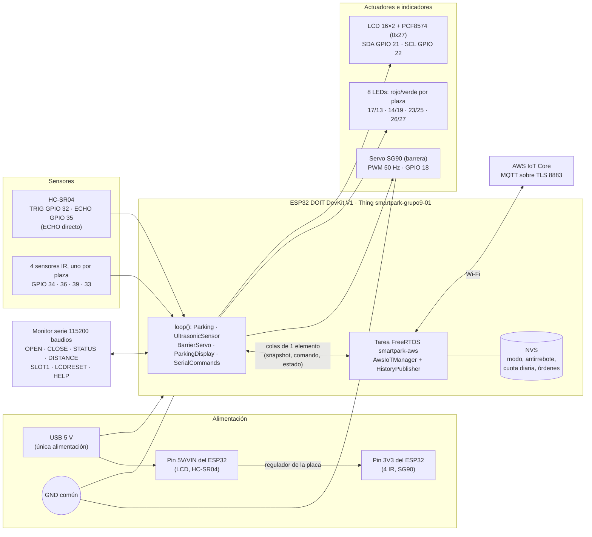

### 2.2 Diagrama de arquitectura


Fuente: [`diagrams/02-arquitectura.html`](diagrams/02-arquitectura.html). Hay dos flujos independientes que se encuentran solo en AWS IoT Core: el de **control** (Alexa → `SmartParkAlexaBackend` → Shadow → ESP32) y el de **histórico** (ESP32 → `smartpark/+/history/v1` → `SmartParkHistoryIngest` → `SmartParkHistoryProcessor` → `SmartParkHistory`). Las etiquetas de las flechas son las acciones IAM mínimas de las plantillas de cada rol; los permisos asignados en la cuenta son más amplios y se documentan en 3.2. Ni Alexa ni las Lambdas hablan con el ESP32: solo escriben `desired`.

### 2.3 Diagrama de circuito


Fuente editable: [`diagrams/03-circuito.excalidraw`](diagrams/03-circuito.excalidraw) · SVG: [`diagrams/03-circuito.svg`](diagrams/03-circuito.svg).

El montaje está en una protoboard y se alimenta solo por el USB del ESP32. El pin 5V/VIN alimenta la LCD y el HC-SR04; el pin 3V3, del regulador de la placa, alimenta los cuatro IR y el servo. Todos los módulos se conectan directamente a los GPIO, y todas las masas están unidas al GND del ESP32. Las mejoras eléctricas para una versión real están en 7.5.


*Montaje real en protoboard: ESP32, HC-SR04, 4 IR, 8 LEDs, servo SG90 y LCD 16×2, alimentados por USB. La LCD muestra el texto del firmware anterior a la adaptación a 16×2 (3.1), con la fila 0 cortada.*

| Pin ESP32 | Componente | Alimentación | Conexión en el montaje |
|---|---|---|---|
| GPIO 32 | HC-SR04 TRIG | 5 V (pin 5V/VIN) | Directa. La salida de 3,3 V del GPIO es nivel alto para el HC-SR04. |
| GPIO 35 | HC-SR04 ECHO | 5 V (pin 5V/VIN) | Directa al pin. GPIO 35 solo admite entrada; el ECHO del módulo entrega pulsos de 5 V (7.5). |
| GPIO 34 / 36 / 39 / 33 | IR plazas 1 / 2 / 3 / 4 (OUT) | 3,3 V (pin 3V3) | Directa. Salida digital activa en bajo (`IR_OCCUPIED_LEVEL = LOW`). 34, 36 y 39 son solo entrada y sin pull-up interno. |
| GPIO 18 | SG90 señal | 3,3 V (pin 3V3) | PWM 50 Hz, 500–2400 µs (0° = 500 µs, 90° = 1450 µs). El servo toma su corriente del regulador de 3,3 V de la placa (7.5). |
| GPIO 17 / 13 | LED rojo / verde plaza 1 | GPIO | Una resistencia en serie por LED, con el cátodo a GND. |
| GPIO 14 / 19 | LED rojo / verde plaza 2 | GPIO | Ídem. |
| GPIO 23 / 25 | LED rojo / verde plaza 3 | GPIO | Ídem. |
| GPIO 26 / 27 | LED rojo / verde plaza 4 | GPIO | Ídem. |
| GPIO 21 / 22 | LCD 16×2 SDA / SCL (PCF8574, 0x27) | 5 V (pin 5V/VIN) | I²C a 100 kHz, SDA y SCL directos a los GPIO (7.5). |
| 5V/VIN · 3V3 · GND | Alimentación | USB 5 V | 5V/VIN: LCD y HC-SR04. 3V3: 4 IR y SG90. GND común a todos los componentes. |

Resistencias de los LEDs: 4 de 220 Ω y 4 de 330 Ω, una en serie con cada LED; no está registrado qué valor lleva cada color.

Fuente de los pines: [`config.example.h`](../include/config.example.h). Notas de cableado y presupuesto de corriente: [`firmware-v2.md`](firmware-v2.md#cableado-del-montaje).

### 2.4 Diagramas de clases

#### 2.4.1 Objeto inteligente (firmware ESP32)

Cada clase encapsula un periférico o una responsabilidad. `AwsIoTManager` contiene a `ShadowBudget` (cuota diaria en NVS) y a `HistoryPublisher` (colas del histórico); actúa sobre `Parking` y `BarrierServo` solo desde `applyPending()`, en el contexto de `loop()`. `SerialCommands` devuelve un `Command`; con `LcdReset`, `main` llama a `ParkingDisplay::reinitialize()`, que reinicia la secuencia de arranque de la LCD (`prepareExpander()` y los pasos del HD44780) y redibuja ambas filas. Copia: [`diagrams/04-clases-firmware.mmd`](diagrams/04-clases-firmware.mmd).

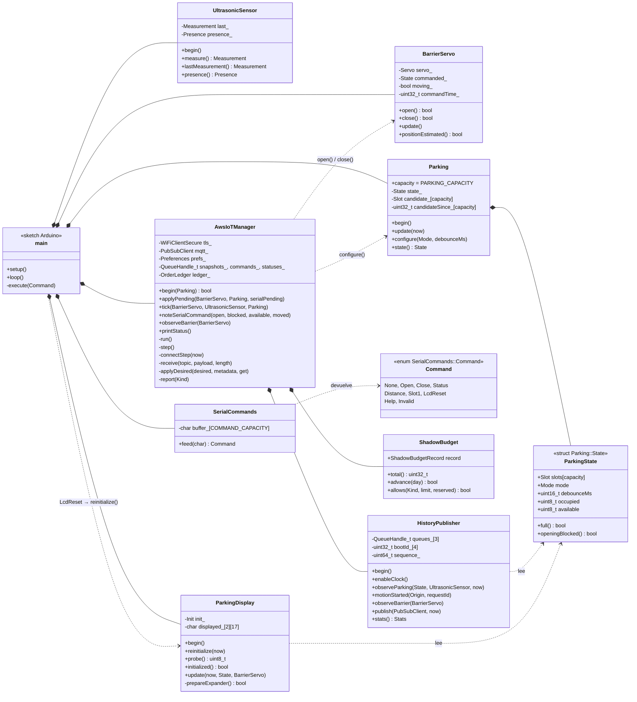

#### 2.4.2 Funciones Lambda

Tres paquetes de despliegue con responsabilidad única. El backend de la skill y la administración comparten solo `services.validation`; el procesador del histórico es un único archivo sin dependencias del SDK de Alexa, para que su ZIP sea mínimo. Los errores que se pueden decir al usuario heredan de `UserError`; `MissingReportedField` indica que el atributo consultado no existe en `reported`. Copia: [`diagrams/05-clases-lambdas.mmd`](diagrams/05-clases-lambdas.mmd).

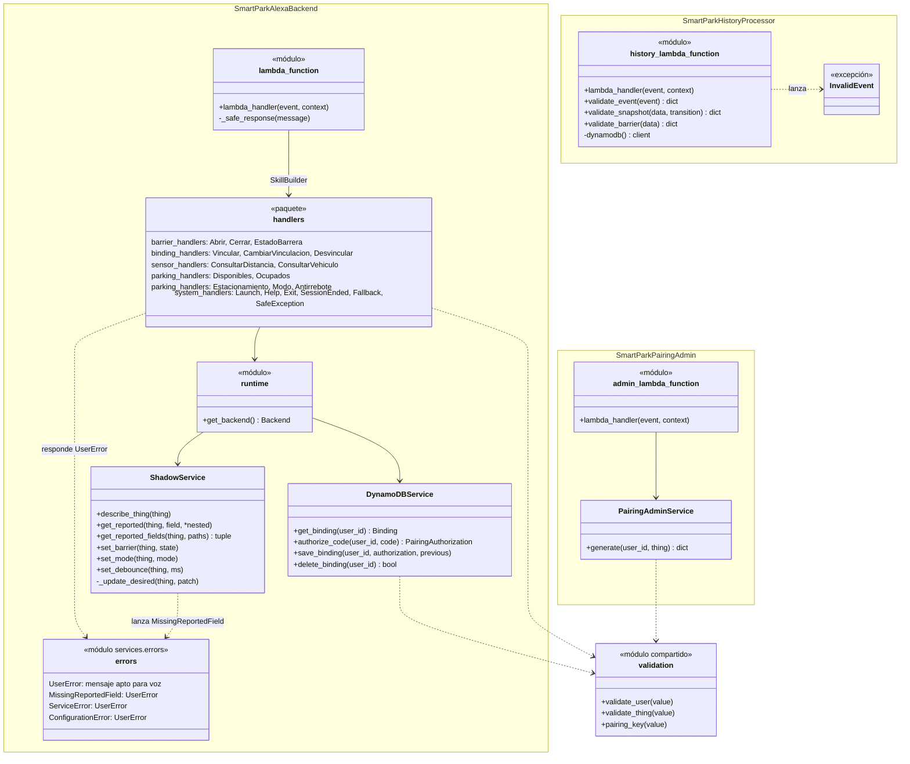

### 2.5 Diagramas de secuencia

#### 2.5.1 Consulta del sensor y comando sobre el actuador

**Consulta del sensor** (*"hay un auto esperando"*). El ESP32 publica `distancia_cm` y `vehiculo_detectado` a partir de la misma muestra del HC-SR04 ([`report()`](../src/AwsIoTManager.cpp#L465)); sin lectura válida envía ambos como `null` y AWS elimina las dos claves. La Lambda comprueba el `timestamp` de cada atributo usado en `metadata.reported` (≤ 180 s, `MAX_REPORTED_AGE_SECONDS`) y distingue el dato desactualizado del ausente ([`MissingReportedField`](../lambda/services/shadow_service.py#L61)). Las demás consultas (disponibles, plaza, modo, antirrebote) siguen el mismo camino con otros atributos. Copia: [`06-secuencia-consulta.mmd`](diagrams/06-secuencia-consulta.mmd).

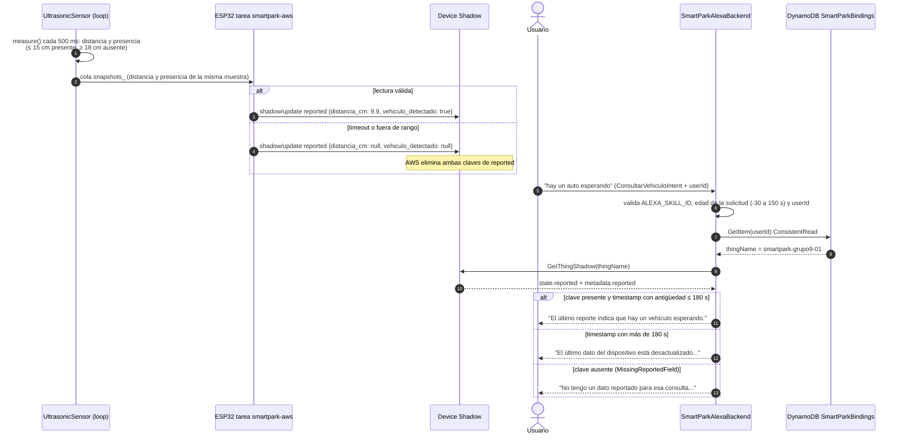

**Comando sobre el actuador** (*"abre la barrera"*). La Lambda solo escribe `desired.barrera` (formato V1; el firmware registra la orden con `origen = legado`); la decisión de mover o bloquear la toma el Edge y queda en `reported.ultima_orden`. Copia: [`07-secuencia-comando.mmd`](diagrams/07-secuencia-comando.mmd).

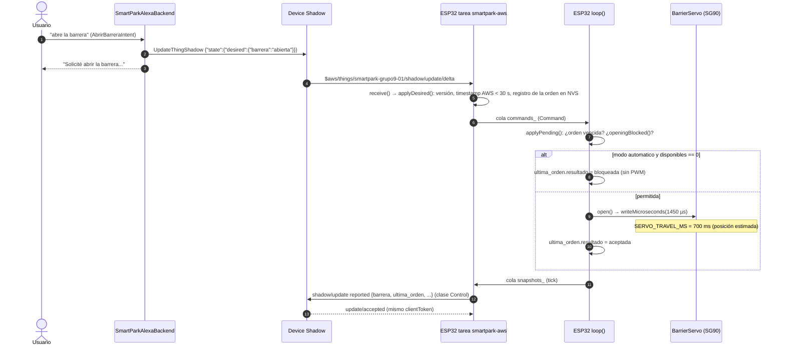

**Cambio de parámetro por voz (RF14).** La validación ocurre dos veces: en la Lambda (50–1000) y en el firmware, que además persiste el valor en NVS antes de aplicarlo. Copia: [`07b-secuencia-modo.mmd`](diagrams/07b-secuencia-modo.mmd).

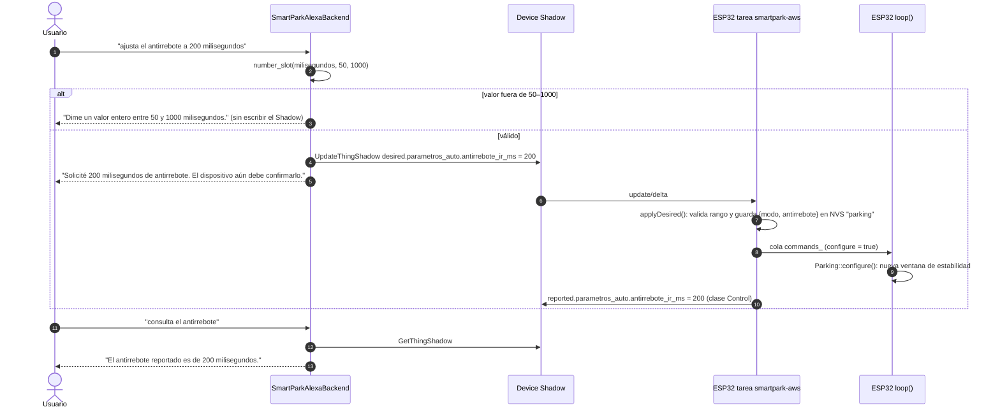

#### 2.5.2 Almacenamiento de un dato (objeto → regla de IoT → Lambda → DynamoDB)

Incluye el descarte de inválidos y la deduplicación por escritura condicional. Copia: [`08-secuencia-almacenamiento.mmd`](diagrams/08-secuencia-almacenamiento.mmd).

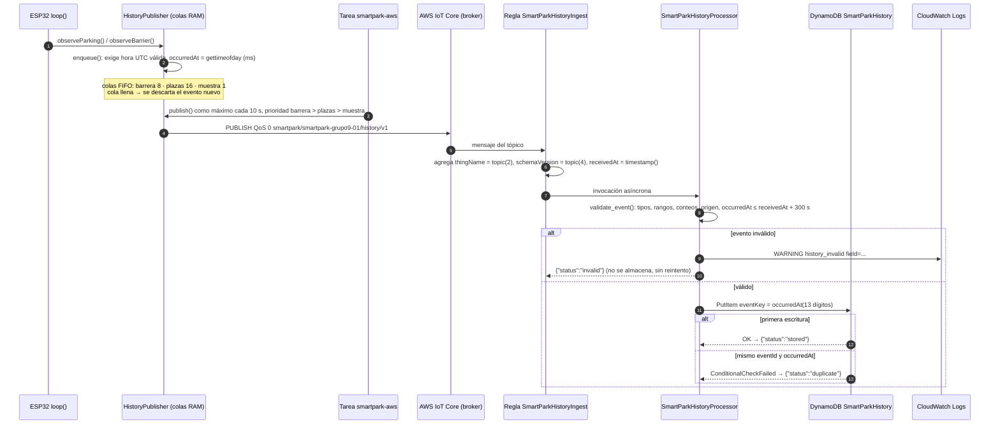

#### 2.5.3 Ejecución de la regla automática en el Edge

**E1 — indicación de plaza.** Copia: [`09-secuencia-edge-plaza.mmd`](diagrams/09-secuencia-edge-plaza.mmd).

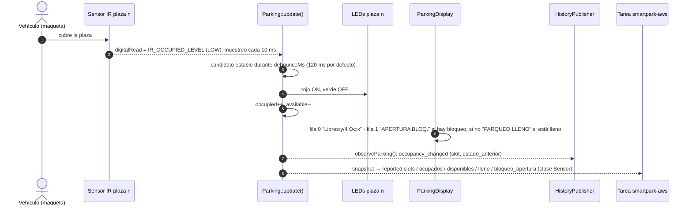

**E2, E3 y E4 — bloqueo de apertura, cierre siempre permitido y vencimiento de órdenes.** La misma regla se aplica a la orden por voz y a `OPEN` por Serial ([`main.cpp`](../src/main.cpp#L62)). Copia: [`10-secuencia-edge-bloqueo.mmd`](diagrams/10-secuencia-edge-bloqueo.mmd).

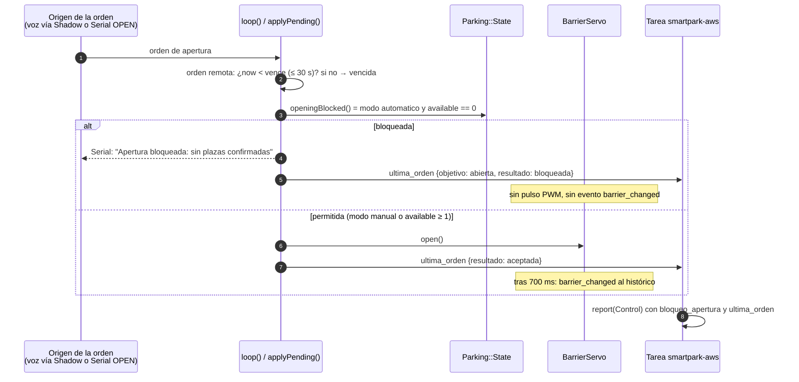

#### 2.5.4 Ejecución de las reglas automáticas en la Nube

No aplica: el repositorio no implementa reglas de control en la Nube. La única Lambda disparada por una regla de IoT, `SmartParkHistoryProcessor`, valida y almacena: su código no llama al Shadow y la plantilla de su rol no incluye `iot:UpdateThingShadow` ([`processor-execution-policy.example.json`](../aws/history/processor-execution-policy.example.json)), por lo que no actúa sobre la barrera. La justificación está en 2.6 y las reglas de Nube recomendadas para una versión real en la sección 7.

### 2.6 Lógica de control (diagrama de estados y ubicación Edge / Nube)

**Modo de operación.** El valor por defecto es `manual`; el modo y el antirrebote se guardan en NVS y sobreviven a un reinicio. Copia: [`11-estados-control.mmd`](diagrams/11-estados-control.mmd).

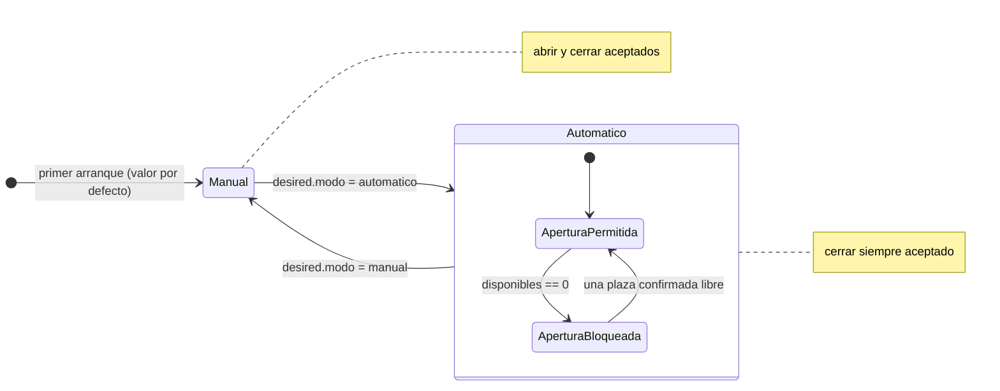

**Barrera (posición estimada).** Arranca sin estimar y sin PWM: ni el arranque, ni un cambio de modo, ni liberar una plaza mueven el servo. Copia: [`11b-estados-barrera.mmd`](diagrams/11b-estados-barrera.mmd).

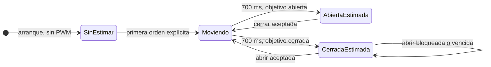

**Plaza.** Una lectura solo se acepta si se mantiene `debounceMs`; `desconocido` no cuenta como libre ni como ocupada. Copia: [`12-estados-plaza.mmd`](diagrams/12-estados-plaza.mmd).

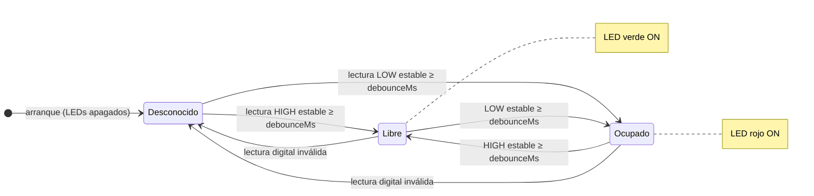

**Reglas y ubicación.**

| Regla | Condición → acción | Ubicación | Justificación |
|---|---|---|---|
| E1 Indicación de plaza | IR estable ≥ `debounceMs` → LED rojo/verde, conteos y fila 0 de la LCD (`Libres:x/4 Oc:y`) | Edge ([`Parking::update()`](../src/Parking.cpp#L27), [`ParkingDisplay::update()`](../src/ParkingDisplay.cpp#L50)) | Depende solo de datos locales; latencia de decenas de ms; debe funcionar sin red. Llevarla a la Nube costaría un mensaje por transición y dejaría el LED apagado sin conexión. |
| E2 Bloqueo de apertura | `modo == automatico` y `disponibles == 0` → apertura rechazada (`bloqueada`) y fila 1 de la LCD `APERTURA BLOQ.` | Edge ([`openingBlocked()`](../include/Parking.h#L15), [`applyPending()`](../src/AwsIoTManager.cpp#L42), [`main.cpp`](../src/main.cpp#L62)) | La decisión usa el estado de las plazas que solo el ESP32 conoce al instante; en la Nube habría una carrera entre el último `reported` y la orden. Sigue operando sin red. |
| E3 Cierre permitido | En `automatico`, `cerrar` siempre se acepta | Edge | Cerrar nunca empeora la ocupación; bloquearlo dejaría la barrera abierta. |
| E4 Vencimiento de orden remota | `now ≥ vence` (≤ `AWS_ORDER_TTL_S` = 30 s) → `vencida`, sin movimiento | Edge ([`applyPending()`](../src/AwsIoTManager.cpp#L40)) | Evita que una orden dada durante un corte abra la barrera minutos después, cuando nadie la espera. |

**Por qué ninguna regla está en la Nube.** Las cuatro reglas dependen solo del estado local y deben cumplirse sin conexión (RNF10). Una regla en la Nube añadiría un viaje Shadow → regla → Lambda → `desired` → `delta` por decisión, más invocaciones y mensajes (2.10), y fallaría justo cuando el objeto pierde la red. Las decisiones que sí requieren histórico, varios Things o detectar silencio del objeto (por ejemplo, alertar si el Thing deja de reportar o limitar aperturas diarias) no forman parte de RF1–RF15 de este caso de uso y se proponen en 7.2. La Nube se encarga del **almacenamiento validado** y de los **reportes** (2.8, 2.12).

**Convivencia entre voz y lógica automática** (según el código):

| Situación | Resultado |
|---|---|
| `manual` + *"abre la barrera"* | Se acepta y mueve el servo (`aceptada`). |
| `automatico` con ≥ 1 plaza libre + *"abre la barrera"* | Se acepta. |
| `automatico` con 0 libres (o plazas `desconocido`) + *"abre la barrera"* | Se rechaza en el Edge: `ultima_orden.resultado = "bloqueada"`, fila 1 de la LCD `APERTURA BLOQ.`. Alexa responde *"Solicité abrir la barrera…"* porque la Lambda no espera al dispositivo; *"consulta el estado de la barrera"* confirma que sigue cerrada. |
| Cualquier modo + *"cierra la barrera"* | Se acepta. |
| Orden Serial y orden remota en la misma vuelta de `loop()` | Prevalece la Serial (operador en sitio) y la remota se descarta ([`applyPending()`](../src/AwsIoTManager.cpp#L37)). |
| *"activa el modo manual"* | Desactiva el bloqueo: la voz no obliga a abrir, solo cambia el modo; la apertura requiere otra orden. |

### 2.7 Especificación del documento Shadow

Shadow clásico del Thing `smartpark-grupo9-01`. Lo escriben el ESP32 (`reported`, [`report()`](../src/AwsIoTManager.cpp#L427)) y `SmartParkAlexaBackend` (`desired`, [`_update_desired`](../lambda/services/shadow_service.py#L94)).

| Atributo | Tipo | Valores válidos | Sección | Escribe | Lee |
|---|---|---|---|---|---|
| `barrera` | string \| null | `abierta`, `cerrada`; `null` sin posición estimada | reported / desired | ESP32 / Lambda | Lambda (`EstadoBarreraIntent`) / ESP32 |
| `barrera_posicion_estimada` | bool | `true` tras un recorrido completo | reported | ESP32 | — |
| `distancia_cm` | number \| null | 2–400 (1 decimal); `null` (clave eliminada) si la lectura es inválida | reported | ESP32 | Lambda (`ConsultarDistanciaIntent`) |
| `vehiculo_detectado` | bool \| null | `true` ≤ 15 cm, `false` ≥ 18 cm (histéresis de 3 cm), tomado de la misma muestra que `distancia_cm`; `null` (clave eliminada) solo sin lectura válida | reported | ESP32 | Lambda (`ConsultarVehiculoIntent`) |
| `slots` | objeto `"1"`..`"4"` → string | `libre`, `ocupado`, `desconocido` | reported | ESP32 | Lambda (`ConsultarEstacionamientoIntent`) |
| `ocupados`, `disponibles` | int | 0–`capacidad` (`desconocido` no cuenta) | reported | ESP32 | Lambda |
| `capacidad` | int | 1–4 (`PARKING_CAPACITY`) | reported | ESP32 | Lambda |
| `lleno` | bool | `ocupados == capacidad` | reported | ESP32 | — |
| `bloqueo_apertura` | bool | `modo == automatico` y `disponibles == 0` | reported | ESP32 | — |
| `modo` | string | `manual`, `automatico` | reported / desired | ESP32 / Lambda | Lambda / ESP32 |
| `parametros_auto.antirrebote_ir_ms` | int | 50–1000 | reported / desired | ESP32 / Lambda | Lambda / ESP32 |
| `ultima_orden` | objeto | `id` (string \| null), `objetivo` (`abierta`/`cerrada`), `origen` (`voz`, `nube`, `edge`, `legado`), `resultado` (`aceptada`, `bloqueada`, `vencida`, `no_disponible`) | reported | ESP32 | consola / pruebas |
| `orden_barrera` | objeto | `id` 1–32 `[A-Za-z0-9_-]`, `objetivo`, `origen` (`voz`/`nube`), `solicitada_ms` (epoch ms), `vence_s` (epoch s, ≤ 30 s) | desired | cliente V2 (ninguno en el repositorio; `set_barrier` usa V1) | ESP32 |

`desired` escrito por la skill (formato V1 para la barrera, RF14 para modo y parámetro):

```json
{"state": {"desired": {"barrera": "abierta"}}}
{"state": {"desired": {"modo": "automatico"}}}
{"state": {"desired": {"parametros_auto": {"antirrebote_ir_ms": 200}}}}
```

`reported` emitido por el ESP32 (forma de [`report()`](../src/AwsIoTManager.cpp#L427); valores ilustrativos):

```json
{
  "state": {
    "reported": {
      "barrera_posicion_estimada": true, "barrera": "cerrada",
      "slots": {"1": "ocupado", "2": "ocupado", "3": "ocupado", "4": "ocupado"},
      "ocupados": 4, "disponibles": 0, "capacidad": 4,
      "modo": "automatico", "lleno": true, "bloqueo_apertura": true,
      "parametros_auto": {"antirrebote_ir_ms": 120},
      "ultima_orden": {"id": null, "objetivo": "abierta", "origen": "legado", "resultado": "bloqueada"},
      "distancia_cm": 12.4, "vehiculo_detectado": true
    }
  }
}
```

`delta` que recibe el ESP32 tras *"activa el modo manual"* con `reported.modo = "automatico"`:

```json
{"version": 128, "timestamp": 1795000000, "state": {"modo": "manual"},
 "metadata": {"modo": {"timestamp": 1795000000}}}
```

El firmware ordena GET y deltas por `version` y correlaciona los acuses por `clientToken`. Para el formato V1, que es el que envía la skill, identifica la orden por `metadata.barrera.timestamp`, la descarta si tiene más de 30 s y la registra con `origen = legado` ([`applyDesired()`](../src/AwsIoTManager.cpp#L307)). El firmware también acepta el formato V2 (`orden_barrera`, con `origen = voz`), pero la Lambda no lo usa (5.5). Formato V2 completo: [`firmware-v2.md`](firmware-v2.md#device-shadow-clásico).

### 2.8 Modelo de datos de DynamoDB

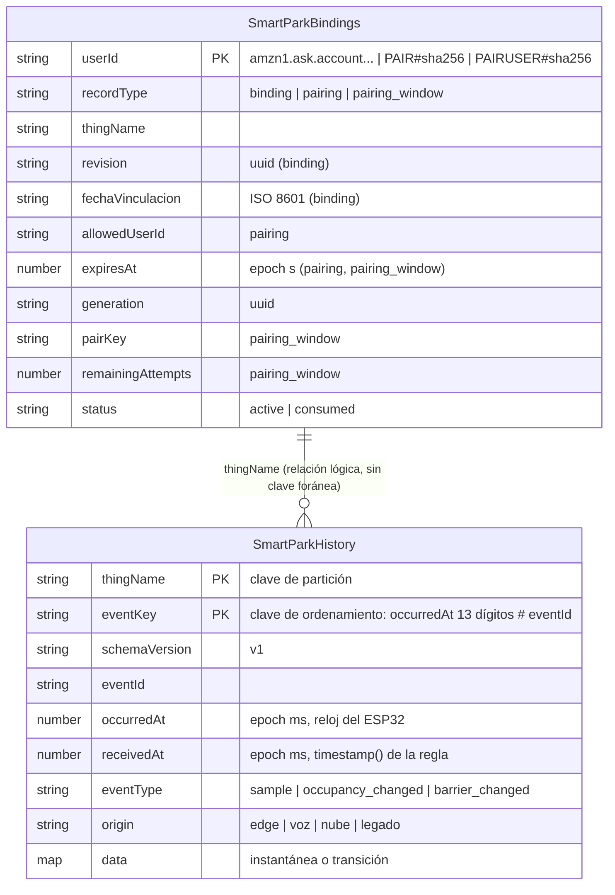

Copia: [`13-modelo-datos.mmd`](diagrams/13-modelo-datos.mmd). Las dos tablas son independientes: la relación por `thingName` es lógica.

**`SmartParkBindings`** (heredada de la P3, bajo demanda, PK `userId` String). Una sola tabla guarda tres tipos de registro distinguidos por el prefijo de la clave: `amzn1.ask.account…` (vinculación), `PAIR#<sha256(PIN)>` (autorización) y `PAIRUSER#<sha256(userId)>` (ventana de intentos). Sin índices; los registros de PIN tienen `expiresAt` (epoch s), pero el repositorio no documenta TTL activado en la tabla: la caducidad se aplica por condición en el código ([`dynamodb_service.py`](../lambda/services/dynamodb_service.py)).

**`SmartParkHistory`** ([`table.example.json`](../aws/history/table.example.json), `PAY_PER_REQUEST`):

| Atributo | Tipo DynamoDB | Origen | Ejemplo |
|---|---|---|---|
| `thingName` (PK) | S | regla: `topic(2)` | `smartpark-grupo9-01` |
| `eventKey` (SK) | S | Lambda: `f"{occurredAt:013d}#{eventId}"` | `1795000000000#b1982cbc…-0000000000000011` |
| `schemaVersion` | S | regla: `topic(4)` | `v1` |
| `eventId` | S | ESP32: 32 hex de arranque + `-` + 16 hex de secuencia | |
| `occurredAt` | N | ESP32 (epoch ms, NTP) | `1795000000000` |
| `receivedAt` | N | regla: `timestamp()` (epoch ms) | `1795000000412` |
| `eventType` | S | ESP32 | `sample`, `occupancy_changed`, `barrier_changed` |
| `origin` | S | ESP32 | `edge` (lecturas); `voz`, `edge`, `nube`, `legado` (barrera) |
| `data` | M | ESP32, validado | lectura: `slots`, `capacidad`, `ocupados`, `disponibles`, `modo`, `distancia_cm`, `vehiculo_detectado` (+ `slot`, `estado_anterior`); barrera: `anterior`, `actual`, `posicion_estimada`, `requestId` |

**Decisiones.** La SK empieza por la hora de ocurrencia con 13 dígitos fijos, así que el orden lexicográfico es el cronológico y un rango de fechas es un `BETWEEN`; el sufijo `#eventId` hace única la clave y permite deduplicar con `attribute_not_exists`. **Índices secundarios:** ninguno; todos los patrones de acceso de esta práctica son por Thing y rango de tiempo. **TTL:** no configurado; con la frecuencia del código la tabla crece ≈ 10 MB/mes por Thing (5.6), muy por debajo de 25 GB, y los reportes necesitan meses de histórico. Se recomienda un atributo `expiresAt` con TTL de 13 meses (7.1).

**Patrones de acceso.**

| # | Patrón | Operación | Clave / condición | Filtro |
|---|---|---|---|---|
| A1 | Guardar un evento sin duplicar | `PutItem` | `thingName`, `eventKey`; `attribute_not_exists(thingName) AND attribute_not_exists(eventKey)` | — |
| A2 | Eventos de un Thing en un rango | `Query` | `thingName = :t AND eventKey BETWEEN :desde13 + "#" AND :hasta13 + "#~"` | — |
| A3 | Transiciones de plazas en un rango (M1, M4) | `Query` A2 | ídem | `eventType = occupancy_changed` (M4: `AND data.slot = :n`) |
| A4 | Aperturas por origen (M2) | `Query` A2 | ídem | `eventType = barrier_changed AND data.actual = abierta` |
| A5 | Tiempo con parqueo lleno / bloqueado (M3) | `Query` A2 | ídem | `eventType IN (occupancy_changed, sample)` |
| A6 | Último estado conocido del objeto | `Query` | `thingName = :t`, `ScanIndexForward = false`, `Limit = 1` | — |
| A7 | Thing vinculado a un usuario | `GetItem` (`SmartParkBindings`) | `userId = :u`, lectura consistente | — |
| A8 | Eventos de todos los Things en un rango (panel multi-parqueo) | requiere índice | **cambio recomendado**: GSI `eventType` + `eventKey` (7.1) | — |

El filtro se aplica después de leer el rango: no reduce el costo de lectura, pero el volumen por Thing es pequeño (≈ 570 ítems/día, 2.10). Para rangos grandes se recorre `LastEvaluatedKey`.

### 2.9 Reglas de AWS IoT y funciones Lambda

**Regla `SmartParkHistoryIngest`** ([`iot-rule.example.json`](../aws/history/iot-rule.example.json)):

```sql
SELECT topic(2) AS thingName, topic(4) AS schemaVersion, eventId, occurredAt, eventType, origin, data,
       timestamp() AS receivedAt
FROM 'smartpark/+/history/v1'
```

| Campo | Valor |
|---|---|
| Tópico | `smartpark/+/history/v1` (el ESP32 publica en `smartpark/smartpark-grupo9-01/history/v1`) |
| Versión SQL | `2016-03-23` |
| Acción | `lambda` → `SmartParkHistoryProcessor` (invocación asíncrona) |
| Permiso | Política basada en recursos de la Lambda: `lambda:InvokeFunction` para `iot.amazonaws.com`, limitada por `SourceArn` (la regla) y `SourceAccount` ([`iot-invoke-permission.example.json`](../aws/history/iot-invoke-permission.example.json)). La acción Lambda no usa rol IAM de regla. |
| Identidad | `thingName` sale del tópico y no del cuerpo. La plantilla de la política del dispositivo ([`device-publish-policy.example.json`](../aws/history/device-publish-policy.example.json)) solo le permite publicar en su propio tópico, así que con ella un Thing no puede escribir el histórico de otro. En la cuenta, la política asignada es `iot:*` y esta garantía no está activa (3.2, 5.5). |

La plantilla se crea con `"ruleDisabled": true` para habilitarla solo después de verificar la tabla y la Lambda ([`historial-aws-practica-4.md`](historial-aws-practica-4.md#despliegue-manual)).

**Funciones Lambda.**

| Lambda | Responsabilidad | Disparador | Recursos | Permisos mínimos (plantilla) |
|---|---|---|---|---|
| `SmartParkAlexaBackend` | Backend de la skill: consultas, comandos, modo/parámetros, vinculación | Alexa Skills Kit (Skill ID) | `SmartParkBindings`, Shadow del Thing | [`alexa-execution-policy.example.json`](../lambda/iam/alexa-execution-policy.example.json) |
| `SmartParkHistoryProcessor` | Validar, enriquecer y almacenar el histórico | Regla `SmartParkHistoryIngest` | `SmartParkHistory`, su grupo de logs | [`processor-execution-policy.example.json`](../aws/history/processor-execution-policy.example.json) |
| `SmartParkPairingAdmin` | Generar el PIN de vinculación | Invocación manual de un operador IAM | `SmartParkBindings` (claves `PAIR#`, `PAIRUSER#`), `DescribeThing` | [`admin-execution-policy.example.json`](../lambda/iam/admin-execution-policy.example.json) |

**Justificación de la separación.** *Responsabilidad única:* cada función tiene un disparador y un propósito. *Frecuencia:* el procesador del histórico se invoca por cada evento (cientos al día) y la skill solo cuando alguien habla; separarlas permite dimensionar memoria y concurrencia por separado. *Permisos:* con las plantillas, el procesador solo necesita `dynamodb:PutItem` sobre una tabla y no podría leer vinculaciones ni tocar el Shadow, y la skill no podría escribir el histórico. En la cuenta, el rol del backend tiene `AmazonDynamoDBFullAccess` (3.2). La administración no es invocable por Alexa. *Costo:* el ZIP del procesador es un solo archivo sin el SDK de Alexa (arranque en frío menor que el del backend, que pesa ≈ 18 MB).

### 2.10 Política de reporte

| Canal | Cuándo publica | Límite en el código | Razón |
|---|---|---|---|
| Shadow `update` clase `Control` | Tras ejecutar o rechazar una orden, o aplicar modo/antirrebote | Sin separación mínima; usa la reserva de 200 | El usuario espera la confirmación. |
| Shadow clase `Sensor` | Cambio de plaza, de presencia confirmada en 3 muestras (`AWS_PRESENCE_STABLE_SAMPLES`; el valor publicado es el de la última muestra), de validez o Δ distancia ≥ 10 cm | Separación mínima 10 s (`AWS_MIN_PUBLISH_INTERVAL_MS`), salvo presencia | Refleja cambios sin saturar la cuota. |
| Shadow clase `Periodic` | Sin cambios durante 30 s (`AWS_REPORT_INTERVAL_MS`) | Total ordinario ≤ 800/día | Mantiene `reported` dentro de los 180 s que acepta la skill aun perdiendo 5 respaldos seguidos. |
| Shadow `get` (`Recovery`) | Al conectar o reconectar | Usa la reserva | Recupera el `desired` pendiente. |
| Histórico | Cada transición de plaza o barrera + muestra cada 300 s (`HISTORY_SAMPLE_INTERVAL_MS`) | ≤ 1 publicación cada 10 s (`HISTORY_PUBLISH_INTERVAL_MS`), presupuesto separado del Shadow; colas de 8 eventos de barrera y 16 de plazas ([`config.example.h#L119-L120`](../include/config.example.h#L119-L120)) | Los reportes necesitan transiciones exactas; las muestras detectan huecos de cobertura. |
| Sesión de demostración | — | La tarea se desconecta tras 60 min conectados (`AWS_DEMO_MAX_CONNECTED_MS`) hasta reiniciar | Límite académico de consumo. |

El Shadow refleja el **estado actual** (lo que consulta Alexa) y el tópico de histórico guarda la **secuencia de cambios** (lo que necesitan los reportes). Usar `update/accepted` del Shadow como fuente del histórico mezclaría ambos: perdería las transiciones intermedias entre dos reportes y dependería de la cuota del Shadow.

**Mensajes por día (un Thing).** Shadow: como máximo 1000 solicitudes (`AWS_MAX_SHADOW_UPDATES_PER_DAY`), cada una con su respuesta `accepted`. En una sesión de 60 min en reposo: 120 respaldos + eventos. Histórico: 288 muestras/día con conexión continua más las transiciones; con 30 ingresos por plaza al día (240 transiciones) y 40 movimientos de barrera, ≈ 570 eventos/día. Cota física: 8640 publicaciones/día por el intervalo de 10 s. Costo en 5.6.

**Reconexión (base de RNF6).** Tras una falla, el reintento espera 5 s y duplica la espera hasta 300 s (`AWS_RETRY_MAX_MS`), con *jitter* de 0–1 s y un máximo de 10 intentos consecutivos sin un GET válido ([`failedAttempt()`](../src/AwsIoTManager.cpp#L174), [`connectStep()`](../src/AwsIoTManager.cpp#L185)). Los intentos ocurren ≈ 5, 15, 35 y 75 s después de detectar la caída, así que con un corte de 45 s la red vuelve entre el intento de 35 s y el de 75 s. Si la caída se detecta al iniciar el corte, la reconexión ocurre ≈ 30 s después de restaurar la red; una detección tardía desplaza los intentos y el peor caso queda en ≈ 40 s, más el saludo TLS. El contador de intentos solo vuelve a 0 con un GET válido ([`#L391`](../src/AwsIoTManager.cpp#L391), [`#L409`](../src/AwsIoTManager.cpp#L409)) y cada intento de Wi-Fi también lo incrementa. Por eso un corte de más de ≈ 20 min agota los 10 intentos: `connectStep()` ya no intenta y la tarea de AWS no reconecta hasta reiniciar, aunque E1–E4 siguen operando. Con un corte de varios minutos la espera entre intentos ya llegó a 80–300 s y la reconexión puede tardar hasta una espera completa después de volver la red; eso explica los tiempos de 1 a 4 min medidos en PNF-06 ([F3](#f3-reconexión-en-pnf-06)).

**Ráfagas en el histórico.** El límite de 1 publicación cada 10 s acota el costo (8640 mensajes/día como máximo), pero tiene dos efectos cuando las transiciones llegan más rápido. El n-ésimo evento de una ráfaga espera ≈ 10·n s antes de salir (Δ0 de hasta 179,1 s, [F4](#f4-latencia-del-histórico-en-ráfagas-pnf-05)). Cuando hay 16 eventos de plazas en espera, el siguiente se descarta (12 de 50 en una ráfaga del 19/11, [F6](#f6-integridad-del-almacenamiento-pf-05-y-pnf-05)). Con el uso declarado del caso (≈ 240 transiciones/día, una cada 6 min en promedio) la cola no se llena; los resultados de 5.2 corresponden a ráfagas de prueba. La corrección está en 7.6.

### 2.11 Diseño de la skill de Alexa

Nombre de invocación: **`parqueo inteligente`** (es-US). Modelo: [`alexa/es-US.smartpark-v2.final.json`](../alexa/es-US.smartpark-v2.final.json).

| Intent | Slot (tipo) | Frases de ejemplo (del modelo) | Acción en el Shadow |
|---|---|---|---|
| `ConsultarDisponiblesIntent` | — | cuántos espacios hay disponibles · consulta los espacios libres · cuántas plazas libres quedan | lee `reported.disponibles`, `capacidad` |
| `ConsultarOcupadosIntent` | — | cuántos espacios están ocupados · consulta los espacios ocupados · cuántas plazas están ocupadas | lee `reported.ocupados`, `capacidad` |
| `ConsultarEstacionamientoIntent` | `espacio` (`AMAZON.NUMBER`, 1–4) | cómo está el estacionamiento {espacio} · está libre la plaza {espacio} · consulta el espacio {espacio} | lee `reported.slots.<n>` |
| `ConsultarModoIntent` | — | consulta el modo del parqueo · en qué modo está el parqueo · cuál es el modo actual | lee `reported.modo` |
| `ActivarModoAutomaticoIntent` | — | activa el modo automático · pon el parqueo en modo automático · cambia a modo automático | `desired.modo = "automatico"` |
| `ActivarModoManualIntent` | — | activa el modo manual · pon el parqueo en modo manual · cambia a modo manual | `desired.modo = "manual"` |
| `ConsultarAntirreboteIntent` | — | consulta el antirrebote · cuántos milisegundos tiene el antirrebote · cuál es el valor del antirrebote | lee `reported.parametros_auto.antirrebote_ir_ms` |
| `CambiarAntirreboteIntent` | `milisegundos` (`AMAZON.NUMBER`, 50–1000) | ajusta el antirrebote a {milisegundos} milisegundos · cambia el antirrebote a {milisegundos} · configura {milisegundos} milisegundos de antirrebote | `desired.parametros_auto.antirrebote_ir_ms` |
| `AbrirBarreraIntent` / `CerrarBarreraIntent` | — | abre la barrera · levanta la barrera · abrir … / cierra la barrera · baja la barrera · cerrar … (7 frases cada uno) | `desired.barrera` (formato V1) |
| `EstadoBarreraIntent` | — | consulta el estado de la barrera · dime el estado de la barrera · consultar estado … | lee `reported.barrera` |
| `ConsultarDistanciaIntent` / `ConsultarVehiculoIntent` | — | consulta la distancia … / hay un auto esperando … | lee `distancia_cm` / `vehiculo_detectado` |
| `VincularParqueoIntent` / `CambiarVinculacionIntent` | `codigo` (`AMAZON.FOUR_DIGIT_NUMBER`) | vincula mi parqueo con el codigo {codigo} … / cambia mi vinculacion con el código {codigo} … | `SmartParkBindings` |
| `DesvincularParqueoIntent` | — | desvincula mi parqueo · elimina la vinculación de mi parqueo inteligente · quita la vinculación de mi parqueo inteligente · desvincular parqueo | `SmartParkBindings` |
| `AMAZON.HelpIntent`, `CancelIntent`, `StopIntent`, `NavigateHomeIntent` | — | integrados | — |

Los valores fuera de rango del slot se rechazan en la Lambda sin escribir el Shadow ([`number_slot()`](../lambda/handlers/parking_handlers.py#L9)). Si falta `reported.slots.<n>` y `capacidad` es menor que `n`, la respuesta indica que la plaza no está configurada ([`ParkingSlotHandler`](../lambda/handlers/parking_handlers.py#L55)). Las frases de desvinculación nombran el parqueo inteligente para no confundirse con órdenes generales del dispositivo Alexa. Las respuestas de los cambios dicen *"Solicité…; el dispositivo aún debe confirmarlo"*, porque la escritura en `desired` no garantiza su aplicación.

### 2.12 Diseño de reportes (mockups)

Cuatro reportes para el administrador del parqueo. Los valores dibujados son ilustrativos; lo que se diseña es **qué** se muestra y **de qué consulta** sale. Todos parten del patrón A2 (2.8) sobre `SmartParkHistory`. Fuentes editables `.excalidraw` y exportaciones SVG/PNG en [`docs/mockups/`](mockups/).

**M1 — Ocupación por plaza y franja horaria.** Decisión: horarios de mayor demanda (personal, tarifas por hora).

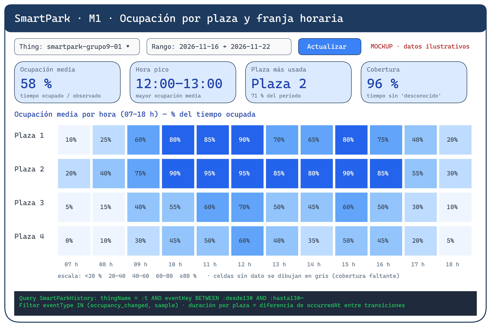

| Elemento | Atributos | Consulta |
|---|---|---|
| Mapa de calor plaza × hora | `occurredAt`, `data.slot`, `data.estado_anterior`, `data.slots` | `Query` `SmartParkHistory`: `thingName = :t AND eventKey BETWEEN :desde13# AND :hasta13#~`; filtro `eventType IN (occupancy_changed, sample)`; tiempo ocupado = diferencias de `occurredAt` entre transiciones, repartidas por hora |
| Ocupación media, hora pico, plaza más usada | derivados del mapa | misma consulta |
| Cobertura | intervalos con `desconocido` o sin muestras de 300 s | misma consulta, `eventType = sample` |

**M2 — Aperturas de barrera por origen.** Decisión: cuánto se usa la voz frente a la operación local.


| Elemento | Atributos | Consulta |
|---|---|---|
| Barras apiladas por día y origen | `occurredAt`, `origin`, `data.actual` | `Query` A2; filtro `eventType = barrier_changed AND data.actual = abierta`; agrupar por día y `origin` |
| KPIs (total, % voz/`legado` y % `edge`, día con más aperturas) | `origin`, `occurredAt` | misma consulta |

En la implementación desplegada las órdenes de la skill usan el formato V1 (`desired.barrera`) y se registran con `origin = legado`; el origen `voz` lo produce el formato V2 `orden_barrera`, que la Lambda no emite (5.5). El mockup solo muestra los orígenes voz/`legado` y `edge`: el diseño no tiene lógica de control en la Nube (2.6), por lo que no hay aperturas con `origin = nube`. Si se agregara una regla de Nube (7.2), sus aperturas formarían una tercera serie.

**M3 — Saturación: parqueo lleno y aperturas bloqueadas.** Decisión: si la capacidad es insuficiente.

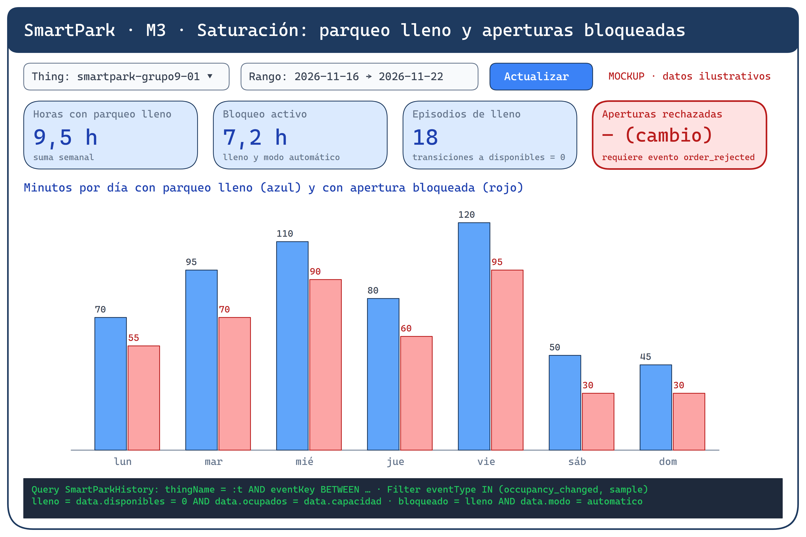

| Elemento | Atributos | Consulta |
|---|---|---|
| Minutos por día con parqueo lleno | `occurredAt`, `data.disponibles`, `data.capacidad` | `Query` A2; filtro `eventType IN (occupancy_changed, sample)`; lleno = `disponibles = 0` y `ocupados = capacidad` |
| Minutos con apertura bloqueada | + `data.modo` | misma consulta; bloqueado = lleno y `modo = automatico` |
| Episodios de lleno | transiciones a `disponibles = 0` | misma consulta |
| Aperturas rechazadas | — | **Cambio recomendado:** el firmware no publica las órdenes bloqueadas (solo `reported.ultima_orden`). Requiere un evento nuevo `order_rejected` en el histórico y su validación en la Lambda (7.1). |

**M4 — Tiempo de permanencia por plaza.** Decisión: rotación de plazas y tiempo máximo de estadía.


| Elemento | Atributos | Consulta |
|---|---|---|
| Permanencia media por plaza, mediana, P95 | `occurredAt`, `data.slot`, `data.estado_anterior` | `Query` A2; filtro `eventType = occupancy_changed AND data.slot = :n`; permanencia = `occurredAt` (ocupado → libre) − `occurredAt` (libre → ocupado) |
| Últimas estancias | ídem | misma consulta con `ScanIndexForward = false` |
| Estancias y rotación | conteo de pares | misma consulta |

Ningún mockup requiere un índice nuevo para un Thing; un panel que compare varios Things necesita el GSI de A8.

---

## 3. Desarrollo e Implementación

### 3.1 Estructura del código

**Firmware (C++, PlatformIO, `esp32doit-devkit-v1`, Arduino; bibliotecas fijadas en [`platformio.ini`](../platformio.ini): ESP32Servo 1.1.2, PubSubClient 2.8, ArduinoJson 6.21.5).**

| Archivo | Responsabilidad |
|---|---|
| [`src/main.cpp`](../src/main.cpp) | `setup()`/`loop()`: orden de ejecución, comandos Serial y regla E2 para órdenes Serial |
| [`include/Parking.h`](../include/Parking.h), [`src/Parking.cpp`](../src/Parking.cpp) | IR, antirrebote, conteos, LEDs, modo (reglas E1 y E2) |
| [`src/BarrierServo.cpp`](../src/BarrierServo.cpp) | SG90, PWM perezoso y posición estimada por tiempo |
| [`src/UltrasonicSensor.cpp`](../src/UltrasonicSensor.cpp) | HC-SR04 con espera acotada e histéresis de presencia |
| [`include/ParkingDisplay.h`](../include/ParkingDisplay.h), [`src/ParkingDisplay.cpp`](../src/ParkingDisplay.cpp) | LCD 16×2 por PCF8574 (HD44780 en 4 bits, filas en DDRAM 0x00 y 0x40), sin bloqueos: escribe una fila por llamada y solo si su texto cambió; ante un error I²C o con `LCDRESET` vuelve a la inicialización ([`reinitialize()`](../src/ParkingDisplay.cpp#L16)) y reescribe ambas filas. Fila 0: `Libres:x/4 Oc:y`. Fila 1, por prioridad: `APERTURA BLOQ.`, `PARQUEO LLENO` o, cada 2 s, `Modo: manual`/`Modo: automatico` y `Barrera: abierta`/`cerrada`/`mueve`/`---`. |
| [`include/SerialCommands.h`](../include/SerialCommands.h) | Analizador acotado de `OPEN`, `CLOSE`, `STATUS`, `DISTANCE`, `SLOT1`, `LCDRESET`, `HELP` |
| [`src/AwsIoTManager.cpp`](../src/AwsIoTManager.cpp) | Tarea de red: Wi-Fi, NTP, MQTT/TLS, Shadow, cuota, órdenes y trazas de diagnóstico del Shadow |
| [`include/ShadowBudget.h`](../include/ShadowBudget.h) | Cuota diaria persistente por clase de solicitud |
| [`src/HistoryPublisher.cpp`](../src/HistoryPublisher.cpp) | Colas y publicación del histórico |
| [`src/lcd_diagnostico.cpp`](../src/lcd_diagnostico.cpp) | Programa aislado de diagnóstico de la LCD (entorno `[env:lcd-diagnostico]` de [`platformio.ini`](../platformio.ini), biblioteca hd44780 1.3.2): sondea 0x27, inicializa la pantalla y relee la DDRAM de cada fila. El entorno principal lo excluye con `build_src_filter` y `pio run` solo compila `esp32doit-devkit-v1` (`default_envs`); se usa con `pio run -e lcd-diagnostico -t upload`. |
| [`include/config.example.h`](../include/config.example.h), [`include/secrets.example.h`](../include/secrets.example.h) | Plantillas de configuración sin secretos |

**Fragmentos clave.**

- **Tarea FreeRTOS.** [`AwsIoTManager::begin()`](../src/AwsIoTManager.cpp#L27) crea `smartpark-aws` (pila de 12 288 B, prioridad 1) y tres colas de un elemento. `loop()` publica su instantánea con `xQueueOverwrite` y nunca espera a la red: si TLS tarda, se pierde una instantánea intermedia, no el control local.
- **Antirrebote de los IR.** [`Parking::update()`](../src/Parking.cpp#L27) muestrea cada 10 ms; una lectura nueva reinicia `candidateSince_` y el estado solo cambia cuando el candidato se mantiene `debounceMs`. Si `loop()` se atrasa más de 3 muestras, la ventana se reinicia (`interrupted`) para no confirmar con datos viejos. Cambiar el antirrebote reinicia los candidatos ([`configure()`](../src/Parking.cpp#L18)).
- **Regla de bloqueo.** Una sola expresión, [`openingBlocked()`](../include/Parking.h#L15): `mode == Automatic && available == 0`. La usan la orden remota ([`applyPending()`](../src/AwsIoTManager.cpp#L42)), la Serial ([`main.cpp`](../src/main.cpp#L62)), la LCD y `reported.bloqueo_apertura`, de modo que no hay dos versiones de la regla.
- **Manejo del Shadow.** [`receive()`](../src/AwsIoTManager.cpp#L335) filtra el JSON con un `StaticJsonDocument` de 2048 B, ignora deltas con `version` vieja y respuestas sin el `clientToken` propio. [`applyDesired()`](../src/AwsIoTManager.cpp#L247) valida modo y antirrebote, los guarda en NVS **antes** de aplicarlos y registra la orden en NVS para no repetirla tras un reinicio.
- **Distancia y presencia en el Shadow.** [`report()`](../src/AwsIoTManager.cpp#L464) publica `distancia_cm` y `vehiculo_detectado` de la misma muestra; las 3 muestras estables solo deciden si un cambio de presencia adelanta un reporte ([`step()`](../src/AwsIoTManager.cpp#L539)). Sin lectura válida ambos van como `null`.
- **Trazas de diagnóstico del Shadow.** Al iniciar la tarea se imprime `AWS Shadow diagnostico v1 compilado=<fecha hora> thing=… MQTT_buffer=3072` ([`run()`](../src/AwsIoTManager.cpp#L131)); cada UPDATE imprime `AWS Shadow TX` con bytes, resultado de la escritura local y el JSON ([L489](../src/AwsIoTManager.cpp#L489)); cada acuse imprime `AWS Shadow RX update/accepted|rejected` con `coincide` (mismo `clientToken`) y `version` ([L368](../src/AwsIoTManager.cpp#L368)). PF-01 usa estas líneas para correlacionar cada UPDATE con su acuse.
- **Reinicialización de la LCD.** `LCDRESET` ([`main.cpp`](../src/main.cpp#L75)) llama a [`reinitialize()`](../src/ParkingDisplay.cpp#L16). La secuencia no bloqueante espera 100 ms, fija E, RS y R/W en bajo con [`prepareExpander()`](../src/ParkingDisplay.cpp#L28), envía 3-3-3-2, `0x28 0x0C 0x01` y, en un paso aparte, `0x06` para dar tiempo a *Clear Display*; cada paso está separado 5 ms.
- **Cuota de solicitudes.** [`reserve()`](../src/AwsIoTManager.cpp#L162) cuenta cada intento en NVS antes de publicar; [`ShadowBudget::allows()`](../include/ShadowBudget.h#L22) deja 200 de las 1000 diarias para `Control` y `Recovery`. El día UTC solo avanza: un reinicio no repone la cuota.
- **Publicador de histórico.** [`enqueue()`](../src/HistoryPublisher.cpp#L34) exige hora UTC válida y usa `xQueueSend` sin espera: con la cola llena descarta el evento nuevo y lo cuenta. [`publish()`](../src/HistoryPublisher.cpp#L135) envía uno cada ≥ 10 s, con prioridad barrera > plazas > muestra y hasta 3 intentos con los mismos bytes (mismo `eventId` y `occurredAt`, por lo que un reintento no duplica filas).

**Lambdas (Python 3.13, estilo funcional por responsabilidad).**

| Paquete | Archivos | Responsabilidad |
|---|---|---|
| `SmartParkAlexaBackend` | [`lambda_function.py`](../lambda/lambda_function.py), [`handlers/`](../lambda/handlers/), [`services/`](../lambda/services/) | Validación del sobre de Alexa, intents, Shadow y vinculación |
| `SmartParkHistoryProcessor` | [`history_lambda_function.py`](../lambda/history_lambda_function.py) | Validación y `PutItem` condicional |
| `SmartParkPairingAdmin` | [`admin_lambda_function.py`](../lambda/admin_lambda_function.py), [`administration/`](../lambda/administration/) | Generación de PIN |

- **Validación y enriquecimiento del histórico.** [`validate_event()`](../lambda/history_lambda_function.py#L87) exige `schemaVersion = "v1"`, `thingName` y `eventId` con patrón, `receivedAt` entero y `occurredAt` no más de 300 s por delante de `receivedAt`. [`validate_snapshot()`](../lambda/history_lambda_function.py#L39) exige exactamente las claves esperadas, plazas 1..`capacidad`, conteos coherentes con `slots`, distancia 2–400 cm y presencia solo con distancia; [`validate_barrier()`](../lambda/history_lambda_function.py#L74) exige una transición real. Un inválido se registra como `history_invalid field=<campo>` y devuelve `invalid` sin reintento; un error de DynamoDB se propaga para que la invocación asíncrona reintente.
- **Dato ausente frente a desactualizado.** Si el atributo no existe en `reported`, [`get_reported_fields`](../lambda/services/shadow_service.py#L38) lanza [`MissingReportedField`](../lambda/services/errors.py#L8) (*"No tengo un dato reportado para esa consulta…"*); si existe con más de 180 s, responde que está desactualizado.
- **Handlers de modo y parámetros.** [`parking_handlers.py`](../lambda/handlers/parking_handlers.py): las consultas leen `reported` con control de antigüedad por atributo; los cambios llaman a [`set_mode`/`set_debounce`](../lambda/services/shadow_service.py#L84), que escriben un parche mínimo en `desired` sin leer antes el Shadow. Los límites 50–1000 están declarados junto a la nota de sincronía con el firmware ([`shadow_service.py`](../lambda/services/shadow_service.py#L11)).
- **Sin credenciales.** Los clientes de boto3 se crean en la primera invocación y usan el rol de ejecución; ningún archivo contiene *access keys*. Una sola llamada por operación (`total_max_attempts: 1`) con tiempos de 0,5 s de conexión y 1 s de lectura ([`runtime.py`](../lambda/services/runtime.py)).

### 3.2 Configuraciones en AWS y permisos asignados

Las plantillas usan `<REGION>`/`<ACCOUNT_ID>` ([`aws/history/`](../aws/history/)) o `us-east-1`/`REEMPLAZAR_ACCOUNT_ID` ([`lambda/iam/`](../lambda/iam/), [`docs/aws-iot-policy.example.json`](aws-iot-policy.example.json)).

| Recurso | Configuración |
|---|---|
| Thing | `smartpark-grupo9-01` (`THING_NAME`); `clientId` MQTT = nombre del Thing |
| Certificados | X.509 del Thing y Amazon Root CA 1 en `include/secrets.h`, excluido por [`.gitignore`](../.gitignore); plantilla vacía en [`secrets.example.h`](../include/secrets.example.h). Se quedan fuera del repositorio porque quien tenga la clave privada puede suplantar al objeto. |
| Política IoT del dispositivo | [`aws-iot-policy.example.json`](aws-iot-policy.example.json) (Shadow) + [`device-publish-policy.example.json`](../aws/history/device-publish-policy.example.json) (histórico) |
| Regla | `SmartParkHistoryIngest` (2.9) |
| Lambda `SmartParkHistoryProcessor` | Python 3.13, handler `history_lambda_function.lambda_handler`, 128 MB (punto de partida), `HISTORY_TABLE_NAME=SmartParkHistory` ([`historial-aws-practica-4.md`](historial-aws-practica-4.md#despliegue-manual)) |
| Lambda `SmartParkAlexaBackend` | Python 3.13, handler `lambda_function.lambda_handler`, disparador Alexa Skills Kit con Skill ID; variables `ALEXA_SKILL_ID`, `TABLE_NAME=SmartParkBindings`, `IOT_DATA_ENDPOINT` (opcional), `MAX_REPORTED_AGE_SECONDS` (opcional, 180 por defecto) |
| Lambda `SmartParkPairingAdmin` | Python 3.13, handler `admin_lambda_function.lambda_handler`, sin disparador; `TABLE_NAME=SmartParkBindings` |
| Tablas | `SmartParkBindings` (PK `userId`), `SmartParkHistory` ([`table.example.json`](../aws/history/table.example.json)) |
| Roles | Confianza `lambda.amazonaws.com` ([`execution-role-trust.example.json`](../lambda/iam/execution-role-trust.example.json)) + una política por Lambda |
| Logs | `/aws/lambda/SmartParkHistoryProcessor` creado de antemano con retención (por ejemplo 14 días) |

`SmartParkAlexaBackend` y `SmartParkPairingAdmin` se configuran con x86_64, 128 MB y *timeout* de 10 s según el procedimiento de despliegue ([`lambda/README.md`](../lambda/README.md?plain=1#L122)). Las capturas de la consola (8.4) muestran el disparador Alexa y las variables de entorno de ambas funciones; no muestran el runtime, la memoria ni el *timeout*.

**Permisos asignados en la cuenta.** Durante el desarrollo se asignaron permisos amplios para simplificar la configuración, como acepta §3.3 del enunciado si se documenta qué se asignó, por qué y qué haría falta en producción. Esta tabla separa lo asignado (según las capturas) del mínimo de producción (según las plantillas versionadas).

| Principal | Asignado en la cuenta | Por qué se asignó | Riesgo concreto | Mínimo de producción |
|---|---|---|---|---|
| Certificado del ESP32 | `SmartParkPolicy`: `Allow` `iot:*` sobre `*` ([`politica-publica.png`](evidencias/aws-iot/politica-publica.png)) | Una sola política para conectar, usar el Shadow y publicar el histórico mientras se definían los tópicos | Con ese certificado se puede conectar con cualquier `clientId` (y desconectar a otro dispositivo), publicar en el Shadow o en el tópico de histórico de cualquier Thing y suscribirse a todos los tópicos de la cuenta | [`aws-iot-policy.example.json`](aws-iot-policy.example.json) + [`device-publish-policy.example.json`](../aws/history/device-publish-policy.example.json) (detalle abajo) |
| Rol de `SmartParkAlexaBackend` | `AWSIoTFullAccess`, `AmazonDynamoDBFullAccess` y la política básica de ejecución creada por la consola ([`iam-rol-publica.png`](evidencias/aws-iot/iam-rol-publica.png)) | Evitar errores de permisos al probar el backend con la vinculación y el Shadow | Un error o una entrada maliciosa en la Lambda podría borrar o modificar cualquier Thing, certificado, política o tabla de la cuenta, incluido `SmartParkHistory` | [`alexa-execution-policy.example.json`](../lambda/iam/alexa-execution-policy.example.json) |
| Rol de `SmartParkHistoryProcessor` | Sin captura en el repositorio | — | — | [`processor-execution-policy.example.json`](../aws/history/processor-execution-policy.example.json) |
| Rol de `SmartParkPairingAdmin` | Sin captura en el repositorio | — | — | [`admin-execution-policy.example.json`](../lambda/iam/admin-execution-policy.example.json) |
| Regla `SmartParkHistoryIngest` → Lambda | Sin captura en el repositorio; la regla invoca la Lambda (84 eventos almacenados, 5.3) | — | — | [`iot-invoke-permission.example.json`](../aws/history/iot-invoke-permission.example.json) |

**Detalle del mínimo de producción (plantillas).**

| Principal | Permiso mínimo | Motivo |
|---|---|---|
| Certificado del ESP32 | `iot:Connect` sobre `client/smartpark-grupo9-01` | Solo ese `clientId`; con `${iot:Connection.Thing.ThingName}` una política sirve a todos los Things |
| Certificado del ESP32 | `iot:Publish` en `shadow/get`, `shadow/update` del Thing | Pedir y reportar el Shadow |
| Certificado del ESP32 | `iot:Subscribe`/`iot:Receive` en los 5 tópicos de respuesta del Thing | Recibir `delta` y acuses |
| Certificado del ESP32 | `iot:Publish` en `smartpark/${iot:Connection.Thing.ThingName}/history/v1` con `iot:Connection.Thing.IsAttached = true` | Cada objeto solo escribe su histórico |
| Regla `SmartParkHistoryIngest` | `lambda:InvokeFunction` en la política de recursos de la Lambda, con `SourceArn` y `SourceAccount` | Solo esa regla puede invocar el procesador; la acción Lambda no usa rol IAM de regla |
| `SmartParkHistoryProcessor` | `dynamodb:PutItem` en `table/SmartParkHistory`; `logs:CreateLogStream`, `logs:PutLogEvents` en su grupo | Escribir eventos y sus logs (no necesita `logs:CreateLogGroup` porque el grupo se crea antes) |
| `SmartParkAlexaBackend` | `dynamodb:GetItem/PutItem/DeleteItem/UpdateItem` en `SmartParkBindings` con `dynamodb:LeadingKeys` por prefijo | Vincular sin poder tocar registros de otro tipo |
| `SmartParkAlexaBackend` | `iot:DescribeThing`, `iot:GetThingShadow`, `iot:UpdateThingShadow` en `thing/<Thing autorizado>` | Leer y escribir solo el Shadow de los Things registrados |
| `SmartParkAlexaBackend` | `iot:DescribeEndpoint` en `*` | La acción no admite ARN de recurso; se elimina configurando `IOT_DATA_ENDPOINT` |
| `SmartParkPairingAdmin` | `dynamodb:PutItem` con `LeadingKeys` `PAIR#*`, `PAIRUSER#*`; `iot:DescribeThing` | Crear la ventana del PIN |
| Operador | `lambda:InvokeFunction` sobre `SmartParkPairingAdmin` ([`admin-invoke-policy.example.json`](../lambda/iam/admin-invoke-policy.example.json)) | Solo un humano autorizado genera PIN |

**Comodines.** En la cuenta hay dos: `iot:*` sobre `*` en la política del dispositivo y los permisos de servicio completo de las dos políticas administradas del rol del backend. En las plantillas de producción el único `*` de recurso es `iot:DescribeEndpoint`, que la acción exige y que desaparece al fijar `IOT_DATA_ENDPOINT`. El código de cada Lambda solo llama a las acciones de su plantilla, así que la migración no requiere cambiar código; los pasos están en 7.6.

**Alerta de facturación.** No hay evidencia de una alerta de facturación en el repositorio; se recomienda un presupuesto de AWS Budgets de 1 USD/mes con aviso por correo (7.3).

### 3.3 Configuraciones en Alexa

| Elemento | Valor |
|---|---|
| Idioma | Spanish (US), `es-US` |
| Invocación | `parqueo inteligente` |
| Modelo de interacción | [`alexa/es-US.smartpark-v2.final.json`](../alexa/es-US.smartpark-v2.final.json) (modelo combinado P3 + RF14, 16 intents propios y 4 de Amazon; se importa en **Build → JSON Editor**) |
| Endpoint | AWS Lambda ARN de `SmartParkAlexaBackend`, región `us-east-1` |
| Vinculación con la Lambda | Disparador Alexa Skills Kit con verificación de Skill ID en la Lambda y en el código (`ALEXA_SKILL_ID`, [`lambda_function.py`](../lambda/lambda_function.py#L39)) |
| Prueba | **Test → Development** en el simulador |

Procedimiento de despliegue y validación en consola: [`alexa-practica-4.md`](alexa-practica-4.md). Las capturas de la consola de Alexa (8.4) son del 07/11/2026 y muestran el nombre de invocación y el modelo inicial (12 intents); el modelo final se importó después y sus intents de RF14 se usan en los videos de PF-07. El modelo final se valida con [`test_alexa_model.py`](../lambda/tests/test_alexa_model.py) (PA-03). El repositorio conserva también [`alexa/es-US.interaction-model.json`](../alexa/es-US.interaction-model.json) como modelo inicial; no es el que se carga en la consola.

---

## 4. Pruebas y Validaciones

### 4.1 Plan de pruebas

**Enfoque.** Tres niveles complementarios: pruebas automáticas con dobles (PA-01 a PA-03, 4.5), que verifican cada regla y validación en el código; pruebas funcionales en vivo (PF-01 a PF-08, 4.2), que verifican cada RF con el hardware, AWS y Alexa; y pruebas no funcionales (PNF-01 a PNF-06, 4.3), que miden cada valor declarado en 1.4. En 4.2 y 4.3 está el procedimiento, el criterio y la evidencia; los valores medidos y su análisis están en 5, y las fallas en 4.4.

**Cobertura de las exigencias del enunciado.**

| Exigencia (§5.2.2, nivel 4) | Pruebas |
|---|---|
| Requerimientos funcionales RF1–RF15 | PF-01 a PF-08 (matriz en 5.1) |
| Frases de la skill: todos los intents de [`es-US.smartpark-v2.final.json`](../alexa/es-US.smartpark-v2.final.json) | PF-02, PF-03, PF-06, PF-07 (lista por intent en 4.2) |
| Almacenamiento en DynamoDB | PF-04, PF-05, PNF-05 |
| Cada regla de la lógica de control (E1–E4) | PF-06 (E1–E3), PNF-06 (E4), PA-02 |
| Valores declarados en los RNF | PNF-01 a PNF-06; RNF11 por cálculo (5.6); RNF12 por revisión y PA-03 |

**Plan completo y estado de ejecución.**

| ID | Requisitos | Tipo | Ejecución | Resultado |
|---|---|---|---|---|
| PF-01 | RF1, RF2 | En vivo | Ejecutada | 4.2, 5.1 |
| PF-02 | RF3–RF6 | En vivo | Ejecutada | 4.2, 5.1 |
| PF-03 | RF7–RF9 | En vivo + PA-03 | Parcial (vinculación y desvinculación en el simulador) | 4.2, [F10](#f10-vinculación-pf-03) |
| PF-04 | RF10–RF12 | En vivo (exportación de DynamoDB) | Ejecutada | 4.2, 5.3 |
| PF-05 | RF11, RNF7 | PA-03 | No ejecutada en vivo (cubierta por PA-03) | 4.2, [F6](#f6-integridad-del-almacenamiento-pf-05-y-pnf-05) |
| PF-06 | RF13 (E1–E3), RF14 | En vivo | Parcial | 4.2, [F11](#f11-reglas-del-edge-y-cambio-de-modo-pf-06) |
| PF-07 | RF14, RF3 | En vivo | Ejecutada | 4.2, 5.1 |
| PF-08 | RF15 | Exportación de DynamoDB | Parcial (sin exportaciones M1–M4) | 4.2, [F12](#f12-consultas-de-los-reportes-pf-08) |
| PNF-01 | RNF1 | En vivo | Ejecutada (10 min) | 5.2, [F1](#f1-reinicios-en-pnf-01) |
| PNF-02 | RNF2, RNF3 | En vivo | Ejecutada para RNF2; RNF3 no ejecutada | 5.2, [F7](#f7-exactitud-de-los-ir-pnf-02) |
| PNF-03 | RNF4 | En vivo | Ejecutada con cronómetro | 5.2, [F2](#f2-respuesta-por-voz-pnf-03) |
| PNF-04 | RNF9 (Edge) | En vivo | No ejecutada (videos sin conteo de cuadros) | [F8](#f8-respuesta-ir--led-pnf-04) |
| PNF-05 | RNF5, RNF7, RNF8 | Exportación de DynamoDB | Parcial (sin log serie ni CloudWatch; N reconstruido por secuencia) | 5.2, [F4](#f4-latencia-del-histórico-en-ráfagas-pnf-05), [F5](#f5-frecuencia-de-las-muestras-pnf-05), [F6](#f6-integridad-del-almacenamiento-pf-05-y-pnf-05) |
| PNF-06 | RNF6, RNF10, RF13 (E4) | En vivo | Parcial (3 cortes; tiempos en minutos) | 5.2, [F3](#f3-reconexión-en-pnf-06), [F9](#f9-operación-sin-conexión-y-e4-pnf-06) |
| PA-01 | Compilación | Automática | Ejecutada | 4.5 |
| PA-02 | Firmware con dobles + contrato | Automática | Ejecutada | 4.5 |
| PA-03 | Lambdas + modelo de Alexa | Automática | Ejecutada | 4.5 |

**Alcance real de la sesión de pruebas (22/11/2026).**

- **Ejecutado:** lecturas del HC-SR04 y detección por distancia (PF-01, PF-02, PNF-02), órdenes y consultas por voz (PF-02, PF-07), apertura y cierre por Serial (PF-04), escenarios de apertura con el parqueo lleno (PF-06, PF-07), estabilidad durante 10 min (PNF-01), 10 tiempos de respuesta por voz con cronómetro (PNF-03), 3 cortes de red (PNF-06) y la exportación de `SmartParkHistory` (PF-04).
- **No ejecutado:** el log serie de toda la sesión (`serial-sesion.txt`), la exportación de CloudWatch Logs, las 40 transiciones IR de RNF3, el conteo de cuadros de los videos (PNF-03 y PNF-04), el corte controlado de 45 s con cronómetro (PNF-06), la publicación MQTT de mensajes inválidos (PF-05), las exportaciones M1–M4 (PF-08) y la captura del simulador para cambio de vinculación (PF-03).
- **Por qué:** la sesión se registró con hojas en papel, cronómetro y videos de celular; sin el log serie no hay contadores `Historico: MQTT local` ni horas de conexión, y sin CloudWatch no hay hora de fin del `PutItem`. Las mediciones que dependían de esas fuentes quedaron sin dato.
- **Compensación:** cada regla y validación sin prueba en vivo está cubierta por una prueba automática nombrada (PA-02, PA-03); la latencia, la frecuencia de muestras, el reparto por origen y la integridad (reconstruida con el número de secuencia de cada evento) se calcularon con las exportaciones de DynamoDB ([`historial-resultados.md`](evidencias/analisis/historial-resultados.md)). Lo que ninguna fuente permite medir figura como **No ejecutada**, con su ficha en 4.4.

**Orígenes de tiempo usados.** `occurredAt` (reloj NTP del ESP32, 1 ms) y `receivedAt` (`timestamp()` de la regla, 1 ms) de cada ítem de DynamoDB; cronómetro con resolución de 1 s (PNF-03); minutos enteros anotados en la hoja (PNF-06). El plan preveía además el log serie con la hora del PC (`pio device monitor -f time`), video ≥ 30 fps contado por cuadros y `@timestamp` de CloudWatch; esas fuentes no se generaron en la sesión.

**Hojas de registro** (plantillas usadas para planificar la sesión): [`hoja-pruebas-funcionales.md`](evidencias/hojas-registro/hoja-pruebas-funcionales.md) y [`hoja-pruebas-no-funcionales.md`](evidencias/hojas-registro/hoja-pruebas-no-funcionales.md). Los valores anotados en la sesión están en las hojas de cálculo y en el PDF de cada carpeta, transcritos a Markdown.

**Criterios de aceptación.** Una prueba funcional se aprueba si el valor observado coincide con el esperado en todas sus repeticiones. Una no funcional, si el indicador cumple el valor declarado en 1.4, que no se modifica después de medir.

### 4.2 Pruebas funcionales

Índice de archivos por prueba en 8.3.

| ID | RF | Procedimiento | Criterio | Evidencia | Estado |
|---|---|---|---|---|---|
| PF-01 | RF1, RF2 | 10 series de `DISTANCE` con un objeto a 10, 20 y 30 cm; `SLOT1` cubriendo y liberando el IR de la plaza 1 | Lectura dentro de ±1 cm, detección correcta y cambio de la plaza en `reported` | [`pf01.md`](evidencias/pruebas/PF-01/pf01.md), [`pf01-sesion.mp4`](evidencias/pruebas/PF-01/pf01-sesion.mp4), 6 fotos, [`shadow-publica.png`](evidencias/aws-iot/shadow-publica.png) | ✅ Cumple |
| PF-02 | RF3–RF6 | Abrir y cerrar por voz (3 veces) contrastando `desired`; consultar distancia, vehículo y estado de la barrera; detección a 10, 16, 17 y 18 cm (6 series) | Orden → `desired` → movimiento; respuestas coherentes con `reported` | [`pf02.md`](evidencias/pruebas/PF-02/pf02.md), 4 videos | ✅ Cumple |
| PF-03 | RF7–RF9 | Desvincular y vincular con PIN en el simulador; cambio de vinculación, PIN vencido, Thing inexistente y aislamiento con PA-03 | Vínculo creado y eliminado; guía sin vínculo; rechazos esperados | [`test-publica.png`](evidencias/alexa/test-publica.png), [`lambda-unittest.txt`](evidencias/pruebas-automaticas/lambda-unittest.txt) | ⚠️ Cumple parcial |
| PF-04 | RF10–RF12 | `OPEN`/`CLOSE` por Serial y órdenes por voz; exportar `SmartParkHistory` | Ítem por evento, con `thingName`, `eventKey`, `schemaVersion`, `occurredAt`, `receivedAt`, `origin` y `data` | [`historial-barrera.csv`](evidencias/pruebas/PF-04/historial-barrera.csv), [`historial-muestra.csv`](evidencias/pruebas/PF-04/historial-muestra.csv), [`Abrir-CerrarPorTerminal.mp4`](evidencias/pruebas/PF-04/Abrir-CerrarPorTerminal.mp4) | ✅ RF10, RF12; ⚠️ RF11 |
| PF-05 | RF11 | Mensajes inválidos y duplicados al histórico | Inválidos sin ítem; duplicado sin segundo ítem | PA-03: `test_history` (4.5) | Verificada con PA-03 |
| PF-06 | RF13 (E1–E3), RF14 | Llenar las 4 plazas en `automatico`, pedir apertura y cierre, liberar una plaza, cambiar a `manual` | LED/LCD según plazas; apertura bloqueada con 0 libres; cierre aceptado | [`PF-06/`](evidencias/pruebas/PF-06/) (3 videos), [`AbrirCuandoTodosEspaciosOcupados.mp4`](evidencias/pruebas/PF-07/AbrirCuandoTodosEspaciosOcupados.mp4) | ⚠️ Cumple parcial |
| PF-07 | RF14, RF3 | Consultar plazas, plaza 2, modo y antirrebote; ajustar a 200 y 120 ms; 1001 ms fuera de rango; ayuda, cancelar, detener | Respuestas iguales a `reported`; 1001 ms rechazado sin escribir el Shadow | [`PF-07/`](evidencias/pruebas/PF-07/) (14 videos) | ✅ Cumple |
| PF-08 | RF15 | Ejecutar las consultas M1–M4 de [`consultas.txt`](evidencias/pruebas/PF-08/consultas.txt) y comprobar los atributos de cada mockup | Cada mockup se obtiene de atributos almacenados | [`consultas.txt`](evidencias/pruebas/PF-08/consultas.txt), CSV de PF-04, 5.3 | ⚠️ Cumple parcial |

**PF-01.** Las 30 lecturas de [`pf01.xlsx`](evidencias/pruebas/PF-01/pf01.xlsx) tienen un error máximo de 0,5 cm y la detección es correcta en 30/30 (`true` a 10 cm, `false` a 20 y 30 cm). El reporte al Shadow se apoya en dos fuentes. La captura [`shadow-publica.png`](evidencias/aws-iot/shadow-publica.png) muestra `distancia_cm`, `vehiculo_detectado`, `barrera` y `barrera_posicion_estimada` en `reported` (captura del 08/11/2026, anterior a los atributos de plazas). Los atributos de plazas, modo y antirrebote se verifican indirectamente en PF-07, porque Alexa solo responde esas consultas leyendo `reported` con menos de 180 s de antigüedad ([`get_reported_fields`](../lambda/services/shadow_service.py#L38)). La hoja de PF-01 anota el cambio de la plaza 1 en `update/accepted` a las 19:24:41 del 22/11.

**PF-02 y la histéresis.** En [`pf02.md`](evidencias/pruebas/PF-02/pf02.md) coinciden 46 de 48 lecturas; las 2 discrepancias son "No" a 17 cm en las series 1 y 5. Están dentro de la banda de histéresis (15–18 cm), donde el firmware conserva el estado anterior y, si es desconocido o hubo una lectura fallida, resuelve `false` ([`UltrasonicSensor.cpp#L29-L37`](../src/UltrasonicSensor.cpp#L29-L37)). La hoja no registra el sentido del movimiento, así que no se puede decidir cuál de las dos situaciones ocurrió; en las distancias que fijan el umbral (10 y 18 cm) coinciden 24/24. Las 3 órdenes de apertura y 3 de cierre por voz dejaron `desired.barrera` en el valor esperado (6/6, [`pf02-voz-desired.xlsx`](evidencias/pruebas/PF-02/pf02-voz-desired.xlsx)).

**PF-03.** La captura del simulador ([`test-publica.png`](evidencias/alexa/test-publica.png)) muestra, en este orden: *"desvincular parqueo"* → *"Desvinculé tu parqueo."*; al abrir la skill sin vínculo, la guía para pedir un código; y la vinculación con un código de 4 dígitos (oculto en la captura) → *"Tu parqueo quedó vinculado…"*. La captura no tiene fecha y su mensaje de bienvenida difiere del código actual ([`system_handlers.py#L20`](../lambda/handlers/system_handlers.py#L20)), por lo que corresponde a un despliegue anterior del backend. El cambio de vinculación, el PIN de 300 s con 3 intentos y el Thing inexistente solo están verificados con PA-03 ([F10](#f10-vinculación-pf-03)).

**PF-04.** Las exportaciones contienen 38 `barrier_changed` (31 `legado`, 7 `edge`), 40 `occupancy_changed` y 8 `sample`; deduplicadas por `eventKey`, 86 ítems únicos. Todos tienen los 9 atributos del modelo (2.8). Las órdenes de voz figuran como `legado` porque la skill escribe el formato V1 (5.5, desviación 1). Las lecturas (`sample`, `occupancy_changed`) son del 19 y 20/11 con `capacidad = 1`: verifican el formato y el enriquecimiento, no la sesión con 4 plazas ([F13](#f13-lecturas-almacenadas-pf-04-rf11)). Detalle en 5.3.

**PF-06.** Los videos de [`PF-06/`](evidencias/pruebas/PF-06/) (`Abrir.mp4`, `Abrir1.mp4`, `Abrir2.mp4`) registran aperturas, pero su README no identifica el escenario de cada uno; el intento de apertura con todas las plazas ocupadas está en [`AbrirCuandoTodosEspaciosOcupados.mp4`](evidencias/pruebas/PF-07/AbrirCuandoTodosEspaciosOcupados.mp4). El cierre con el parqueo lleno (E3) y la apertura en `manual` con el parqueo lleno no tienen un archivo identificable ([F11](#f11-reglas-del-edge-y-cambio-de-modo-pf-06)).

**PF-08.** No se exportaron los resultados de las cuatro consultas. 5.3 comprueba con los CSV de PF-04 que cada atributo usado por M1–M4 está en los ítems almacenados y calcula M2 sobre los datos del 22/11 ([F12](#f12-consultas-de-los-reportes-pf-08)).

**Intents cubiertos.**

| Intent | Prueba | Evidencia |
|---|---|---|
| `AbrirBarreraIntent`, `CerrarBarreraIntent` | PF-02 | [`Abrir-Cerrar.mp4`](evidencias/pruebas/PF-02/Abrir-Cerrar.mp4), [`pf02-voz-desired.xlsx`](evidencias/pruebas/PF-02/pf02-voz-desired.xlsx) |
| `ConsultarDistanciaIntent` | PF-02 | [`ConsultarDistancia.mp4`](evidencias/pruebas/PF-02/ConsultarDistancia.mp4) |
| `ConsultarVehiculoIntent` | PF-02 | [`AutoEsperando.mp4`](evidencias/pruebas/PF-02/AutoEsperando.mp4) |
| `EstadoBarreraIntent` | PF-02 | [`ConsultarEstado.mp4`](evidencias/pruebas/PF-02/ConsultarEstado.mp4) |
| `VincularParqueoIntent`, `DesvincularParqueoIntent` | PF-03 | [`test-publica.png`](evidencias/alexa/test-publica.png) |
| `CambiarVinculacionIntent` | PF-03 | PA-03 (`test_backend`, `test_pin_public`) |
| `ConsultarDisponiblesIntent`, `ConsultarOcupadosIntent` | PF-07 | [`EspaciosDisponibles.mp4`](evidencias/pruebas/PF-07/EspaciosDisponibles.mp4), [`EspaciosOcupados.mp4`](evidencias/pruebas/PF-07/EspaciosOcupados.mp4) |
| `ConsultarEstacionamientoIntent` | PF-07 | [`Plaza2Ocupada-1.mp4`](evidencias/pruebas/PF-07/Plaza2Ocupada-1.mp4), [`Plaza2Ocupada-2.mp4`](evidencias/pruebas/PF-07/Plaza2Ocupada-2.mp4) |
| `ConsultarModoIntent` | PF-07 | [`ConsultaModoParqueo.mp4`](evidencias/pruebas/PF-07/ConsultaModoParqueo.mp4) |
| `ConsultarAntirreboteIntent` | PF-07 | [`ConsultaAntirrebote.mp4`](evidencias/pruebas/PF-07/ConsultaAntirrebote.mp4) |
| `CambiarAntirreboteIntent` | PF-07 | [`Antirrebote200ms.mp4`](evidencias/pruebas/PF-07/Antirrebote200ms.mp4), [`Antirrebote120ms.mp4`](evidencias/pruebas/PF-07/Antirrebote120ms.mp4), [`Antirrebote120ms-2.mp4`](evidencias/pruebas/PF-07/Antirrebote120ms-2.mp4), [`Antirrebote1001ms.mp4`](evidencias/pruebas/PF-07/Antirrebote1001ms.mp4) |
| `ActivarModoAutomaticoIntent`, `ActivarModoManualIntent` | PF-06 | Sin archivo identificable; PA-03 (`test_v2_writes_precise_patches_and_uses_each_users_binding`) |
| `AMAZON.HelpIntent`, `AMAZON.CancelIntent`, `AMAZON.StopIntent` | PF-07 | [`Ayuda.mp4`](evidencias/pruebas/PF-07/Ayuda.mp4), [`Cancelar.mp4`](evidencias/pruebas/PF-07/Cancelar.mp4), [`Detener.mp4`](evidencias/pruebas/PF-07/Detener.mp4) |
| `AMAZON.NavigateHomeIntent` | — | Declarado en el modelo sin frases propias; no se prueba por voz |

### 4.3 Pruebas no funcionales

| ID | RNF | Procedimiento | Rep. | Indicador | Criterio (1.4) | Evidencia | Estado |
|---|---|---|---|---|---|---|---|
| PNF-01 | RNF1 | Operación continua con uso normal; conteo de reinicios, bloqueos y desconexiones | 1 sesión | Duración; reinicios / bloqueos / reconexiones | ≥ 15 min; 0 / 0 / 0 | [`registro-no-funcionales.md`](evidencias/pruebas/PNF-01/registro-no-funcionales.md) | ❌ No cumple |
| PNF-02 | RNF2 | 5 lecturas a 5–50 cm (PDF) y 10 series a 10/20/30 cm (`pf01.xlsx`) | 45 en 10/20/30 cm | Error absoluto máximo | ≤ 1 cm en 10, 20 y 30 cm | [`registro-no-funcionales.md`](evidencias/pruebas/PNF-01/registro-no-funcionales.md), [`pf01.md`](evidencias/pruebas/PF-01/pf01.md) | ✅ Cumple |
| PNF-02 | RNF3 | 5 entradas y 5 salidas por plaza frente a LED y `occupancy_changed` | 40 | Aciertos IR | ≥ 38/40 | — | No ejecutada (sin registro de las transiciones) |
| PNF-03 | RNF4 | Orden de voz en el simulador hasta el fin del movimiento del servo, con cronómetro | 10 | t (s) | máx ≤ 3,0 s | [`registro-no-funcionales.md`](evidencias/pruebas/PNF-01/registro-no-funcionales.md) | ❌ No cumple |
| PNF-04 | RNF9 (Edge) | Cubrir un IR y medir hasta el cambio del LED, por cuadros de video | 5 | t = Δcuadros / fps | máx ≤ 0,3 s | Videos de [`PF-06/`](evidencias/pruebas/PF-06/) sin conteo | No ejecutada (sin conteo de cuadros) |
| — | RNF9 (Nube) | No aplica: no hay reglas de control en la Nube (2.6) | — | — | — | — | No aplica |
| PNF-05 | RNF5 | Intervalo entre ítems `sample` (respaldo del Shadow requería el log serie) | 7 intervalos | Intervalo (s) | 300 ± 10 s | [`historial-resultados.md`](evidencias/analisis/historial-resultados.md) | ⚠️ Cumple parcial |
| PNF-05 | RNF7 | M/N con el contador serie (reconstruido con el número de secuencia de `eventId`); descarte de inválidos y duplicados | 61 eventos | Integridad (%); descartes | ≥ 99 %; 100 % | [`historial-resultados.md`](evidencias/analisis/historial-resultados.md#integridad-reconstruida-por-número-de-secuencia), PA-03 (`test_history`) | ❌ No cumple |
| PNF-05 | RNF8 | Δ0 = `receivedAt` − `occurredAt` sobre los 84 eventos del firmware; Δ1 (CloudWatch) | 84 | Δ0, Δ1 (s) | Δ1 ≤ 5 s; Δ0 ≤ 15 s | [`analisis.md`](evidencias/pruebas/PNF-05/analisis.md), [`historial-resultados.md`](evidencias/analisis/historial-resultados.md) | ❌ No cumple |
| PNF-06 | RNF6 | Cortar la red, escribir `desired` durante el corte y restaurar | 3 cortes | t Wi-Fi, t MQTT; `desired` aplicado | ≤ 60 s; ≤ 70 s; sí | [`registro-no-funcionales.md`](evidencias/pruebas/PNF-01/registro-no-funcionales.md) | ❌ No cumple |
| PNF-06 | RNF10 | Transiciones durante el corte frente a ítems recibidos al reconectar | — | E1–E4 operan; eventos encolados llegan | Declarado en 1.4 | PA-02 | Verificada con PA-02 |
| — | RNF11 | Cálculo con las frecuencias del código (5.6) | — | USD/mes | < 0,05 con capa gratuita; < 0,30 sin ella | 5.6 | ✅ Cumple (cálculo) |
| — | RNF12 | `git ls-files`, `.gitignore`, plantillas, PA-03 y capturas de permisos | — | Secretos en el repositorio; políticas por recurso | 0; políticas por recurso | 3.2, PA-03 | ⚠️ Cumple parcial |

**Fórmulas.** Promedio x̄ = Σxᵢ/n; mediana; P95 = valor en la posición ⌈0,95·n⌉ de la muestra ordenada; integridad = M/N·100; error absoluto = |lectura − referencia|.

**Revisión de secretos (RNF12, 2026-11-23).** `git ls-files` no incluye `include/secrets.h`, `include/config.h`, `.env` ni archivos `.pem`, `.key` o `.crt` (excluidos en [`.gitignore`](../.gitignore)); los únicos PEM versionados son las cabeceras vacías de [`secrets.example.h`](../include/secrets.example.h), el `secrets.h` de `test/host/aws_fakes/` solo contiene marcadores `test` y no hay claves de acceso de AWS. La plantilla versionada [`config.example.h`](../include/config.example.h) usa el marcador `TU_ENDPOINT-ats.iot.us-east-1.amazonaws.com`; el endpoint real de AWS IoT solo está en `include/config.h`, excluido por [`.gitignore`](../.gitignore). Los commits anteriores del historial conservan el endpoint de la cuenta en la plantilla; no es una credencial, porque la conexión exige el certificado del Thing y su clave privada, que nunca se versionaron. Las capturas de `docs/evidencias/` tienen ocultos los ARN, el número de cuenta, el Skill ID y el código de vinculación.

### 4.4 Análisis de fallas y correcciones

Una ficha por cada resultado que no es ✅. El impacto sobre el usuario del parqueo está en 5.5. **Hecho comprobado** indica una causa demostrada por el código o los datos; **Causa probable**, una explicación coherente con la evidencia que no se pudo confirmar.

#### F1. Reinicios en PNF-01

| Campo | Contenido |
|---|---|
| Qué se planificó | ≥ 15 min de operación con uso normal y log serie; contar reinicios (banner `=== SmartPark V2`), bloqueos y reconexiones no provocadas (RNF1). |
| Qué se midió | 10 min, **3 reinicios**, 0 bloqueos, 1 desconexión y 10 UPDATE aceptados ([`registro-no-funcionales.md`](evidencias/pruebas/PNF-01/registro-no-funcionales.md)). |
| Comparación | Duración 10 < 15 min; reinicios 3 > 0; reconexiones 1 > 0; bloqueos 0 = 0. |
| Por qué | **Causa probable:** caída de tensión (*brownout*) al mover el SG90, alimentado desde el pin 3V3 del regulador de la placa (2.3); el rango nominal del SG90 es 4,8–6 V y sus picos de corriente pasan por el mismo regulador que alimenta el ESP32. No se pudo confirmar porque el firmware no imprime `esp_reset_reason()` ni el heap libre (5.5, desviación 3). **Dato compatible:** las 8 muestras del 19/11 provienen de 6 arranques distintos (`bootId`) en 13 min ([`historial-resultados.md`](evidencias/analisis/historial-resultados.md#intervalos-entre-muestras-sample)). Sin log no se distingue un reinicio espontáneo de una recarga del firmware o de un reinicio manual. Fuera de PNF-01, un arranque también puede ser un reinicio manual tras el límite de 60 min conectado ([`AwsIoTManager.cpp#L498`](../src/AwsIoTManager.cpp#L498)). **Causa de proceso:** la prueba duró 10 min en lugar de 15 y no se guardó el log serie. |
| Consecuencias | Cada reinicio vacía las colas del histórico en RAM (los eventos no publicados se pierden, RNF10), publica una `sample` anticipada al obtener la hora ([`HistoryPublisher.cpp#L47`](../src/HistoryPublisher.cpp#L47)) y obliga a reconectar (TLS, GET del Shadow); la desconexión registrada es coherente con ello. |
| Qué sí queda garantizado | El modo y el antirrebote se guardan en NVS y sobreviven al reinicio; las órdenes ya ejecutadas no se repiten tras reiniciar (registro de órdenes en NVS, PA-02: "modos, lleno, prioridad Serial y deduplicación V1/V2 tras reconexión o reinicio"); el servo no se mueve al arrancar (2.6). |
| Acción correctiva | Alimentar el SG90 con un regulador de 5 V propio y masa común; imprimir `esp_reset_reason()` al arrancar y `ESP.getFreeHeap()`/`getMinFreeHeap()` en `STATUS` (7.6). |
| Cómo volver a medir | 15 min con log serie (`pio device monitor -f time`), 10 aperturas y cierres; contar banners y `reconexiones=`; criterio 0/0/0; origen S. Repetir con el servo alimentado por separado para aislar la causa. |
| Estado | ❌ No cumple. Nueva medición no realizada. |

#### F2. Respuesta por voz (PNF-03)

| Campo | Contenido |
|---|---|
| Qué se planificó | Tiempo desde el fin de la frase hasta el fin del movimiento estimado del servo, con video ≥ 30 fps y conteo de cuadros (RNF4). |
| Qué se midió | 10 tiempos con cronómetro, en segundos enteros: 2, 3, 1, 2, 4, 1, 1, 1, 1, 3 → mín 1 s, mediana 1,5 s, promedio 1,9 s, **máx 4 s**; 9/10 ≤ 3,0 s ([`registro-no-funcionales.md`](evidencias/pruebas/PNF-01/registro-no-funcionales.md#pnf-03-pdf--tiempo-de-respuesta-de-alexa-rnf4)). El PDF anota 5 s como máximo; ninguna medición vale 5 s y se usan los valores individuales. |
| Comparación | Máx 4 s > 3,0 s (medición 5). |
| Por qué | **Hecho comprobado (diseño):** la orden recorre simulador → `SmartParkAlexaBackend` → `UpdateThingShadow` → `delta` MQTT → tarea `smartpark-aws` → `loop()` → servo, y solo el último tramo (700 ms de `SERVO_TRAVEL_MS`, [`config.example.h#L62`](../include/config.example.h#L62)) es del objeto. **Causa probable** del valor de 4 s: un tramo de red lento o el arranque en frío del backend (≈ 18 MB con el SDK de Alexa, 2.9). **Causa de proceso:** la resolución de 1 s no permite separar los tramos ni distinguir 3,0 de 3,9 s; un valor de "4" puede ser cualquier tiempo entre 3,5 y 4,5 s según cómo se redondeó. |
| Qué sí queda garantizado | La Lambda responde sin esperar al dispositivo y usa una sola llamada con tiempos de 0,5 s de conexión y 1 s de lectura ([`runtime.py`](../lambda/services/runtime.py)); una orden de más de 30 s no mueve la barrera (E4, PA-02). |
| Acción correctiva | Medir con video ≥ 30 fps y conteo de cuadros; registrar en CloudWatch la duración de la Lambda y en el log serie la llegada del `delta` para separar tramos (7.6). |
| Cómo volver a medir | 10 órdenes (5 abrir, 5 cerrar) filmadas a ≥ 30 fps; t = Δcuadros / fps; separar Lambda (`REPORT` de CloudWatch) y `delta` (log serie); criterio máx ≤ 3,0 s; orígenes V, C y S. |
| Estado | ❌ No cumple en el máximo (9/10 ≤ 3,0 s). Nueva medición no realizada. |

#### F3. Reconexión en PNF-06

| Campo | Contenido |
|---|---|
| Qué se planificó | Corte de red de 45 s; MQTT reconectado en ≤ 60 s y `desired.modo` escrito durante el corte reflejado en `reported` en ≤ 70 s, desde que vuelve la red (RNF6). |
| Qué se midió | 3 cortes: Wi-Fi en 2, 1 y 4 min; MQTT en 1, 3 y 1 min; `desired` pendiente aplicado 3/3 ([`registro-no-funcionales.md`](evidencias/pruebas/PNF-01/registro-no-funcionales.md#pnf-04-pdf--pnf-06-del-informe--reconexión-wi-fi-y-mqtt-rnf6)). No se anotó la duración de cada corte. |
| Comparación | Tiempos de 1 a 4 min (60–240 s) frente a ≤ 60 s; sincronización 3/3 frente a "sí". |
| Por qué | **Hecho comprobado (código):** el reintento de Wi-Fi y de MQTT usa el mismo *backoff* exponencial: 5 s ([`MQTT_RETRY_INTERVAL_MS`](../include/config.example.h#L81)) duplicado en cada fallo hasta 300 s ([`AWS_RETRY_MAX_MS`](../include/config.example.h#L104)), con *jitter* de 0–1 s ([`connectStep()`](../src/AwsIoTManager.cpp#L185), [`failedAttempt()`](../src/AwsIoTManager.cpp#L174)). La espera solo vuelve a 5 s tras conectar MQTT ([`AwsIoTManager.cpp#L228`](../src/AwsIoTManager.cpp#L228)). Con un corte de varios minutos la espera llega a 80, 160 o 300 s, y la red puede volver justo después de un intento: la reconexión ocurre entonces hasta una espera completa más tarde. El cálculo de 2.10 (≈ 30–40 s) solo vale para un corte de 45 s. **Causa de proceso:** no hubo corte controlado de 45 s ni cronómetro; los tiempos se anotaron en minutos enteros y no se sabe desde qué instante se contaron. |
| Qué sí queda garantizado | El `desired` pendiente se aplicó en los 3 cortes; tras reconectar, el firmware hace un único GET y aplica el `desired` por versión (PA-02: "AWS con dobles: GET único, comandos… backoff"). |
| Acción correctiva | Limitar la espera de Wi-Fi a 30 s mientras dure el corte y reiniciar el contador de intentos al reasociar (7.1); medir con corte controlado (7.6). |
| Cómo volver a medir | 3 cortes de 45 s apagando el punto de acceso con cronómetro; log serie desde `STATUS` al restaurar hasta `AWS MQTT/TLS conectado` y el primer `AWS UPDATE`; `update/accepted` en el cliente MQTT; criterios ≤ 60 s y ≤ 70 s; origen S. |
| Estado | ❌ No cumple en tiempo; ✅ en sincronización del `desired`. Nueva medición no realizada. |

#### F4. Latencia del histórico en ráfagas (PNF-05)

| Campo | Contenido |
|---|---|
| Qué se planificó | Δ1 = fin del `PutItem` (`REPORT` de CloudWatch) − `receivedAt` ≤ 5 s, y complementario Δ0 = `receivedAt` − `occurredAt` ≤ 15 s, con ≥ 20 eventos (RNF8). |
| Qué se midió | Δ1: sin exportación de CloudWatch. Δ0 sobre 84 eventos del firmware: mín 0,2 s, mediana 9,7 s, promedio 42,0 s, máx 179,1 s, P95 171,8 s; 47/84 (56 %) ≤ 15 s ([`analisis.md`](evidencias/pruebas/PNF-05/analisis.md)). Separados según la regla del publicador: **37 aislados** con mediana 1,2 s y máx 9,8 s (37/37 ≤ 15 s) y **47 en cola** con mediana 53,4 s y máx 179,1 s (10/47 ≤ 15 s) ([`historial-resultados.md`](evidencias/analisis/historial-resultados.md#δ0--receivedat--occurredat-s)). |
| Comparación | Máx 179,1 s > 15 s. Para los eventos aislados, máx 9,8 s ≤ 15 s. |
| Por qué | **Hecho comprobado:** el publicador envía como máximo un evento cada 10 s ([`HISTORY_PUBLISH_INTERVAL_MS`](../include/config.example.h#L120), [`publish()`](../src/HistoryPublisher.cpp#L135)) con prioridad barrera > plazas > muestra. En una ráfaga el n-ésimo evento espera ≈ 10·n s: Δ0 crece ≈ 10 s por evento en dos ráfagas: el 19/11, transiciones de una plaza entre 16:56 y 16:59 publicadas hasta las 17:02, y el 22/11 a las 19:31 (8 órdenes en 75 s: 9,8; 13,0; 15,5; 17,4; 20,3 y 21,8 s). Es un compromiso de diseño entre costo y latencia: el límite acota los mensajes a 8640/día (2.10, 5.6). El ítem `prueba-mqtt-slot2-001` (Δ0 = 2815,3 s) se excluye porque se publicó a mano desde el cliente MQTT con un `occurredAt` fijo; no lo generó el firmware. **Causa de proceso:** sin CloudWatch no hay Δ1, que es el criterio principal. |
| Qué sí queda garantizado | La espera no altera `occurredAt`, que conserva la hora de ocurrencia, y un reintento usa los mismos bytes y el mismo `eventKey` (contrato de PA-02), así que los reportes de 2.12 no cambian. Δ0 mide la espera en el ESP32 más la red, no la latencia de almacenamiento de AWS. La misma ráfaga sí provocó pérdidas al llenarse la cola (F6). |
| Acción correctiva | Permitir ráfagas (por ejemplo, 5 eventos seguidos y luego 1 cada 10 s) o publicar por lotes en un solo mensaje (7.6); exportar CloudWatch para Δ1. |
| Cómo volver a medir | ≥ 20 eventos en una ventana de 10 min con log serie y exportación de CloudWatch; `python tools/analizar_pruebas.py` con `--serial` y `--cloudwatch`; criterios Δ1 ≤ 5 s y Δ0 ≤ 15 s; orígenes R, O y C. |
| Estado | ❌ No cumple (Δ0 complementario); Δ1 no ejecutado. |

#### F5. Frecuencia de las muestras (PNF-05)

| Campo | Contenido |
|---|---|
| Qué se planificó | Intervalo entre `sample` de 300 ± 10 s y entre respaldos del Shadow de 30 ± 1 s (RNF5). |
| Qué se midió | 7 intervalos: 272,7; 109,3; 207,4; 44,8; 162,7; 300,0 y 300,0 s ([`historial-resultados.md`](evidencias/analisis/historial-resultados.md#intervalos-entre-muestras-sample)). Respaldo del Shadow: sin log serie. |
| Comparación | 2/7 en 300 ± 10 s; los 5 restantes fuera. |
| Por qué | **Hecho comprobado:** los 5 intervalos cortos terminan en una muestra de un arranque distinto (`bootId` nuevo), y cada arranque publica una muestra en cuanto obtiene la hora ([`HistoryPublisher.cpp#L47`](../src/HistoryPublisher.cpp#L47)). Dentro de un mismo arranque los 2 intervalos valen exactamente 300,0 s. La desviación es una consecuencia de los arranques (F1), no del temporizador de muestras. |
| Qué sí queda garantizado | El período de 300 s se cumple sin reinicios; PA-02 verifica el reloj y la prioridad de las muestras. |
| Acción correctiva | La de F1; guardar el log serie para medir el respaldo del Shadow. |
| Cómo volver a medir | ≥ 30 min sin reinicios con log serie; `analizar_pruebas.py --serial`; criterios 300 ± 10 s y 30 ± 1 s; orígenes O y S. |
| Estado | ⚠️ Cumple parcial (2/2 dentro de un arranque; respaldo del Shadow no medido). |

#### F6. Integridad del almacenamiento (PF-05 y PNF-05)

| Campo | Contenido |
|---|---|
| Qué se planificó | M/N ≥ 99 % en 10 min (N = contador `Historico: MQTT local` del log serie; M = ítems en DynamoDB) y publicar a mano 4 mensajes inválidos y 1 duplicado (RNF7, PF-05). |
| Qué se midió | Sin log serie, N se reconstruyó con el número de secuencia de `eventId`: el firmware lo incrementa por cada evento generado, antes de encolarlo, aunque la cola esté llena ([`HistoryPublisher.cpp#L41-L43`](../src/HistoryPublisher.cpp#L41-L43)). En los arranques que cubre la exportación de lecturas (19 y 20/11), **M/N = 48/61 = 78,7 %**; en la ráfaga del arranque `39cdb54e`, **38/50 = 76,0 %**, con 12 secuencias ausentes (0x1e a 0x30) ([`historial-resultados.md`](evidencias/analisis/historial-resultados.md#integridad-reconstruida-por-número-de-secuencia)). No se publicaron inválidos ni duplicados en vivo. |
| Comparación | 78,7 % < 99 %. |
| Por qué | **Hecho comprobado:** las 12 ausencias del arranque `39cdb54e` empiezan justo después de la secuencia 0x1d (16:58:46). Entre 16:56:34 y ese instante se generaron 26 transiciones (0x4 a 0x1d) y solo se habían publicado 10 (`receivedAt` hasta 16:58:37), así que quedaban 16 en espera: la capacidad exacta de la cola de plazas ([`HISTORY_SLOT_QUEUE = 16`](../include/config.example.h#L119)), que se vacía a 1 evento cada 10 s. Con la cola llena, `xQueueSend` falla y el evento nuevo se descarta y se cuenta en `overflow_`. Es el comportamiento declarado en RNF10 ("se pierden si la cola se llena") y en 2.5.2. La ausencia restante (secuencia 0x1 del arranque `df03561b`) no tiene causa determinada sin log. **Condición:** la conclusión supone que `historial-muestra.csv` es una página contigua de la consulta por rango; contiene los tres tipos de evento, lo que indica una consulta sin filtro. **Causa de proceso:** la ventana es de desarrollo (19 y 20/11), no de la sesión, porque sin log serie es la única donde N se puede reconstruir. |
| Qué sí queda garantizado | Las pérdidas ocurren en la cola del ESP32, antes de publicar: las 12 ausencias de la ráfaga coinciden con la cola llena, y entre los 84 eventos almacenados no hay dos ítems para el mismo `eventId`. PA-03 (`test_history`): `test_invalid_never_initializes_sdk` (los inválidos no se almacenan), `test_put_conditional_duplicate_and_retry` (el duplicado no crea otro ítem), `test_snapshot_item_and_reduced_capacity`. PA-02: 12 cargas del firmware aceptadas por la Lambda y "desborde" de la cola contado. |
| Acción correctiva | Cupo de ráfaga o lotes en el publicador y cola de plazas de mayor tamaño (7.6); log serie con el contador `overflow` en `STATUS`. |
| Cómo volver a medir | Ventana de 10 min entre dos `STATUS` con uso normal (≤ 1 transición cada 10 s) y otra con ráfaga; N del log y M de la exportación; 4 inválidos y 1 duplicado publicados desde el cliente MQTT, con `history_invalid` en CloudWatch; criterio ≥ 99 % y 100 %; orígenes S y R. |
| Estado | ❌ No cumple (78,7 %); descarte de inválidos y duplicados Verificada con PA-03. |

#### F7. Exactitud de los IR (PNF-02)

| Campo | Contenido |
|---|---|
| Qué se planificó | 5 entradas y 5 salidas por plaza (40 transiciones) contrastadas con el LED y con `occupancy_changed` (RNF3). |
| Qué se midió | Nada: el PDF y las hojas no tienen tabla de transiciones IR. |
| Comparación | Sin dato frente a ≥ 38/40. |
| Por qué | **Causa de proceso:** la prueba no se ejecutó en la sesión del 22/11. Los 38 `occupancy_changed` exportados son de una sola plaza (`capacidad = 1`) el 19 y 20/11 y no tienen referencia de qué transiciones fueron reales. |
| Qué sí queda garantizado | PA-02: "cuatro sensores IR, rebotes, conteos, LEDs y LCD 16x2" verifica el antirrebote y los conteos con dobles. PF-01 registra el cambio de la plaza 1. |
| Acción correctiva | Ejecutar la prueba con la hoja de registro (7.6). |
| Cómo volver a medir | 40 transiciones con video y exportación de `occupancy_changed`; criterio ≥ 38/40. |
| Estado | No ejecutada (sin registro de las transiciones). |

#### F8. Respuesta IR → LED (PNF-04)

| Campo | Contenido |
|---|---|
| Qué se planificó | 5 ocupaciones filmadas a ≥ 30 fps; t = Δcuadros / fps desde que el vehículo cubre el IR hasta que cambia el LED; criterio ≤ 0,3 s (RNF9 Edge). |
| Qué se midió | Hay videos en [`PF-06/`](evidencias/pruebas/PF-06/), pero no se contaron cuadros ni se registró su fps. |
| Comparación | Sin valor medido. |
| Por qué | **Causa de proceso:** el conteo de cuadros no se hizo. **Hecho comprobado (diseño):** el retardo del Edge es el antirrebote (120 ms por defecto, [`config.example.h#L73`](../include/config.example.h#L73)) más el muestreo de 10 ms y la vuelta de `loop()`, sin red de por medio (2.5.3). |
| Qué sí queda garantizado | PA-02 verifica que la plaza cambia exactamente cuando el candidato se mantiene `debounceMs` y que los LEDs siguen al estado. |
| Acción correctiva | Contar cuadros en los videos existentes si su fps es conocido, o grabar de nuevo (7.6). |
| Cómo volver a medir | 5 ocupaciones a ≥ 30 fps con el IR y el LED en el mismo cuadro; criterio máx ≤ 0,3 s; origen V. |
| Estado | No ejecutada (sin conteo de cuadros). |

#### F9. Operación sin conexión y E4 (PNF-06)

| Campo | Contenido |
|---|---|
| Qué se planificó | Durante dos cortes de 45 s, ocupar plazas y pedir aperturas; comprobar E1–E4 sin red y que los eventos encolados llegan al reconectar; una orden V1 de más de 30 s no mueve la barrera (RNF10, E4). |
| Qué se midió | El PDF registra 3 cortes y el `desired` aplicado (F3), pero no lo ocurrido en el objeto durante el corte. |
| Comparación | Sin dato. |
| Por qué | **Causa de proceso:** sin log serie no hay contadores de la cola ni la hora de cada transición. |
| Qué sí queda garantizado | PA-02: "publicación MQTT, reloj, prioridad, reconexión, reintentos, cuota independiente y desborde" (cola del histórico sin red y descarte al llenarse); E4 en [`test_aws.cpp#L83-L85`](../test/host/test_aws.cpp#L83-L85) (orden V1 con `AWS_ORDER_TTL_S + 1` s sin movimiento); E1–E3 en `loop()` no dependen de la red (2.6). Con un corte de más de ≈ 20 min se agotan los 10 intentos ([`connectStep()`](../src/AwsIoTManager.cpp#L185)) y la reconexión requiere reiniciar; E1–E4 siguen operando. |
| Acción correctiva | Repetir los cortes con log serie (7.6). |
| Cómo volver a medir | 2 cortes de 45 s; 4 transiciones y una apertura por voz durante cada corte; contar `occupancy_changed` recibidos al reconectar; criterio: E1–E4 operan, eventos encolados almacenados; orígenes S y R. |
| Estado | Verificada con PA-02 (RNF10 y E4); sin ejecución en vivo. |

#### F10. Vinculación (PF-03)

| Campo | Contenido |
|---|---|
| Qué se planificó | Generar un PIN con `SmartParkPairingAdmin`, vincular, cambiar la vinculación, desvincular, probar un PIN vencido y un Thing inexistente (RF7–RF9). |
| Qué se midió | Desvinculación, guía sin vínculo y vinculación con PIN en el simulador ([`test-publica.png`](evidencias/alexa/test-publica.png)). |
| Comparación | 3 de los 6 comportamientos con evidencia en vivo. |
| Por qué | **Causa de proceso:** la ventana de un PIN impide generar otro para el mismo usuario durante 300 s ([`test_consumed_window_still_blocks_regeneration`](../lambda/tests/test_pin_public.py)), lo que obliga a repartir la prueba en la sesión; las partes de cambio y PIN vencido no se registraron. La captura es de un despliegue anterior del backend (4.2). |
| Qué sí queda garantizado | PA-03: `test_existing_thing_required`, `test_thing_not_found`, `test_v2_writes_precise_patches_and_uses_each_users_binding`, `test_twelve_digit_pin_is_rejected_by_both_binding_intents_without_aws` y las suites `test_admin`, `test_pin_public`, `test_isolation`. |
| Acción correctiva | Capturas del simulador de cada paso con el backend actual (7.6). |
| Cómo volver a medir | Secuencia completa con dos usuarios del simulador; criterio: cada respuesta coincide con la esperada. |
| Estado | ⚠️ Cumple parcial (RF7–RF9). |

#### F11. Reglas del Edge y cambio de modo (PF-06)

| Campo | Contenido |
|---|---|
| Qué se planificó | 4 plazas ocupadas en `automatico`: apertura bloqueada con `APERTURA BLOQ.`, cierre aceptado, liberación de la plaza 4 y apertura aceptada, `manual` con el parqueo lleno; cambio de modo por voz (RF13, RF14). |
| Qué se midió | 3 videos de apertura sin escenario identificado y el video del intento de apertura con todas las plazas ocupadas ([`AbrirCuandoTodosEspaciosOcupados.mp4`](evidencias/pruebas/PF-07/AbrirCuandoTodosEspaciosOcupados.mp4)). No hay archivo identificable del cierre con el parqueo lleno, del modo `manual` con el parqueo lleno ni de *"activa el modo automático/manual"*. |
| Comparación | E1 y E2 con evidencia parcial; E3 y el cambio de modo por voz sin archivo. |
| Por qué | **Causa de proceso:** los videos se nombraron por acción (`Abrir*`) y no por escenario, y el README no los describe. |
| Qué sí queda garantizado | PA-02: E2 en [`test_aws.cpp#L61-L62`](../test/host/test_aws.cpp#L61-L62) (orden de voz bloqueada sin escribir el servo), E3 en [`test_aws.cpp#L254-L256`](../test/host/test_aws.cpp#L254-L256) ("Explicit close is legal when full"), LCD y prioridades en la suite del `loop`. PA-03: `test_v2_*` para el cambio de modo por voz. |
| Acción correctiva | Un video por escenario con la LCD, los LEDs y el servo en el mismo cuadro, nombrado por escenario (7.6). |
| Cómo volver a medir | Los 5 escenarios de PF-06; criterio de 4.2. |
| Estado | ⚠️ Cumple parcial (RF13 y cambio de modo de RF14). |

#### F12. Consultas de los reportes (PF-08)

| Campo | Contenido |
|---|---|
| Qué se planificó | Ejecutar las 4 consultas de [`consultas.txt`](evidencias/pruebas/PF-08/consultas.txt) sobre el rango de la sesión y exportar M1–M4.csv (RF15). |
| Qué se midió | No se exportaron M1–M4. Con los CSV de PF-04 se comprobó que los 11 atributos que usan los mockups están en los ítems y se calculó M2 para el 22/11 (5.3). |
| Comparación | Diseño verificado con datos reales; consultas no ejecutadas en la consola. |
| Por qué | **Causa de proceso:** la exportación de PF-08 no se hizo en la sesión. |
| Qué sí queda garantizado | El modelo de datos (2.8) resuelve cada mockup con una `Query` por rango; los atributos existen en los ítems almacenados. |
| Acción correctiva | Ejecutar las consultas en el editor PartiQL y exportar (7.6). |
| Cómo volver a medir | Consultas de `consultas.txt` con el rango de la sesión; criterio: cada mockup se reconstruye con su CSV. |
| Estado | ⚠️ Cumple parcial. |

#### F13. Lecturas almacenadas (PF-04, RF11)

| Campo | Contenido |
|---|---|
| Qué se planificó | Lecturas (`sample`, `occupancy_changed`) de la sesión con 4 plazas almacenadas y enriquecidas; invocación del procesador por evento en CloudWatch. |
| Qué se midió | 8 `sample` y 38 `occupancy_changed` del firmware, todos del 19 y 20/11 con `capacidad = 1`; sin CloudWatch. |
| Comparación | Formato y enriquecimiento correctos (`thingName`, `schemaVersion`, `receivedAt` presentes); no hay lecturas de la sesión del 22/11. |
| Por qué | **Causa de proceso:** la exportación de lecturas es una página de 50 filas ordenada por `eventKey`, que solo alcanzó los primeros días; la exportación de barrera sí cubre el 22/11. |
| Qué sí queda garantizado | PA-03 `test_snapshot_item_and_reduced_capacity` (lectura con 4 plazas y con capacidad reducida); contrato de PA-02 (12 cargas del firmware aceptadas). |
| Acción correctiva | Exportar todas las páginas del rango (7.6). |
| Cómo volver a medir | Query por `thingName` y rango de la sesión, todas las páginas; criterio: un ítem por transición observada. |
| Estado | ⚠️ Cumple parcial (RF11). |

#### F14. Permisos de la cuenta (RNF12)

| Campo | Contenido |
|---|---|
| Qué se planificó | Sin secretos en el repositorio y políticas por recurso (RNF12, 3.2). |
| Qué se midió | 0 secretos versionados (4.3). En la cuenta, la política IoT `SmartParkPolicy` permite `iot:*` sobre `*` ([`politica-publica.png`](evidencias/aws-iot/politica-publica.png)) y el rol de `SmartParkAlexaBackend` tiene `AWSIoTFullAccess` y `AmazonDynamoDBFullAccess` ([`iam-rol-publica.png`](evidencias/aws-iot/iam-rol-publica.png)). |
| Comparación | Secretos: cumple. Políticas por recurso: no aplicadas en la cuenta; documentadas en las plantillas. |
| Por qué | **Hecho comprobado:** se asignaron permisos amplios para simplificar la configuración durante el desarrollo, como acepta §3.3 del enunciado; 3.2 documenta lo asignado, el motivo, el riesgo y el mínimo de producción. |
| Qué sí queda garantizado | Las plantillas mínimas están versionadas y verificadas por `test_templates_keep_rule_identity_and_table_keys_aligned` (PA-03); el código de cada Lambda solo llama a las acciones de su plantilla. |
| Acción correctiva | Plan de migración de 7.6. |
| Cómo volver a medir | Capturas de la política y los roles tras la migración; PF-02 y PF-04 repetidos para confirmar que nada se rompe. |
| Estado | ⚠️ Cumple parcial. |

### 4.5 Pruebas automáticas

Las tres suites se ejecutaron el 2026-11-23 sobre el commit `ad5d377` (rama `docs/final-report-review`), en Windows 11 con PlatformIO (`pio run -t clean` y luego `pio run`), MSYS2 (g++ 16.2.0) y Python 3.13 (`lambda/.venv`), con `include/config.h` e `include/secrets.h` locales, no versionados. Desde la ejecución anterior (commit `b6f1c5e`) solo cambiaron la documentación, una fixture de pruebas de la P3 en `lambda/tests/` y un espacio final en la línea `#include "config.h"` de `src/`; los resultados son idénticos. Salidas completas, con fecha, commit y comando, en [`docs/evidencias/pruebas-automaticas/`](evidencias/pruebas-automaticas/).

| ID | Suite | Comando | Pruebas | Resultado | Evidencia |
|---|---|---|---|---|---|
| PA-01 | Compilación del firmware | `pio run` | — | **SUCCESS** en 30,1 s (`espressif32@7.1.0`): compila el entorno `esp32doit-devkit-v1` (`src/lcd_diagnostico.cpp` queda excluido), enlaza `firmware.elf` y genera `firmware.bin`. **RAM 49 944 / 327 680 B (15,2 %)**; **Flash 965 557 / 1 310 720 B (73,7 %)**. | [`pio-run.txt`](evidencias/pruebas-automaticas/pio-run.txt), [`pio-run-publica.png`](evidencias/pruebas-automaticas/pio-run-publica.png) |
| PA-02 | Firmware con dobles (host) + contrato del histórico | `SMARTPARK_HISTORY_PYTHON=lambda/.venv/Scripts/python.exe sh test/run_host_tests.sh` | 6 suites (5 + contrato) | **6/6 PASS**: IR, rebotes, conteos, LEDs y LCD 16×2; sensor, histéresis, servo, parser y `loop`; AWS con dobles (GET, comandos, `reported`, versiones, cuota/NVS, *backoff*, demo, distancia y presencia de la misma muestra); modos, lleno y deduplicación V1/V2 tras reconexión o reinicio; publicación del histórico (reloj, prioridad, reintentos, desborde). Histórico máx. 347 B (MQTT 394 B). Contrato firmware → Lambda ([`check_history_contract.py`](../test/check_history_contract.py)): **12 cargas MQTT del firmware aceptadas por `SmartParkHistoryProcessor`**, y el reintento conserva la misma clave (`eventKey`). | [`host-tests.txt`](evidencias/pruebas-automaticas/host-tests.txt) |
| PA-03 | Lambdas | `AWS_EC2_METADATA_DISABLED=true PYTHONUTF8=1 python -m unittest discover -s tests` (en `lambda/`) | 108 | **108 OK**, incluidas las 4 del modelo final de Alexa ([`test_alexa_model.py`](../lambda/tests/test_alexa_model.py)). Sin `PYTHONUTF8=1`, Windows cp1252 provoca 1 error de lectura del modelo. | [`lambda-unittest.txt`](evidencias/pruebas-automaticas/lambda-unittest.txt) |

**Cobertura de PA-03.** Vinculación y PIN (`test_admin`, `test_pin_public`, `test_isolation`); backend de la skill incluido RF14 (`test_backend`, `test_v2_*`), la orden de barrera V1 (`test_open_and_close_only_desired`), el dato ausente frente a la plaza no configurada (`test_v2_distinguishes_unconfigured_space_from_missing_measurement`) y el rechazo de un PIN de 12 dígitos sin llamar a AWS (`test_twelve_digit_pin_is_rejected_by_both_binding_intents_without_aws`); modelo final de Alexa (`test_alexa_model`: invocación, handler de cada intent propio, frases únicas, slot `codigo` de 4 dígitos); sesión (`test_session`); histórico (`test_history`: lectura y capacidad reducida, orígenes y transiciones de barrera, inválidos sin inicializar el SDK, duplicado y reintento, coherencia de plantillas).

**Cobertura de PA-02 por regla.** E1: suite de `Parking` y LCD; E2: [`test_aws.cpp#L61-L62`](../test/host/test_aws.cpp#L61-L62) y [`#L230`](../test/host/test_aws.cpp#L230); E3: [`test_aws.cpp#L254-L256`](../test/host/test_aws.cpp#L254-L256); E4: [`test_aws.cpp#L83-L85`](../test/host/test_aws.cpp#L83-L85). Los tamaños medidos confirman que el GET del Shadow (2459 B) cabe en `MQTT_BUFFER_SIZE = 3072`, que cada mensaje se factura como uno solo en IoT Core (< 5 KB) y cada ítem del histórico como 1 WRU (< 1 KB) (5.6).

---

## 5. Resultados

### 5.1 Matriz de cumplimiento

Convención de estados en el [Resumen del informe](#resumen-del-informe). Cada valor sale del archivo enlazado; las fichas de 4.4 analizan cada estado distinto de ✅.

**Requerimientos funcionales.**

| Req. | Prueba en vivo | Prueba automática | Valor medido u observado | Criterio | Estado | Evidencia |
|---|---|---|---|---|---|---|
| RF1 | PF-01, PNF-02 | PA-02 ✅ | 65 lecturas HC-SR04 (30 en `pf01.xlsx`, 35 en el PDF), error máx 1,0 cm; `SLOT1` y cambio de la plaza 1 | Lecturas válidas; plaza detectada | ✅ Cumple | [`pf01.md`](evidencias/pruebas/PF-01/pf01.md), [`registro-no-funcionales.md`](evidencias/pruebas/PNF-01/registro-no-funcionales.md) |
| RF2 | PF-01, PF-07 | PA-02 ✅ | `reported` con distancia, vehículo y barrera (captura); plazas, modo y antirrebote leídos por Alexa desde `reported` | Atributos en `reported` | ✅ Cumple | [`shadow-publica.png`](evidencias/aws-iot/shadow-publica.png), [`PF-07/`](evidencias/pruebas/PF-07/) |
| RF3 | PF-02, PF-07, PNF-06 | PA-02 ✅ | 6/6 órdenes → `desired`; ajuste del antirrebote por voz a 200 y 120 ms; `desired` pendiente aplicado 3/3 tras cortes | `delta` aplicado y confirmado | ✅ Cumple | [`pf02.md`](evidencias/pruebas/PF-02/pf02.md), [`PF-07/`](evidencias/pruebas/PF-07/) |
| RF4 | PF-02 | PA-03 ✅ | Respuestas a distancia y vehículo esperando | Dato de `reported` ≤ 180 s | ✅ Cumple | [`ConsultarDistancia.mp4`](evidencias/pruebas/PF-02/ConsultarDistancia.mp4), [`AutoEsperando.mp4`](evidencias/pruebas/PF-02/AutoEsperando.mp4) |
| RF5 | PF-02 | PA-03 ✅ | 3 aperturas y 3 cierres por voz; `desired.barrera` 6/6 | Barrera se mueve | ✅ Cumple | [`Abrir-Cerrar.mp4`](evidencias/pruebas/PF-02/Abrir-Cerrar.mp4), [`pf02.md`](evidencias/pruebas/PF-02/pf02.md) |
| RF6 | PF-02 | PA-03 ✅ | Respuesta con el estado de la barrera | Estado de `reported` | ✅ Cumple | [`ConsultarEstado.mp4`](evidencias/pruebas/PF-02/ConsultarEstado.mp4) |
| RF7 | PF-03 | PA-03 ✅ | Vinculación con PIN en el simulador; PIN de 300 s y 3 intentos solo con PA-03 | Vínculo persistente | ⚠️ Cumple parcial | [`test-publica.png`](evidencias/alexa/test-publica.png), [F10](#f10-vinculación-pf-03) |
| RF8 | PF-03 | PA-03 ✅ | Guía sin vínculo en el simulador (backend anterior) | Resolver por `userId` y guiar | ⚠️ Cumple parcial | [`test-publica.png`](evidencias/alexa/test-publica.png), [F10](#f10-vinculación-pf-03) |
| RF9 | PF-03 | PA-03 ✅ | Desvinculación en vivo; cambio y Thing inexistente solo con PA-03 | Validar, cambiar y eliminar | ⚠️ Cumple parcial | [`test-publica.png`](evidencias/alexa/test-publica.png), [F10](#f10-vinculación-pf-03) |
| RF10 | PF-04 | PA-02 ✅, PA-03 ✅ | 31 `barrier_changed` del 22/11 almacenados por la regla y la Lambda | Ítem por evento | ✅ Cumple | [`historial-barrera.csv`](evidencias/pruebas/PF-04/historial-barrera.csv) |
| RF11 | PF-04, PF-05 | PA-03 ✅ | 46 lecturas enriquecidas (19-20/11, capacidad 1); inválidos y duplicados con PA-03 | Validar, descartar, enriquecer, guardar | ⚠️ Cumple parcial | [`historial-resultados.md`](evidencias/analisis/historial-resultados.md), [F13](#f13-lecturas-almacenadas-pf-04-rf11), [F6](#f6-integridad-del-almacenamiento-pf-05-y-pnf-05) |
| RF12 | PF-04 | PA-03 ✅ | 38 `barrier_changed` con origen: 31 `legado` (voz V1), 7 `edge` | Origen registrado | ✅ Cumple | [`historial-barrera.csv`](evidencias/pruebas/PF-04/historial-barrera.csv) |
| RF13 | PF-06, PNF-06 | PA-02 ✅ | Ver reglas E1–E4 | Reglas del Edge | ⚠️ Cumple parcial | [F11](#f11-reglas-del-edge-y-cambio-de-modo-pf-06), [F9](#f9-operación-sin-conexión-y-e4-pnf-06) |
| RF14 | PF-07, PF-06 | PA-03 ✅ | Consulta de modo y antirrebote; ajuste 200/120 ms; 1001 ms rechazado; cambio de modo por voz sin archivo | Consultar y modificar por voz | ⚠️ Cumple parcial | [`PF-07/`](evidencias/pruebas/PF-07/), [F11](#f11-reglas-del-edge-y-cambio-de-modo-pf-06) |
| RF15 | PF-08 | — | 11/11 atributos de M1–M4 presentes; M2 calculado (22/11: 14 aperturas `legado`, 2 `edge`) | Mockups obtenibles de DynamoDB | ⚠️ Cumple parcial | 5.3, [F12](#f12-consultas-de-los-reportes-pf-08) |

**Reglas de control (RF13).**

| Regla | Prueba en vivo | Prueba automática | Observado | Estado |
|---|---|---|---|---|
| E1 Indicación de plaza | PF-01, PF-06 | PA-02 ✅ | Cambio de la plaza 1 (PF-01); videos de PF-06 sin escenario identificado | ⚠️ Cumple parcial |
| E2 Bloqueo de apertura | PF-06/PF-07 | PA-02 ✅ ([`#L61-L62`](../test/host/test_aws.cpp#L61-L62)) | Video del intento de apertura con todas las plazas ocupadas | ⚠️ Cumple parcial |
| E3 Cierre permitido | — | PA-02 ✅ ([`#L254-L256`](../test/host/test_aws.cpp#L254-L256)) | Sin archivo identificable | Verificada con PA-02 |
| E4 Orden vencida | PNF-06 | PA-02 ✅ ([`#L83-L85`](../test/host/test_aws.cpp#L83-L85)) | Sin registro en vivo | Verificada con PA-02 |

**Requerimientos no funcionales.**

| RNF | Prueba | Valor declarado (1.4) | Valor medido | Estado | Evidencia |
|---|---|---|---|---|---|
| RNF1 Estabilidad | PNF-01 | ≥ 15 min; 0 / 0 / 0 | 10 min; 3 reinicios, 0 bloqueos, 1 desconexión | ❌ No cumple | [F1](#f1-reinicios-en-pnf-01) |
| RNF2 Exactitud HC-SR04 | PNF-02 | ≤ 1 cm en 10, 20 y 30 cm | Máx 1,0 cm (20 cm); error medio 0,24 cm; n = 45 | ✅ Cumple | 5.2 |
| RNF3 Exactitud IR | PNF-02 | ≥ 38/40 | Sin dato | No ejecutada (sin registro de las transiciones) | [F7](#f7-exactitud-de-los-ir-pnf-02) |
| RNF4 Respuesta por voz | PNF-03 | máx ≤ 3,0 s | mín 1 s, prom 1,9 s, máx 4 s; 9/10 ≤ 3,0 s | ❌ No cumple | [F2](#f2-respuesta-por-voz-pnf-03) |
| RNF5 Frecuencia de reporte | PNF-05 | muestra 300 s; respaldo 30 s | 2/7 intervalos en 300,0 s (los 2 dentro de un arranque); respaldo sin dato | ⚠️ Cumple parcial | [F5](#f5-frecuencia-de-las-muestras-pnf-05) |
| RNF6 Reconexión | PNF-06 | ≤ 60 s; ≤ 70 s | Wi-Fi 1–4 min, MQTT 1–3 min; `desired` 3/3 | ❌ No cumple | [F3](#f3-reconexión-en-pnf-06) |
| RNF7 Integridad | PNF-05, PF-05 | ≥ 99 %; 100 % inválidos descartados | M/N = 48/61 (78,7 %; ráfaga del 19/11: 38/50); descarte con PA-03 | ❌ No cumple | [F6](#f6-integridad-del-almacenamiento-pf-05-y-pnf-05) |
| RNF8 Latencia de almacenamiento | PNF-05 | Δ1 ≤ 5 s; Δ0 ≤ 15 s | Δ1 sin dato; Δ0 máx 179,1 s (aislados máx 9,8 s) | ❌ No cumple | [F4](#f4-latencia-del-histórico-en-ráfagas-pnf-05) |
| RNF9 Lógica automática Edge | PNF-04 | ≤ 0,3 s | Sin dato | No ejecutada (sin conteo de cuadros) | [F8](#f8-respuesta-ir--led-pnf-04) |
| RNF9 Lógica automática Nube | — | No aplica | — | No aplica | 2.6 |
| RNF10 Operación sin conexión | PNF-06 | E1–E4 sin red; eventos encolados | Sin registro en vivo | Verificada con PA-02 | [F9](#f9-operación-sin-conexión-y-e4-pnf-06) |
| RNF11 Costo | 5.6 | < 0,05 / < 0,30 USD/mes | ≈ 0,01 USD/mes con capa gratuita; ≈ 0,15 (peor caso ≈ 0,23) sin ella | ✅ Cumple (cálculo) | 5.6 |
| RNF12 Seguridad | Revisión, PA-03 | Sin secretos; políticas por recurso | 0 secretos; `iot:*` y FullAccess en la cuenta | ⚠️ Cumple parcial | [F14](#f14-permisos-de-la-cuenta-rnf12), 3.2 |

**Conteo por estado.**

| Estado | RF (15) | Reglas E1–E4 (4) | RNF (13 filas) |
|---|---:|---:|---:|
| ✅ Cumple | 8 (RF1–RF6, RF10, RF12) | 0 | 2 (RNF2, RNF11) |
| ⚠️ Cumple parcial | 7 (RF7–RF9, RF11, RF13–RF15) | 2 (E1, E2) | 2 (RNF5, RNF12) |
| ❌ No cumple | 0 | 0 | 5 (RNF1, RNF4, RNF6, RNF7, RNF8) |
| No ejecutada | 0 | 0 | 2 (RNF3, RNF9 Edge) |
| Verificada con PA-02/PA-03 | 0 | 2 (E3, E4) | 1 (RNF10) |
| No aplica | 0 | 0 | 1 (RNF9 Nube) |

**Pruebas automáticas.** PA-01 SUCCESS, PA-02 6/6 PASS y PA-03 108/108 OK (4.5).

### 5.2 Resultados de las pruebas no funcionales

**PNF-01 — Estabilidad.** 10 min de operación con 3 reinicios, 0 bloqueos, 1 desconexión y 10 UPDATE aceptados ([`registro-no-funcionales.md`](evidencias/pruebas/PNF-01/registro-no-funcionales.md#pnf-01--estabilidad-rnf1)). Un reinicio cada 3,3 min en promedio; el criterio pide 0 en 15 min. Análisis en [F1](#f1-reinicios-en-pnf-01).

**PNF-02 — Exactitud del HC-SR04.**

| Referencia (cm) | n | Fuente | Promedio (cm) | Error máx (cm) | Error medio (cm) |
|---:|---:|---|---:|---:|---:|
| 10 | 10 + 5 | `pf01.xlsx` + PDF | 9,91 / 9,96 | 0,4 / 0,2 | 0,19 / 0,08 |
| 20 | 10 + 5 | `pf01.xlsx` + PDF | 19,96 / 20,60 | 0,5 / **1,0** | 0,20 / 0,60 |
| 30 | 10 + 5 | `pf01.xlsx` + PDF | 30,00 / 29,86 | 0,5 / 0,5 | 0,20 / 0,26 |
| **10, 20 y 30** | **45** | ambas | — | **1,0** | **0,24** |
| 5, 15, 40, 50 (fuera del criterio) | 20 | PDF | 5,16 / 15,04 / 40,20 / 50,10 | 0,3 / 0,2 / 0,5 / 0,5 | — |

El error máximo (1,0 cm, lectura de 21,0 cm a 20 cm) iguala el límite de RNF2: cumple, sin margen. La serie del PDF a 20 cm tiene un sesgo de +0,6 cm que no aparece en las 10 series de `pf01.xlsx` (−0,04 cm de sesgo medio a 20 cm), lo que apunta a la colocación del objeto en esa serie más que al sensor. La detección por distancia acierta 30/30 en `pf01.xlsx` y 46/48 en `pf02.xlsx` (las 2 diferencias en la banda de histéresis, 4.2).

**PNF-03 — Respuesta por voz.**

| Medición | 1 | 2 | 3 | 4 | 5 | 6 | 7 | 8 | 9 | 10 | Mín | Mediana | Prom | Máx |
|---|---:|---:|---:|---:|---:|---:|---:|---:|---:|---:|---:|---:|---:|---:|
| t (s) | 2 | 3 | 1 | 2 | 4 | 1 | 1 | 1 | 1 | 3 | 1 | 1,5 | 1,9 | 4 |

9/10 cumplen ≤ 3,0 s; la medición 5 lo supera. Resolución de 1 s (cronómetro), sin conteo de cuadros; el PDF anota 5 s como máximo por error de transcripción ([`registro-no-funcionales.md`](evidencias/pruebas/PNF-01/registro-no-funcionales.md#pnf-03-pdf--tiempo-de-respuesta-de-alexa-rnf4)). Análisis en [F2](#f2-respuesta-por-voz-pnf-03).

**PNF-05 — Latencia y frecuencia del histórico** (84 eventos del firmware; [`historial-sesion.csv`](evidencias/pruebas/PNF-05/historial-sesion.csv), [`analisis.md`](evidencias/pruebas/PNF-05/analisis.md), [`historial-resultados.md`](evidencias/analisis/historial-resultados.md)).

| Δ0 = `receivedAt` − `occurredAt` | n | Mín (s) | Mediana (s) | Promedio (s) | Máx (s) | P95 (s) | ≤ 15 s |
|---|---:|---:|---:|---:|---:|---:|---:|
| Aislados (intervalo de 10 s libre) | 37 | 0,2 | 1,2 | 2,2 | 9,8 | 9,6 | 37/37 |
| En cola (detrás del límite de 10 s) | 47 | 1,3 | 53,4 | 73,2 | 179,1 | 173,7 | 10/47 |
| Todos | 84 | 0,2 | 9,7 | 42,0 | 179,1 | 171,8 | 47/84 (56 %) |

Un evento está **en cola** si ocurrió antes de que pasaran 10 s desde la publicación del evento anterior del mismo arranque (regla de [`publish()`](../src/HistoryPublisher.cpp#L135)). Los eventos aislados llegan a AWS en una mediana de 1,2 s; en ráfagas Δ0 crece ≈ 10 s por evento. Δ1 (fin del `PutItem`) no se midió. Análisis en [F4](#f4-latencia-del-histórico-en-ráfagas-pnf-05).

| Intervalo entre `sample` | 1 | 2 | 3 | 4 | 5 | 6 | 7 |
|---|---:|---:|---:|---:|---:|---:|---:|
| s | 272,7 | 109,3 | 207,4 | 44,8 | 162,7 | 300,0 | 300,0 |
| Mismo arranque | No | No | No | No | No | Sí | Sí |

Mediana 207,4 s y promedio 199,6 s sobre los 7; dentro de un arranque, 300,0 s exactos (2/2). Análisis en [F5](#f5-frecuencia-de-las-muestras-pnf-05).

**Integridad reconstruida (RNF7).** El firmware numera cada evento generado, aunque luego se descarte ([`HistoryPublisher.cpp#L41-L43`](../src/HistoryPublisher.cpp#L41-L43)); en los arranques que cubre la exportación de lecturas, N es la última secuencia y M los ítems almacenados.

| Arranques (19 y 20/11) | N generados | M almacenados | M/N | Ausentes |
|---|---:|---:|---:|---|
| 5 arranques con una sola muestra | 5 | 5 | 100,0 % | — |
| `39cdb54e` (ráfaga de transiciones) | 50 | 38 | 76,0 % | 12 (0x1e a 0x30) |
| `df03561b` | 6 | 5 | 83,3 % | 1 (0x1) |
| **Total** | **61** | **48** | **78,7 %** | 13 |

Las 12 ausencias de `39cdb54e` coinciden con el momento en que la cola de plazas alcanzó sus 16 eventos (F6). En los arranques del 22/11 solo se exportaron los eventos de barrera, así que N no se puede reconstruir.

**PNF-06 — Reconexión.**

| Corte | Hasta Wi-Fi | Hasta MQTT | `desired` pendiente aplicado |
|---:|---|---|---|
| 1 | 2 min | 1 min | Sí |
| 2 | 1 min | 3 min | Sí |
| 3 | 4 min | 1 min | Sí |

Resolución en minutos enteros, sin la duración de cada corte ([`registro-no-funcionales.md`](evidencias/pruebas/PNF-01/registro-no-funcionales.md#pnf-04-pdf--pnf-06-del-informe--reconexión-wi-fi-y-mqtt-rnf6)). Ningún tiempo cumple ≤ 60 s; la sincronización cumple 3/3. Análisis en [F3](#f3-reconexión-en-pnf-06).

### 5.3 Datos almacenados en DynamoDB

**Depuración** ([`historial-resultados.md`](evidencias/analisis/historial-resultados.md)). Las dos exportaciones de PF-04 suman 88 filas; 2 `eventKey` aparecen en ambas, por lo que hay 86 ítems únicos. Se excluyen 2 ítems con `eventId` `prueba-*`, publicados a mano desde el cliente MQTT (uno con `occurredAt` fijado 2815,3 s antes de su llegada). Quedan 84 eventos del firmware en [`historial-sesion.csv`](evidencias/pruebas/PNF-05/historial-sesion.csv). `historial-muestra.csv` tiene exactamente 50 filas: es una página de la consola, no la ventana completa.

| Día (UTC−4) | `barrier_changed` `legado` | `barrier_changed` `edge` | `occupancy_changed` | `sample` | Contexto |
|---|---:|---:|---:|---:|---|
| 19/11 | 0 | 2 | 33 | 8 | Desarrollo, `capacidad = 1` |
| 20/11 | 4 | 1 | 5 | 0 | Desarrollo, `capacidad = 1` |
| 22/11 | 27 | 4 | 0 | 0 | Sesión de pruebas |
| **Total** | **31** | **7** | **38** | **8** | 84 |

**Qué se puede concluir.** De la sesión del 22/11, cada orden de barrera quedó almacenada con su origen: 14 aperturas y 13 cierres `legado` (voz en formato V1) y 2 aperturas y 2 cierres `edge` (órdenes Serial). Todos los ítems tienen los 9 atributos del modelo y el `receivedAt` añadido por la regla. Hay 7 arranques distintos (`bootId`) entre las 17:49 y las 23:33. La sesión duró más de 60 min y la tarea de AWS se desconecta tras 60 min conectada hasta reiniciar ([`AwsIoTManager.cpp#L498-L500`](../src/AwsIoTManager.cpp#L498-L500), [`config.example.h#L103`](../include/config.example.h#L103)); parte de esos arranques pueden ser reinicios manuales para recuperar la conexión o recargas del firmware. Sin log no se puede atribuir cada uno. De los datos de desarrollo: el formato de las lecturas (`slots`, `capacidad`, `ocupados`, `disponibles`, `modo`, `distancia_cm`, `vehiculo_detectado`, más `slot` y `estado_anterior` en las transiciones) y el período de muestras dentro de un arranque (300,0 s). **Qué no se puede concluir:** la ocupación de las 4 plazas en la sesión, la integridad M/N de la sesión del 22/11 (solo se exportaron sus eventos de barrera) ni la latencia del `PutItem`.

**Reparto por origen, todas las fechas.**

| Origen | Aperturas | Cierres | Total |
|---|---:|---:|---:|
| `legado` (órdenes V1, incluida la voz) | 16 | 15 | 31 |
| `edge` (Serial) | 3 | 4 | 7 |
| **Total** | **19** | **19** | **38** |

**Los atributos almacenados alimentan los mockups (RF15).**

| Mockup | Atributos que usa (2.12) | ¿Presentes en los ítems exportados? | Resultado con los datos |
|---|---|---|---|
| M1 Ocupación por plaza | `occurredAt`, `data.slot`, `data.estado_anterior`, `data.slots` | Sí (38 `occupancy_changed`, 8 `sample`) | Datos de una sola plaza; no representativo de 4 plazas |
| M2 Aperturas por origen | `occurredAt`, `origin`, `data.actual` | Sí (38 `barrier_changed`) | 22/11: 16 aperturas, 14 `legado` (87,5 %) y 2 `edge` (12,5 %) |
| M3 Saturación | `data.disponibles`, `data.capacidad`, `data.ocupados`, `data.modo` | Sí | Con `capacidad = 1`, todas las muestras están llenas (`disponibles = 0`) |
| M4 Permanencia | `occurredAt`, `data.slot`, `data.estado_anterior` | Sí | Las transiciones del 19/11 son de prueba (segundos de duración); no representan estancias |

Los 11 atributos que usan los cuatro mockups están en los ítems almacenados, y M2 se reconstruye directamente de la exportación. Las consultas completas de cada mockup están en [`consultas.txt`](evidencias/pruebas/PF-08/consultas.txt).

### 5.4 Análisis de la decisión Edge / Nube

**El viaje por la Nube medido.** Una orden de voz recorre simulador → Lambda → Shadow → `delta` → ESP32 → servo y tardó entre 1 y 4 s (promedio 1,9 s, PNF-03); en 1 de 10 casos superó los 3 s declarados. Esa variabilidad es propia del camino por la red y no se puede controlar desde el objeto.

**La decisión local.** E1–E4 se evalúan en `loop()` con el estado que el ESP32 ya tiene ([`openingBlocked()`](../include/Parking.h#L15), [`applyPending()`](../src/AwsIoTManager.cpp#L29), [`main.cpp#L62`](../src/main.cpp#L62)): el bloqueo de una apertura no espera ningún mensaje. PNF-04 no tiene conteo de cuadros, así que el valor de ≤ 0,3 s es un argumento de diseño (antirrebote de 120 ms + muestreo de 10 ms), no una medición. Los datos muestran intervalos sin red (3 reinicios y 1 desconexión en PNF-01; cortes de 1 a 4 min en PNF-06) en los que una regla en la Nube no habría podido decidir. Que E1–E4 siguieran operando en esos intervalos no se registró en vivo ([F9](#f9-operación-sin-conexión-y-e4-pnf-06)); el código de `loop()` no depende de la red (2.6).

**Si las reglas estuvieran en la Nube.** E2 se implementaría con una regla sobre `update/accepted` y una Lambda que lea las plazas y reescriba `desired`. Con los tiempos medidos:

- Cada decisión añadiría al menos el viaje de PNF-03 (1–4 s).
- Entre el último `reported` y la orden habría una ventana de carrera en la que una apertura podría ejecutarse con el parqueo ya lleno.
- Durante un corte (1–4 min en PNF-06) ninguna apertura quedaría protegida.
- Cada transición de plaza costaría un mensaje y una invocación más (5.6).

**El compromiso costo / latencia del histórico.** El límite de una publicación cada 10 s acota el histórico a 8640 mensajes/día y lo mantiene en la capa gratuita (5.6), pero en ráfagas retrasa los eventos hasta 179,1 s (PNF-05). Para los reportes de 2.12, que se consultan después, el retraso no cambia el resultado porque `occurredAt` conserva la hora de ocurrencia; sí impediría usar el histórico para una regla de Nube en tiempo real.

**Cuándo convendría mover reglas a la Nube.** Las reglas que dependen del histórico, de varios Things o de detectar el silencio del objeto (7.2). Para ellas, la Nube aporta lo que el Edge no puede: persistencia validada, consulta de meses de datos y una vista de varios parqueos. La separación también limita el daño de un error: el código del procesador del histórico no llama al Shadow.

### 5.5 Desviaciones y observaciones

| # | Observación | Impacto en el requisito | Impacto para el usuario del parqueo | Detalle |
|---|---|---|---|---|
| 1 | La skill envía las órdenes en formato V1 (`desired.barrera`) y el firmware las registra con `origin = legado`; el formato V2 con `origen = voz` existe en el firmware, pero `set_barrier` no lo usa. | RF12 registra la voz como `legado`; M2 no separa la voz de otros clientes V1. | El administrador ve "voz/legado" como una sola serie. | 7.1 |
| 2 | Las órdenes rechazadas por E2 no se publican en el histórico. | M3 no puede contar aperturas rechazadas. | No sabe cuántos conductores encontraron el parqueo lleno. | 7.1 |
| 3 | El firmware no imprime la causa del reinicio ni el heap libre. | RNF1 no se puede diagnosticar con certeza. | Un reinicio deja la barrera sin estimar y la LCD se reinicia. | [F1](#f1-reinicios-en-pnf-01) |
| 4 | Dos modelos de Alexa en el repositorio: el inicial (`es-US.interaction-model.json`) y el final (`es-US.smartpark-v2.final.json`), que es el que se importa. Las capturas de la consola son del 07/11 y muestran el modelo inicial (12 intents). | Ninguno sobre la skill: el modelo final se valida con PA-03 y sus intents se usan en PF-07. | Ninguno. | 3.3 |
| 5 | El firmware no registra la hora de publicación de cada evento del histórico. | Δ0 mezcla la espera en el ESP32 con la red. | Ninguno directo. | [F4](#f4-latencia-del-histórico-en-ráfagas-pnf-05), 7.1 |
| 6 | Reinicios (3 en 10 min) y reconexión en minutos. | RNF1 y RNF6 no se cumplen; RNF5 se cumple solo dentro de un arranque. | Durante un reinicio o una reconexión, Alexa responde con datos de hasta 180 s o dice que están desactualizados; las órdenes de voz de más de 30 s se descartan (E4). Con un corte de más de ≈ 20 min, el objeto no vuelve a conectarse hasta reiniciarlo (2.10). La barrera y los LEDs siguen operando en el sitio. | [F1](#f1-reinicios-en-pnf-01), [F3](#f3-reconexión-en-pnf-06) |
| 7 | Respuesta por voz de hasta 4 s. | RNF4 no se cumple en el máximo. | El encargado puede repetir la orden antes de ver el movimiento; la segunda orden igual no cambia el resultado. | [F2](#f2-respuesta-por-voz-pnf-03) |
| 8 | Latencia del histórico en ráfagas (hasta 179,1 s). | RNF8 complementario no se cumple. | Ninguno en los reportes (usan `occurredAt`); un panel en tiempo real mostraría los eventos con retraso. | [F4](#f4-latencia-del-histórico-en-ráfagas-pnf-05) |
| 9 | Pérdida de eventos al llenarse la cola de plazas en una ráfaga (12 de 50 en el arranque `39cdb54e`). | RNF7 no se cumple (78,7 %). | Los reportes M1 y M4 calcularían mal la ocupación y la permanencia de una plaza con mucho movimiento. | [F6](#f6-integridad-del-almacenamiento-pf-05-y-pnf-05) |
| 10 | La política IoT de la cuenta es `iot:*` sobre `*` y el rol del backend tiene `AWSIoTFullAccess` y `AmazonDynamoDBFullAccess`. | RNF12 parcial: el aislamiento por Thing del tópico de histórico y del Shadow no está activo en la cuenta. | Un certificado comprometido podría publicar o leer cualquier tópico de la cuenta, incluido el histórico de otro parqueo. | 3.2, [F14](#f14-permisos-de-la-cuenta-rnf12) |
| 11 | Pruebas sin evidencia en vivo completa (RNF3, RNF9 Edge, RNF10, E3, E4, PF-03, PF-08). | Estados parciales o no ejecutados en 5.1. | Ninguno directo; el comportamiento está verificado con PA-02 y PA-03. | 4.1, [F6](#f6-integridad-del-almacenamiento-pf-05-y-pnf-05)–[F13](#f13-lecturas-almacenadas-pf-04-rf11) |

### 5.6 Costo mensual estimado

Escenario: un Thing, 30 días, **conexión continua** (cota superior; con el límite de demostración de 60 min por arranque el consumo real es mucho menor). Frecuencias del código: tope de 1000 solicitudes Shadow/día con su respuesta `accepted`; histórico de ≈ 570 eventos/día (288 muestras + 240 transiciones de plazas + 40 de barrera, 2.10); 50 interacciones de voz/día, 20 de ellas con escritura en `desired`. Lambda del histórico: 128 MB y 0,1 s supuestos; backend: 128 MB (configuración de [`lambda/README.md`](../lambda/README.md#L122)) y 1 s de duración supuesta.

| Servicio | Uso mensual | Capa gratuita | Costo sin capa gratuita (USD, tarifa `us-east-1` verificada) |
|---|---|---|---|
| IoT Core — mensajes | Shadow 30 000 + `accepted` 30 000 + histórico 17 100 + `delta` 600 ≈ 77 700 | 500 000/mes (12 meses) | 1,00/M → 0,078 |
| IoT Core — operaciones de Shadow | 30 000 (ESP32) + 1500 (Lambda) = 31 500 | 225 000/mes (registro + Shadow) | 1,25/M → 0,039 |
| IoT Core — conectividad | 43 200 min | 2 250 000 min/mes | 0,08/M min → 0,003 |
| IoT Core — reglas + acciones | 17 100 + 17 100 | 250 000 + 250 000/mes | 0,15/M + 0,15/M → 0,005 |
| Lambda — solicitudes | 17 100 + 1500 = 18 600 | 1 000 000/mes (siempre) | 0,20/M → 0,004 |
| Lambda — cómputo | 17 100 × 0,1 s × 0,125 GB + 1500 × 1 s × 0,125 GB ≈ 401 GB-s | 400 000 GB-s/mes (siempre) | 0,0000166667/GB-s → 0,007 |
| DynamoDB — escrituras bajo demanda | 17 100 WRU (ítems < 1 KB) | No cubiertas (la capa gratuita cubre capacidad aprovisionada) | 0,625/M → 0,011 |
| DynamoDB — lecturas | 1500 RRU (vinculación) + consultas de reportes | No cubiertas | 0,125/M → < 0,001 |
| DynamoDB — almacenamiento | ≈ 10 MB acumulados el primer mes (≈ 0,6 KB/ítem) | 25 GB (siempre) | < 0,01 |
| **Total** | | | **≈ 0,15 USD/mes** (peor caso ≈ 0,23 USD/mes, ver «Medición por tamaño»); con capa gratuita ≈ 0,01 USD/mes (escrituras bajo demanda) |

Cotas: aun en el máximo físico del histórico (8640 publicaciones/día = 259 200/mes) los mensajes siguen bajo 500 000, pero las reglas superarían por poco las 250 000 gratuitas. Las cuentas creadas desde el 15 de julio de 2025 reciben créditos de capa gratuita en lugar de la asignación de 12 meses de IoT Core.

**Verificación de tarifas.** Las tarifas por unidad se contrastaron el 2026-11-21 con la AWS Price List API para `us-east-1` (archivos publicados el 2026-10-03 para IoT Core, el 2026-11-20 para Lambda y el 2026-11-11 para DynamoDB) y con las páginas de precios (8.2). Coinciden todas: mensajes 1,00 USD/M (primeros 1000 M al mes), operaciones de Shadow y registro 1,25 USD/M, conectividad 0,08 USD/M min, reglas 0,15 USD/M y acciones 0,15 USD/M, Lambda 0,20 USD/M solicitudes y 0,0000166667 USD/GB-s (x86, primer tramo), DynamoDB bajo demanda 0,625 USD/M WRU y 0,125 USD/M RRU, y almacenamiento 0,25 USD/GB-mes más allá de los primeros 25 GB.

**Medición por tamaño.** IoT Core mide mensajes, reglas y acciones en incrementos de 5 KB, y el Shadow en incrementos de 1 KB del documento. Con los tamaños medidos en PA-02 (4.5), cada mensaje cuenta como uno y cada ítem del histórico como 1 WRU. El reporte del Shadow ocupa 477 B, pero el documento completo devuelto por GET ocupa 2459 B. Si AWS factura cada actualización por el documento completo (3 operaciones), las operaciones de Shadow suben a 94 500/mes (0,118 USD) y el total sin capa gratuita a ≈ 0,23 USD/mes. Ese valor sigue dentro de las 225 000 operaciones gratuitas y bajo la cota de 0,30 USD/mes de RNF11. No se exportó la facturación del mes (8.4), así que el costo queda acotado por este cálculo y no por la factura.

**Coherencia con la frecuencia observada.** Los datos reales están por debajo del escenario de cálculo: el 22/11 se almacenaron 31 eventos de barrera en ≈ 6 h, frente a los 40/día supuestos, y el 19/11 la ráfaga de transiciones de una plaza (16:56–16:59) quedó acotada a 1 publicación cada 10 s por el límite del publicador (PNF-05). Ese límite es el que garantiza la cota física de 8640 mensajes/día usada arriba.

---

## 6. Conclusiones

1. **El caso de uso y el diseño están completos y son coherentes con el código.** Cuatro IR dan la disponibilidad por plaza, el HC-SR04 responde a la pregunta distinta de si hay un vehículo en la barrera y cada componente se usa en una consulta, una regla o un reporte (1.2). Los 13 diagramas Mermaid son idénticos a sus fuentes y cada enlace al código apunta a la línea vigente.
2. **La cadena de voz funciona de punta a punta.** Las 6 órdenes de apertura y cierre llegaron a `desired` (PF-02), los 14 videos de PF-07 cubren las consultas de plazas, modo y antirrebote y el rechazo de 1001 ms, y el `desired` pendiente se aplicó en los 3 cortes de PNF-06. El tiempo de respuesta (promedio 1,9 s) no cumplió el máximo declarado en 1 de 10 casos (4 s), y la medición con resolución de 1 s no permite atribuir ese caso a un tramo concreto (F2).
3. **La lógica de control en el Edge es la decisión correcta, y los datos lo respaldan de forma indirecta.** Con 3 reinicios en 10 min, una desconexión y reconexiones de 1 a 4 min, una regla en la Nube habría dejado el parqueo sin protección durante esos intervalos; E1–E4 se evalúan en `loop()` sin depender de la red. La latencia local (≤ 0,3 s declarada) no se midió por falta de conteo de cuadros (F8).
4. **El almacenamiento en AWS es fiable, pero el ESP32 pierde eventos en ráfagas.** Los 84 eventos que salieron del ESP32 tienen ítem, con los 9 atributos del modelo y el origen de cada orden de barrera (31 `legado`, 7 `edge`), y los inválidos y duplicados se descartan según PA-03. Reconstruyendo N con el número de secuencia, la integridad fue 78,7 % (48/61): en una ráfaga de transiciones la cola de 16 eventos se llenó y se descartaron 12 (F6). La latencia del `PutItem` (Δ1) no se midió por falta de CloudWatch.
5. **El límite de 10 s del histórico es un compromiso deliberado con un costo medible.** Mantiene el histórico por debajo de 8640 mensajes/día, pero en ráfagas retrasa los eventos hasta 179,1 s; los eventos aislados llegan en una mediana de 1,2 s (F4). Para reportes no afecta el resultado; para una regla de Nube en tiempo real habría que permitir ráfagas.
6. **La estabilidad eléctrica es la principal debilidad del prototipo.** Los reinicios (RNF1) también explican los intervalos cortos entre muestras (RNF5) y la pérdida de eventos en RAM. La causa más probable es alimentar el SG90 desde el 3,3 V del ESP32, una decisión del montaje (2.3) con corrección concreta (7.5, 7.6).
7. **El modelo de DynamoDB resuelve los reportes con una sola `Query` por rango.** Los 11 atributos de M1–M4 están en los ítems almacenados y M2 se reconstruye de la exportación (16 aperturas el 22/11, 87,5 % `legado`, voz en formato V1); solo un panel de varios Things o el conteo de aperturas rechazadas requieren cambios (7.1).
8. **Los permisos de la cuenta no aplican el mínimo privilegio, y el informe lo declara.** La política IoT usa `iot:*` sobre `*` y el rol del backend usa políticas FullAccess, aceptado por §3.3 para simplificar la configuración; las plantillas de producción, con recursos concretos, están versionadas y el plan de migración está en 7.6. No hay secretos en el repositorio.
9. **El costo estimado es del orden de céntimos de dólar al mes** (≈ 0,01 USD con capa gratuita, ≈ 0,15–0,23 USD sin ella) y la frecuencia real observada está por debajo del escenario de cálculo.

---

## 7. Recomendaciones

Las correcciones de las fallas de 4.4 están en 7.6; 7.1 a 7.5 son mejoras técnicas y extensiones hacia un uso real.

### 7.1 Cambios técnicos sobre la implementación actual

- **Origen `voz` en el histórico:** que `ShadowService.set_barrier` escriba `desired.orden_barrera` (V2) con `id`, `origen: "voz"`, `solicitada_ms` y `vence_s`, ya soportado por el firmware, y volver a desplegar `SmartParkAlexaBackend`; así RF12 y M2 distinguen la voz de `legado` y el ESP32 identifica cada orden por su ID.
- **Evento `order_rejected`:** publicar en el histórico las órdenes bloqueadas o vencidas y aceptarlas en `validate_event()`, para completar M3.
- **TTL en `SmartParkHistory`:** atributo numérico `expiresAt` (epoch s) calculado en la Lambda, con retención de 13 meses para permitir comparaciones interanuales.
- **Índice para varios Things:** GSI con PK `eventType` y SK `eventKey` (proyección de `thingName`, `origin` y `data`) para paneles de varios parqueos sin `Scan`.
- **Diagnóstico de reinicios:** imprimir `esp_reset_reason()` al arrancar y `ESP.getFreeHeap()`/`ESP.getMinFreeHeap()` en `STATUS`.
- **Medición fina:** imprimir en el serie `epoch_ms` y `eventId` de cada publicación del histórico y registrar `eventKey` en el log de la Lambda, para medir RNF8 desde la publicación y emparejar sin ambigüedad.
- **Respuesta de voz más informativa:** tras escribir `desired`, que la consulta de estado lea `reported.ultima_orden` y explique un bloqueo.
- **Reconexión más rápida:** limitar el *backoff* de Wi-Fi a 30 s mientras el corte sea corto y reiniciar el contador de intentos al reasociar, para no agotar los 10 intentos en cortes de ≈ 20 min.

### 7.2 Reglas de Nube para una versión real

| Regla | Implementación | Por qué en la Nube |
|---|---|---|
| Objeto sin reportar | Lambda programada con EventBridge cada 5 min: `Query` A6 por Thing; si el último `receivedAt` tiene > 15 min, registrar una alerta y notificar por SNS | El objeto no puede informar su propia desconexión |
| Límite diario de aperturas | Regla `SELECT … FROM 'smartpark/+/history/v1' WHERE eventType = 'barrier_changed'` → Lambda que cuenta las del día (`Query` A4) y, al superar el límite, escribe `desired.modo = "automatico"` | Necesita el histórico del día |
| Ocupación sostenida | Lambda programada que calcula la ocupación de la última hora y avisa al administrador si supera el 90 % | Agrega datos de varias horas o varios parqueos |

### 7.3 Seguridad y costo

- Configurar un presupuesto de AWS Budgets de 1 USD/mes con alerta por correo y revisar *Free Tier usage* en la consola.
- Eliminar `iot:DescribeEndpoint` fijando `IOT_DATA_ENDPOINT`.
- Usar variables de política (`${iot:Connection.Thing.ThingName}`) también en la política del Shadow, para que un único documento sirva a todos los Things.
- Agregar un destino de fallos asíncronos (cola SQS) a `SmartParkHistoryProcessor` para no perder eventos si DynamoDB falla tras los reintentos.
- Pasar `SmartParkHistory` a capacidad aprovisionada mínima (por ejemplo, 1 WCU y 1 RCU) para que quede dentro de la capa gratuita de DynamoDB (25 WCU y 25 RCU). A cambio se limita el ritmo de escritura: 1 WCU admite una escritura por segundo de hasta 1 KB, suficiente para un Thing que publica como máximo una vez cada 10 s, y un pico mayor sería rechazado por *throttling*.

### 7.4 Extensiones hacia un uso real

- Sensores de plaza robustos a la luz ambiente (ultrasónicos o magnéticos de piso) y barrera con final de carrera para confirmar la posición.
- Persistir la cola del histórico en memoria flash y publicar con QoS 1 con acuse de la Lambda, para no perder eventos en reinicios.
- Panel web con los reportes M1–M4 sobre las consultas de 2.12 y exportación mensual a S3 para análisis.
- Varios Things por cuenta (un ESP32 por zona del parqueo) con agregación en la Nube y alertas (7.2).

### 7.5 Montaje eléctrico para una versión real

El montaje de la maqueta (2.3) conecta los módulos directamente al ESP32 y se alimenta solo por USB. Para una instalación real:

- **Divisor de voltaje en el ECHO del HC-SR04:** el GPIO 35 trabaja a 3,3 V y el HC-SR04 alimentado a 5 V entrega pulsos de 5 V. Un divisor resistivo (por ejemplo, 1 kΩ en serie y 2 kΩ a GND) baja el pulso a ≈ 3,3 V.
- **SG90 a 5 V con una fuente aparte y GND común:** su rango nominal es 4,8–6 V. A 3,3 V tiene menos torque y puede tardar más que `SERVO_TRAVEL_MS` (700 ms), de modo que la posición estimada (`reported.barrera`) se adelantaría al movimiento real. Una fuente propia también evita que sus picos de corriente pasen por el regulador de 3,3 V del ESP32 (causa probable de F1).
- **Traductor de nivel I²C para la LCD alimentada a 5 V:** un traductor bidireccional entre SDA/SCL (3,3 V, lado del ESP32) y el backpack PCF8574 (5 V), con resistencias de pull-up a la tensión de cada lado.

### 7.6 Correcciones de las fallas de 4.4

| Falla | Corrección | Cómo se comprueba |
|---|---|---|
| F1 Reinicios | Regulador de 5 V propio para el SG90 (≥ 1 A) con GND común; condensador de 470–1000 µF junto al servo; `esp_reset_reason()` al arrancar y heap libre en `STATUS` | PNF-01 de 15 min con log serie: 0 banners nuevos; si hubiera un reinicio, su causa queda impresa |
| F2 Respuesta por voz | Video ≥ 30 fps con conteo de cuadros; `REPORT` de CloudWatch y llegada del `delta` en el log serie | PNF-03 con 10 órdenes y tramos separados |
| F3 Reconexión | Corte controlado de 45 s con cronómetro; *backoff* de Wi-Fi limitado a 30 s (7.1) | PNF-06 con log serie: ≤ 60 s y ≤ 70 s |
| F4 y F6 Latencia y pérdidas en ráfagas | Cola de plazas de mayor tamaño (por ejemplo, 64 eventos, ≈ 2 KB más de RAM) y cupo de ráfaga (por ejemplo, 5 eventos seguidos y luego 1 cada 10 s) o lote de eventos en un solo mensaje; exportación de CloudWatch | PNF-05 con una ráfaga de 30 transiciones en 3 min: M/N ≥ 99 %, Δ0 ≤ 15 s y Δ1 ≤ 5 s |
| F5–F13 Evidencia incompleta | Log serie de toda la sesión (`pio device monitor -f time \| tee …`), exportación de todas las páginas de DynamoDB y de CloudWatch, un video por escenario nombrado por escenario, capturas del simulador con el backend actual | Repetir PF-03, PF-05, PF-06, PF-08, PNF-02 (IR), PNF-04 y PNF-06 según sus fichas |
| F14 Permisos | Migración al mínimo privilegio (pasos abajo) | Capturas de la política y los roles; PF-02 y PF-04 sin cambios de resultado |

**Plan de migración al mínimo privilegio.**

1. Crear la política IoT de producción a partir de [`aws-iot-policy.example.json`](aws-iot-policy.example.json) y [`device-publish-policy.example.json`](../aws/history/device-publish-policy.example.json), con `${iot:Connection.Thing.ThingName}` en los recursos.
2. Adjuntarla al certificado del Thing, verificar conexión, GET, UPDATE y publicación del histórico con el monitor serie, y solo entonces desasociar `SmartParkPolicy` (`iot:*`).
3. Crear las políticas en línea de los roles de Lambda desde [`alexa-execution-policy.example.json`](../lambda/iam/alexa-execution-policy.example.json), [`admin-execution-policy.example.json`](../lambda/iam/admin-execution-policy.example.json) y [`processor-execution-policy.example.json`](../aws/history/processor-execution-policy.example.json), sustituyendo región, cuenta y Thing.
4. Probar cada Lambda con los eventos de [`lambda/events/`](../lambda/events/) y quitar `AWSIoTFullAccess` y `AmazonDynamoDBFullAccess` del rol del backend.
5. Revisar con IAM Access Analyzer los permisos no usados durante una semana y fijar `IOT_DATA_ENDPOINT` para eliminar `iot:DescribeEndpoint`.

---

## 8. Anexos

### 8.1 Glosario

| Término | Significado en este informe |
|---|---|
| Edge | Lógica que corre en el ESP32 |
| Shadow | Documento JSON de AWS IoT con `desired`, `reported` y `delta` del Thing |
| `delta` | Diferencia entre `desired` y `reported` que AWS envía al dispositivo |
| Antirrebote | Tiempo mínimo que una lectura del IR debe mantenerse para aceptarse |
| V1 / V2 | Formatos de orden de barrera: `desired.barrera` / `desired.orden_barrera` |
| `legado` | Origen asignado a una orden V1, que no declara su procedencia; hoy incluye las órdenes de voz de la skill (5.5) |
| Δ0 / Δ1 | `receivedAt − occurredAt` (espera en el ESP32 + red) / fin del `PutItem` − `receivedAt` (procesamiento en AWS) |
| Aislado / en cola | Evento del histórico publicado sin esperar / que esperó el intervalo de 10 s del publicador |
| `bootId` | Identificador aleatorio de cada arranque del ESP32, primera parte de `eventId` |
| WRU / RRU | Unidades de escritura y lectura bajo demanda de DynamoDB |
| NVS | *Non-Volatile Storage*: memoria flash del ESP32 donde se guardan modo, antirrebote, cuota diaria y órdenes |
| TTL | *Time To Live*: atributo de DynamoDB que borra un ítem al vencer su fecha |
| GSI | *Global Secondary Index*: índice de DynamoDB con otra clave de partición |
| QoS | *Quality of Service* de MQTT: 0 = sin acuse, 1 = al menos una entrega |
| P95 | Percentil 95 de una muestra |

### 8.2 Referencias

- Enunciado de la práctica: [`Práctica_4.md`](../Práctica_4.md).
- Repositorio de la Práctica 3: <https://github.com/HenryRiveraM/smartpark-practica-3>.
- Documentos técnicos de la V2: [`firmware-v2.md`](firmware-v2.md), [`historial-aws-practica-4.md`](historial-aws-practica-4.md), [`alexa-practica-4.md`](alexa-practica-4.md), [`lambda/README.md`](../lambda/README.md).
- AWS IoT Core, precios y capa gratuita (consultado el 2026-11-21): <https://aws.amazon.com/iot-core/pricing/>.
- AWS Lambda, precios (consultado el 2026-11-21): <https://aws.amazon.com/lambda/pricing/>.
- Amazon DynamoDB, precios bajo demanda (consultado el 2026-11-21): <https://aws.amazon.com/dynamodb/pricing/on-demand/>.
- AWS Price List API, ofertas vigentes para `us-east-1` (consultado el 2026-11-21): [AWS IoT](https://pricing.us-east-1.amazonaws.com/offers/v1.0/aws/AWSIoT/current/us-east-1/index.json), [AWS Lambda](https://pricing.us-east-1.amazonaws.com/offers/v1.0/aws/AWSLambda/current/us-east-1/index.json), [Amazon DynamoDB](https://pricing.us-east-1.amazonaws.com/offers/v1.0/aws/AmazonDynamoDB/current/us-east-1/index.json).
- Documento del Device Shadow: <https://docs.aws.amazon.com/iot/latest/developerguide/device-shadow-document.html>.
- Funciones SQL de AWS IoT: <https://docs.aws.amazon.com/iot/latest/developerguide/iot-sql-functions.html>.
- Variables de política del Thing: <https://docs.aws.amazon.com/iot/latest/developerguide/thing-policy-variables.html>.
- Escrituras condicionales de DynamoDB: <https://docs.aws.amazon.com/amazondynamodb/latest/developerguide/Expressions.ConditionExpressions.html>.
- Tipos de slot de Alexa: <https://developer.amazon.com/en-US/docs/alexa/custom-skills/slot-type-reference.html>.
- GPIO del ESP32: <https://docs.espressif.com/projects/esp-idf/en/latest/esp32/api-reference/peripherals/gpio.html>.

### 8.3 Índice de evidencia por prueba

| ID | Carpeta | Archivo | Qué demuestra |
|---|---|---|---|
| PF-01 | [`PF-01/`](evidencias/pruebas/PF-01/) | [`pf01.xlsx`](evidencias/pruebas/PF-01/pf01.xlsx) → [`pf01.md`](evidencias/pruebas/PF-01/pf01.md) | 30 lecturas a 10/20/30 cm, error máx 0,5 cm, detección 30/30 |
| | | [`pf01-sesion.mp4`](evidencias/pruebas/PF-01/pf01-sesion.mp4) | Secuencia de `DISTANCE`, `SLOT1` y cambio de la plaza 1 |
| | | `pf01-10cm.jpeg`, `pf01-20cm.jpeg`, `pf01-30cm.jpeg` y sus `…Resultado.jpeg` | Objeto a cada distancia y lectura correspondiente |
| PF-02 | [`PF-02/`](evidencias/pruebas/PF-02/) | [`Abrir-Cerrar.mp4`](evidencias/pruebas/PF-02/Abrir-Cerrar.mp4) | Apertura y cierre por voz |
| | | `ConsultarDistancia.mp4`, `AutoEsperando.mp4`, `ConsultarEstado.mp4` | Consultas de distancia, vehículo y estado de la barrera |
| | | [`pf02.xlsx`](evidencias/pruebas/PF-02/pf02.xlsx) → [`pf02.md`](evidencias/pruebas/PF-02/pf02.md) | Detección a 10/16/17/18 cm, 46/48 e histéresis |
| | | [`pf02-voz-desired.xlsx`](evidencias/pruebas/PF-02/pf02-voz-desired.xlsx) → [`pf02.md`](evidencias/pruebas/PF-02/pf02.md#pf02-voz-desiredxlsx--orden-por-voz-contra-desired) | Orden de voz → `desired.barrera`, 6/6 |
| PF-03 | [`PF-03/`](evidencias/pruebas/PF-03/) | [`test-publica.png`](evidencias/alexa/test-publica.png) | Desvinculación, guía sin vínculo y vinculación en el simulador |
| PF-04 | [`PF-04/`](evidencias/pruebas/PF-04/) | [`historial-barrera.csv`](evidencias/pruebas/PF-04/historial-barrera.csv) | 38 `barrier_changed` con origen |
| | | [`historial-muestra.csv`](evidencias/pruebas/PF-04/historial-muestra.csv) | 50 filas: 8 `sample`, 40 `occupancy_changed`, 2 `barrier_changed` |
| | | [`Abrir-CerrarPorTerminal.mp4`](evidencias/pruebas/PF-04/Abrir-CerrarPorTerminal.mp4) | `OPEN` y `CLOSE` por Serial (origen `edge`) |
| PF-05 | [`PF-05/`](evidencias/pruebas/PF-05/) | [`lambda-unittest.txt`](evidencias/pruebas-automaticas/lambda-unittest.txt) | Descarte de inválidos y duplicados (PA-03) |
| PF-06 | [`PF-06/`](evidencias/pruebas/PF-06/) | `Abrir.mp4`, `Abrir1.mp4`, `Abrir2.mp4` | Aperturas de la barrera (escenario no identificado) |
| PF-07 | [`PF-07/`](evidencias/pruebas/PF-07/) | 14 videos | Un intent o escenario por video (lista en 4.2) |
| PF-08 | [`PF-08/`](evidencias/pruebas/PF-08/) | [`consultas.txt`](evidencias/pruebas/PF-08/consultas.txt) | Consultas PartiQL de M1–M4 |
| PNF-01 | [`PNF-01/`](evidencias/pruebas/PNF-01/) | [`registro-no-funcionales.pdf`](evidencias/pruebas/PNF-01/registro-no-funcionales.pdf) → [`registro-no-funcionales.md`](evidencias/pruebas/PNF-01/registro-no-funcionales.md) | Estabilidad, HC-SR04, voz y reconexión (hoja de la sesión) |
| PNF-02 | [`PNF-02/`](evidencias/pruebas/PNF-02/) | PDF de PNF-01, [`pf01.md`](evidencias/pruebas/PF-01/pf01.md) | 45 lecturas a 10/20/30 cm |
| PNF-03 | [`PNF-03/`](evidencias/pruebas/PNF-03/) | PDF de PNF-01 | 10 tiempos de respuesta por voz |
| PNF-04 | [`PNF-04/`](evidencias/pruebas/PNF-04/) | Videos de PF-06 | Sin conteo de cuadros |
| PNF-05 | [`PNF-05/`](evidencias/pruebas/PNF-05/) | [`historial-sesion.csv`](evidencias/pruebas/PNF-05/historial-sesion.csv), [`analisis.md`](evidencias/pruebas/PNF-05/analisis.md) | 84 eventos del firmware; Δ0, muestras e integridad |
| PNF-06 | [`PNF-06/`](evidencias/pruebas/PNF-06/) | PDF de PNF-01 | 3 cortes y `desired` aplicado |
| Análisis | [`analisis/`](evidencias/analisis/) | [`analizar_historial.py`](evidencias/analisis/analizar_historial.py) → [`historial-resultados.md`](evidencias/analisis/historial-resultados.md) | Deduplicación, Δ0 por grupo, muestras por arranque, integridad por número de secuencia |
| PA-01–PA-03 | [`pruebas-automaticas/`](evidencias/pruebas-automaticas/) | `pio-run.txt`, `pio-run-publica.png`, `host-tests.txt`, `lambda-unittest.txt` | Salidas completas con commit y comando |
| Plantillas | [`hojas-registro/`](evidencias/hojas-registro/) | Hojas funcional y no funcional | Plan de registro de la sesión |

**No generados en la sesión** (motivo en 4.1): log serie `serial-sesion.txt`, exportación de CloudWatch Logs, M1–M4.csv y conteo de cuadros de los videos.

### 8.4 Evidencias de arquitectura y configuración

Las capturas tienen ocultos los ARN, el número de cuenta, el Skill ID y el código de vinculación.

| Evidencia | Archivo | Qué muestra |
|---|---|---|
| Thing | [`thing-publica.png`](evidencias/aws-iot/thing-publica.png) | Thing `smartpark-grupo9-01` en `us-east-1`, sin atributos |
| Certificado | [`certificado-publica.png`](evidencias/aws-iot/certificado-publica.png) | Un certificado X.509 registrado (identificador y ARN ocultos) |
| Política IoT | [`politica-publica.png`](evidencias/aws-iot/politica-publica.png) | `SmartParkPolicy`, versión 1 activa: `Allow` `iot:*` sobre `*` (3.2) |
| Rol del backend | [`iam-rol-publica.png`](evidencias/aws-iot/iam-rol-publica.png) | `SmartParkAlexaBackend-role-…` con `AmazonDynamoDBFullAccess`, `AWSIoTFullAccess` y la política básica de ejecución (3.2) |
| Lambda del backend | [`lambda-backend-publica.png`](evidencias/aws-iot/lambda-backend-publica.png) | `SmartParkAlexaBackend` con disparador Alexa y variables `ALEXA_SKILL_ID` (oculta) y `TABLE_NAME = SmartParkBindings` |
| Lambda de administración | [`lambda-admin-publica.png`](evidencias/aws-iot/lambda-admin-publica.png) | `SmartParkPairingAdmin` sin disparador y `TABLE_NAME = SmartParkBindings` |
| Shadow | [`shadow-publica.png`](evidencias/aws-iot/shadow-publica.png) | Shadow clásico, versión 381, 08/11/2026: `desired.barrera = cerrada`; `reported` con `barrera`, `barrera_posicion_estimada`, `distancia_cm = 7.5`, `vehiculo_detectado = true` |
| Skill: invocación | [`invocations-publica.png`](evidencias/alexa/invocations-publica.png) | Nombre de invocación `parqueo inteligente`, Spanish (US); último *build* 07/11/2026 |
| Skill: intents | [`intents-publica.png`](evidencias/alexa/intents-publica.png) | 12 intents del modelo inicial (8 propios + 4 de Amazon), *build* del 07/11/2026; el modelo final de 20 intents se importó después y se usa en PF-07 |
| Skill: simulador | [`test-publica.png`](evidencias/alexa/test-publica.png) | Desvinculación y vinculación (PF-03) |
| Montaje | [`foto-circuito-protoboard.jpeg`](evidencias/montaje/foto-circuito-protoboard.jpeg) | Montaje real (2.3) |
| Compilación | [`pio-run-publica.png`](evidencias/pruebas-automaticas/pio-run-publica.png) | `pio run` en SUCCESS (PA-01) |

**Sin captura en el repositorio:** la regla `SmartParkHistoryIngest`, la Lambda `SmartParkHistoryProcessor` y su rol, las tablas de DynamoDB, el endpoint de la skill y la facturación del mes. La existencia de la regla, la Lambda y la tabla se demuestra con los 84 eventos almacenados con `receivedAt` (añadido por la regla) y `schemaVersion` (5.3); su configuración está en las plantillas de 8.5.

### 8.5 Configuraciones exportadas

| Configuración | Archivo |
|---|---|
| Política IoT del dispositivo (Shadow) | [`docs/aws-iot-policy.example.json`](aws-iot-policy.example.json) |
| Política IoT complementaria (histórico) | [`aws/history/device-publish-policy.example.json`](../aws/history/device-publish-policy.example.json) |
| Regla de AWS IoT (SQL y acción) | [`aws/history/iot-rule.example.json`](../aws/history/iot-rule.example.json) |
| Permiso de invocación de la regla | [`aws/history/iot-invoke-permission.example.json`](../aws/history/iot-invoke-permission.example.json) |
| Rol del procesador del histórico | [`aws/history/processor-execution-policy.example.json`](../aws/history/processor-execution-policy.example.json) |
| Tabla `SmartParkHistory` | [`aws/history/table.example.json`](../aws/history/table.example.json) |
| Rol de `SmartParkAlexaBackend` | [`lambda/iam/alexa-execution-policy.example.json`](../lambda/iam/alexa-execution-policy.example.json) |
| Rol de `SmartParkPairingAdmin` y política del operador | [`lambda/iam/admin-execution-policy.example.json`](../lambda/iam/admin-execution-policy.example.json), [`lambda/iam/admin-invoke-policy.example.json`](../lambda/iam/admin-invoke-policy.example.json) |
| Confianza de los roles de Lambda | [`lambda/iam/execution-role-trust.example.json`](../lambda/iam/execution-role-trust.example.json) |
| Modelo de interacción de la skill | [`alexa/es-US.smartpark-v2.final.json`](../alexa/es-US.smartpark-v2.final.json) |
| Plantillas de configuración del objeto (sin secretos) | [`include/config.example.h`](../include/config.example.h), [`include/secrets.example.h`](../include/secrets.example.h) |
| Eventos de prueba de la skill | [`lambda/events/`](../lambda/events/) |

### 8.6 Diagramas

Los bloques Mermaid de la sección 2 se renderizan en GitHub. Como respaldo, cada uno está exportado a PNG con mermaid-cli:

| Diagrama | Fuente | Imagen |
|---|---|---|
| Bloques (2.1) | [`01-bloques.mmd`](diagrams/01-bloques.mmd) | [`01-bloques.png`](diagrams/01-bloques.png) |
| Arquitectura (2.2) | [`02-arquitectura.html`](diagrams/02-arquitectura.html) | [`02-arquitectura.png`](diagrams/02-arquitectura.png) |
| Circuito (2.3) | [`03-circuito.excalidraw`](diagrams/03-circuito.excalidraw) | [`03-circuito.png`](diagrams/03-circuito.png), [`03-circuito.svg`](diagrams/03-circuito.svg) |
| Clases del firmware (2.4.1) | [`04-clases-firmware.mmd`](diagrams/04-clases-firmware.mmd) | [`04-clases-firmware.png`](diagrams/04-clases-firmware.png) |
| Clases de las Lambdas (2.4.2) | [`05-clases-lambdas.mmd`](diagrams/05-clases-lambdas.mmd) | [`05-clases-lambdas.png`](diagrams/05-clases-lambdas.png) |
| Secuencia de consulta (2.5.1) | [`06-secuencia-consulta.mmd`](diagrams/06-secuencia-consulta.mmd) | [`06-secuencia-consulta.png`](diagrams/06-secuencia-consulta.png) |
| Secuencia de comando (2.5.1) | [`07-secuencia-comando.mmd`](diagrams/07-secuencia-comando.mmd) | [`07-secuencia-comando.png`](diagrams/07-secuencia-comando.png) |
| Secuencia de cambio de parámetro (2.5.1) | [`07b-secuencia-modo.mmd`](diagrams/07b-secuencia-modo.mmd) | [`07b-secuencia-modo.png`](diagrams/07b-secuencia-modo.png) |
| Secuencia de almacenamiento (2.5.2) | [`08-secuencia-almacenamiento.mmd`](diagrams/08-secuencia-almacenamiento.mmd) | [`08-secuencia-almacenamiento.png`](diagrams/08-secuencia-almacenamiento.png) |
| Regla E1 (2.5.3) | [`09-secuencia-edge-plaza.mmd`](diagrams/09-secuencia-edge-plaza.mmd) | [`09-secuencia-edge-plaza.png`](diagrams/09-secuencia-edge-plaza.png) |
| Reglas E2–E4 (2.5.3) | [`10-secuencia-edge-bloqueo.mmd`](diagrams/10-secuencia-edge-bloqueo.mmd) | [`10-secuencia-edge-bloqueo.png`](diagrams/10-secuencia-edge-bloqueo.png) |
| Estados del modo (2.6) | [`11-estados-control.mmd`](diagrams/11-estados-control.mmd) | [`11-estados-control.png`](diagrams/11-estados-control.png) |
| Estados de la barrera (2.6) | [`11b-estados-barrera.mmd`](diagrams/11b-estados-barrera.mmd) | [`11b-estados-barrera.png`](diagrams/11b-estados-barrera.png) |
| Estados de una plaza (2.6) | [`12-estados-plaza.mmd`](diagrams/12-estados-plaza.mmd) | [`12-estados-plaza.png`](diagrams/12-estados-plaza.png) |
| Modelo de datos (2.8) | [`13-modelo-datos.mmd`](diagrams/13-modelo-datos.mmd) | [`13-modelo-datos.png`](diagrams/13-modelo-datos.png) |

### 8.7 Mockups

| Reporte | Fuente | Imagen |
|---|---|---|
| M1 Ocupación por plaza y franja horaria | [`M1-ocupacion-por-plaza.excalidraw`](mockups/M1-ocupacion-por-plaza.excalidraw) | [`PNG`](mockups/M1-ocupacion-por-plaza.png), [`SVG`](mockups/M1-ocupacion-por-plaza.svg) |
| M2 Aperturas de barrera por origen | [`M2-aperturas-por-origen.excalidraw`](mockups/M2-aperturas-por-origen.excalidraw) | [`PNG`](mockups/M2-aperturas-por-origen.png), [`SVG`](mockups/M2-aperturas-por-origen.svg) |
| M3 Saturación | [`M3-saturacion.excalidraw`](mockups/M3-saturacion.excalidraw) | [`PNG`](mockups/M3-saturacion.png), [`SVG`](mockups/M3-saturacion.svg) |
| M4 Permanencia por plaza | [`M4-permanencia.excalidraw`](mockups/M4-permanencia.excalidraw) | [`PNG`](mockups/M4-permanencia.png), [`SVG`](mockups/M4-permanencia.svg) |
