# Práctica 4 — Procesamiento, Almacenamiento y Lógica de Negocio de Objetos Inteligentes con AWS y Alexa

**SmartPark — Integración de un objeto inteligente con AWS (IoT Core, IoT Rules, Lambda y DynamoDB) y Alexa, con procesamiento, almacenamiento y lógica de control en el Edge y/o en la Nube**

**Carrera:** Ingeniería de Sistemas

**Docente:** Eduardo Enrique Marin Garcia

**Asignatura:** Internet de las Cosas [SIS-234]

**Semestre:** 2-2026

**Grupo:** 9

**Integrantes:**

- Carlos Eduardo Iriarte Rodriguez
- Isabella Catherine Montes Iñiguez
- Henry Alejandro Rivera Mendez

---

## Índice

1. [Caso de Uso y Requerimientos](#1-caso-de-uso-y-requerimientos)
2. [Análisis y Diseño](#2-análisis-y-diseño)
3. [Desarrollo e Implementación](#3-desarrollo-e-implementación)
4. [Pruebas y Validaciones](#4-pruebas-y-validaciones)
5. [Resultados](#5-resultados)
6. [Conclusiones](#6-conclusiones)
7. [Recomendaciones](#7-recomendaciones)
8. [Anexos](#8-anexos)

**Estado de la evidencia.** El diseño y la implementación descritos en las secciones 1 a 3 están en el repositorio y se enlazan en cada punto. Las pruebas automáticas se ejecutaron el 2026-11-22 (sección 4.5). El despliegue en AWS, las pruebas con el hardware y las pruebas en el simulador de Alexa se ejecutan en la sesión de banco descrita en 4.1; sus celdas indican *Pendiente de ejecución* hasta que la evidencia esté en [`docs/evidencias/`](evidencias/).

---

## 1. Caso de Uso y Requerimientos

### 1.1 Caso de uso y ampliación respecto a la Práctica 3

**Problema.** Un parqueo pequeño de acceso controlado, con **cuatro plazas** y una barrera de entrada, necesita tres cosas que un guardia resuelve hoy a ojo: saber cuántas plazas quedan libres, no dejar entrar vehículos cuando el parqueo está lleno y registrar cómo se usa el parqueo para decidir horarios, tarifas o ampliaciones.

**Base heredada (Práctica 3).** El objeto inteligente `smartpark-grupo9-01` (ESP32) medía la distancia con un HC-SR04 frente a la barrera y movía un servo SG90 solo por voz, a través del Device Shadow, con una skill multiusuario y vinculación por PIN temporal. Código e informe de la P3: <https://github.com/HenryRiveraM/smartpark-practica-3>.

**Ampliación en la Práctica 4.**

| Ámbito | Práctica 3 | Práctica 4 (este repositorio) |
|---|---|---|
| Sensores | HC-SR04 | HC-SR04 + **4 sensores IR, uno por plaza** ([`SLOT_PINS`](../include/config.example.h)) |
| Actuadores e indicadores | SG90 | SG90 + **8 LEDs** (rojo/verde por plaza) + **LCD 16×2 I²C** ([`ParkingDisplay`](../src/ParkingDisplay.cpp)) |
| Lógica de control | Ninguna: la barrera solo se mueve por orden | **Modos `manual` / `automatico`**; en automático el Edge **bloquea la apertura sin plazas confirmadas libres** ([`Parking::State::openingBlocked()`](../include/Parking.h#L15)) |
| Parámetros remotos | — | `modo` y `parametros_auto.antirrebote_ir_ms`, persistidos en NVS ([`applyDesired()`](../src/AwsIoTManager.cpp#L241)) |
| Histórico | — | Tópico `smartpark/<thingName>/history/v1` → regla `SmartParkHistoryIngest` → Lambda `SmartParkHistoryProcessor` → tabla `SmartParkHistory` |
| Skill | Barrera, distancia, vehículo, vinculación | + plazas disponibles/ocupadas, estado por plaza, modo y antirrebote (RF14) |
| Reportes | — | 4 mockups para el administrador (2.12) |

**Actores.**

| Actor | Rol |
|---|---|
| Conductor | Llega a la barrera; ocupa y libera plazas (detectado por los IR). |
| Usuario de Alexa (encargado) | Consulta disponibilidad, abre/cierra la barrera y cambia modo y antirrebote por voz. |
| Administrador | Genera el PIN de vinculación con `SmartParkPairingAdmin` y consulta los reportes de 2.12. |
| Objeto inteligente | Thing `smartpark-grupo9-01`: mide, decide en el Edge, actúa y publica estado e histórico. |

**Escenario.** Con el parqueo en `automatico`, el cuarto vehículo ocupa la plaza 4: los IR confirman la ocupación tras el antirrebote, el LED de la plaza pasa a rojo, la LCD muestra `Libres:0/4 Oc:4` en la fila 0 y `APERTURA BLOQ.` en la fila 1, y el Shadow reporta `disponibles: 0` y `bloqueo_apertura: true`. Si alguien pide *"abre la barrera"*, el Edge rechaza la apertura y lo informa en `reported.ultima_orden.resultado = "bloqueada"`. Al liberarse una plaza, la apertura vuelve a permitirse sin intervención. Cada transición queda en `SmartParkHistory` para los reportes.

**Límites.** El SG90 no tiene realimentación: la posición de la barrera es una **estimación temporal** (`SERVO_TRAVEL_MS = 700` ms, `reported.barrera_posicion_estimada`). La barrera no es un dispositivo de seguridad ni detecta obstáculos. Todo el montaje opera a 5 V y 3,3 V (≤ 12 V DC).

### 1.2 Justificación de los sensores y actuadores

| Componente | Cantidad | Variable / acción | Por qué esa cantidad y tipo | Alternativas descartadas |
|---|---|---|---|---|
| Sensor IR de reflexión (salida digital) | 4 (uno por plaza) | Plaza ocupada / libre | La disponibilidad es la información central del caso de uso y se decide **por plaza**; un sensor por plaza permite contar y saber **cuál** está libre (consulta `ConsultarEstacionamientoIntent`). Es digital, barato, sin contacto y de respuesta rápida; el antirrebote por software (`IR_DEBOUNCE_*`) filtra el ruido de entrada. | Contador único en la entrada (pierde la plaza concreta y acumula error si falla una lectura); ultrasónico por plaza (más caro, 2 GPIO por plaza, más lento); sensor magnético en el piso (instalación invasiva). |
| HC-SR04 (ultrasónico) | 1 (frente a la barrera) | Distancia al vehículo y presencia con histéresis (15 cm / +3 cm) | Se conserva de la P3 porque responde una pregunta distinta de los IR: **si hay un vehículo esperando en la barrera** y a qué distancia (`ConsultarVehiculoIntent`, `ConsultarDistanciaIntent`). Los IR solo ven las plazas. No se usa para la decisión automática. | Un quinto IR en la entrada (sí/no sin distancia ni umbral configurable). |
| Servo SG90 | 1 | Barrera 0° (cerrada) ↔ 90° (abierta) | Dos posiciones discretas con una sola señal PWM. En el montaje se alimenta desde el pin 3V3 del ESP32 (2.3, 7.5). Es el actuador que no es LED exigido por el enunciado. | Motor DC con puente H (necesita finales de carrera); solenoide (carrera corta, consumo sostenido). |
| LED rojo + LED verde | 8 (2 por plaza) | Indicación local de ocupación | El conductor ve desde la entrada qué plaza está libre sin consultar a Alexa. Dos colores permiten un tercer estado visible: ambos apagados = `desconocido`. | LED RGB (más pines por plaza o un driver). |
| LCD 16×2 con PCF8574 | 1 | Fila 0: plazas libres y ocupadas (`Libres:3/4 Oc:1`). Fila 1: `APERTURA BLOQ.`, `PARQUEO LLENO` o, sin aviso, modo y barrera alternados cada 2 s | Muestra el estado del parqueo y la razón de un bloqueo en el sitio, también sin conexión, en 2 filas de 16 caracteres. El backpack I²C usa solo 2 GPIO. | LCD de 4 filas (más texto a la vez, pero ocupa más espacio en la maqueta); solo LEDs (no explican la razón de un bloqueo). |

Los pines y su adaptación eléctrica están en 2.3.

### 1.3 Requerimientos funcionales

Las pruebas `PF-xx` están en 4.2 y las automáticas `PA-xx` en 4.5.

| ID | Requerimiento (verificable) | Implementación |
|---|---|---|
| RF1 | Capturar la distancia cada 500 ms (`SENSOR_INTERVAL_MS`) y el estado de cada plaza muestreando los IR cada 10 ms (`IR_SAMPLE_MS`) con antirrebote configurable de 50 a 1000 ms. | [`UltrasonicSensor::measure()`](../src/UltrasonicSensor.cpp#L11), [`Parking::update()`](../src/Parking.cpp#L27) |
| RF2 | Reportar en `state.reported` la distancia, la presencia, la barrera, las plazas, los conteos, el modo y los parámetros: por evento y con respaldo cada 30 s (`AWS_REPORT_INTERVAL_MS`). | [`AwsIoTManager::report()`](../src/AwsIoTManager.cpp#L409), [`step()`](../src/AwsIoTManager.cpp#L464) |
| RF3 | Recibir el `delta`, aplicarlo (barrera, modo, antirrebote) y confirmar en `reported`. | [`receive()`](../src/AwsIoTManager.cpp#L329), [`applyDesired()`](../src/AwsIoTManager.cpp#L241), [`applyPending()`](../src/AwsIoTManager.cpp#L29) |
| RF4 | Responder por voz las consultas de sensores leyendo `reported` del Thing vinculado, solo con datos de ≤ 180 s. | [`sensor_handlers.py`](../lambda/handlers/sensor_handlers.py), [`ShadowService.get_reported_fields`](../lambda/services/shadow_service.py#L41) |
| RF5 | Ejecutar abrir/cerrar por voz escribiendo `desired.orden_barrera` (formato V2, `origen = voz`, vigencia ≤ 30 s). | [`barrier_handlers.py`](../lambda/handlers/barrier_handlers.py), [`set_barrier`](../lambda/services/shadow_service.py#L79) |
| RF6 | Responder el estado reportado de la barrera. | [`EstadoBarreraHandler`](../lambda/handlers/barrier_handlers.py#L27) |
| RF7 | Vincular usuario ↔ Thing con PIN temporal (300 s, 3 intentos) y persistencia entre sesiones. | [`binding_handlers.py`](../lambda/handlers/binding_handlers.py), [`dynamodb_service.py`](../lambda/services/dynamodb_service.py) |
| RF8 | Resolver el Thing por `context.System.user.userId` y guiar si no hay vinculación. | [`bound_device()`](../lambda/handlers/common.py#L13) |
| RF9 | Validar que el Thing exista y permitir cambiar y eliminar la vinculación por voz. | [`CambiarVinculacionHandler`, `DesvincularParqueoHandler`](../lambda/handlers/binding_handlers.py#L30) |
| RF10 | Disparar la regla `SmartParkHistoryIngest` con cada mensaje de `smartpark/+/history/v1` e invocar `SmartParkHistoryProcessor`. | [`iot-rule.example.json`](../aws/history/iot-rule.example.json), [`HistoryPublisher::publish()`](../src/HistoryPublisher.cpp#L135) |
| RF11 | Validar tipos, rangos y coherencia; descartar inválidos sin almacenarlos; enriquecer con `thingName`, `schemaVersion` y `receivedAt`; guardar lecturas (`sample`, `occupancy_changed`) en `SmartParkHistory`. | [`validate_event()`](../lambda/history_lambda_function.py#L87), [`lambda_handler`](../lambda/history_lambda_function.py#L115) |
| RF12 | Registrar cada cambio de estado de la barrera (`barrier_changed`) con su origen: `voz` (órdenes de la skill), `edge` (`OPEN`/`CLOSE`), `nube` o `legado` (solo órdenes V1 de clientes antiguos). | [`HistoryPublisher::observeBarrier()`](../src/HistoryPublisher.cpp#L81), [`validate_barrier()`](../lambda/history_lambda_function.py#L74) |
| RF13 | Lógica automática en el Edge: (E1) indicación de plaza por LED y en la fila 0 de la LCD 16×2 (`Libres:x/4 Oc:y`); (E2) en `automatico`, bloquear la apertura si no hay plaza confirmada libre y mostrar `APERTURA BLOQ.` en la fila 1; (E3) el cierre siempre se acepta; (E4) una orden remota vencida (> 30 s) no mueve la barrera. | [`Parking`](../src/Parking.cpp), [`applyPending()`](../src/AwsIoTManager.cpp#L29), [`main.cpp`](../src/main.cpp#L62), [`ParkingDisplay::update()`](../src/ParkingDisplay.cpp#L35) |
| RF14 | Reportar `modo` y `parametros_auto.antirrebote_ir_ms` en `reported`, y consultarlos y cambiarlos por voz a través de `desired`. | [`parking_handlers.py`](../lambda/handlers/parking_handlers.py), [`set_mode`, `set_debounce`](../lambda/services/shadow_service.py#L93) |
| RF15 | Diseñar mockups de reportes obtenibles con consultas a `SmartParkHistory`. | [2.12](#212-diseño-de-reportes-mockups), [`docs/mockups/`](mockups/) |

### 1.4 Requerimientos no funcionales

Valores declarados, método y prueba. Los RNF1–RNF6 heredan los de la P3 y se extienden a los IR, LEDs y LCD.

| ID | Atributo | Valor declarado | Método de medición (origen de tiempo) | Prueba |
|---|---|---|---|---|
| RNF1 | Estabilidad | ≥ 15 min conectado con uso normal: 0 reinicios, 0 bloqueos, 0 reconexiones no provocadas. | Log serie de la sesión con la hora del PC; banner `=== SmartPark V2` y `reconexiones=` de `STATUS`. | PNF-01 |
| RNF2 | Exactitud HC-SR04 | Error absoluto máximo ≤ 1 cm a 10, 20 y 30 cm (zona de espera frente a la barrera, alrededor del umbral de 15 cm). | Regla + 5 lecturas `DISTANCE` por distancia. | PNF-02 |
| RNF3 | Exactitud IR | ≥ 95 % de transiciones correctas (≥ 38 de 40: 5 entradas y 5 salidas por plaza). | Conteo frente a los LEDs y a los ítems `occupancy_changed`. | PNF-02 |
| RNF4 | Tiempo de respuesta por voz | ≤ 3,0 s desde el fin de la frase hasta el fin del movimiento estimado del servo. | Video ≥ 30 fps, conteo de cuadros. | PNF-03 |
| RNF5 | Frecuencia de reporte | Shadow: por evento y respaldo cada 30 s; separación mínima 10 s salvo control y presencia; ≤ 1000 solicitudes/día (200 reservadas a control y recuperación). Histórico: muestra cada 300 s y ≤ 1 publicación cada 10 s. | Log serie: intervalo entre `AWS UPDATE clase=0`; intervalo entre ítems `sample` en DynamoDB ([`analizar_pruebas.py`](../tools/analizar_pruebas.py)). | PNF-05, PA-02 |
| RNF6 | Reconexión y sincronización | Con un corte de 45 s, MQTT reconecta en ≤ 60 s y el `desired.modo` escrito durante el corte se refleja en `reported` en ≤ 70 s, ambos desde que vuelve la red. | Log serie (`STATUS` al restaurar → `AWS MQTT/TLS conectado` → primer `AWS UPDATE`) + `update/accepted` en el cliente MQTT. | PNF-06 |
| RNF7 | Integridad del almacenamiento | ≥ 99 % de los eventos publicados (contador `Historico: MQTT local`) quedan en `SmartParkHistory` en una ventana de 10 min; 100 % de los inválidos descartados. | Contador serie frente a ítems con `receivedAt` en la ventana; CloudWatch ([`analizar_pruebas.py`](../tools/analizar_pruebas.py)). | PNF-05, PF-05 |
| RNF8 | Latencia de almacenamiento | ≤ 5 s desde la llegada a AWS IoT (`receivedAt`) hasta el fin del `PutItem` (registro `REPORT` en CloudWatch). Complementario: `receivedAt − occurredAt` ≤ 15 s (cola del ESP32 de hasta 10 s + red). | Atributos del ítem y hora de CloudWatch, ≥ 20 eventos ([`analizar_pruebas.py`](../tools/analizar_pruebas.py)). | PNF-05 |
| RNF9 | Respuesta de la lógica automática | Edge: ≤ 0,3 s desde que el vehículo cubre el IR hasta el cambio de LED (antirrebote de 120 ms + muestreo de 10 ms + ciclo de `loop()`). Nube: no aplica (2.6). | Video ≥ 30 fps. | PNF-04 |
| RNF10 | Operación sin conexión | E1–E4 siguen operando; los eventos de histórico se encolan en RAM (8 de barrera, 16 de plazas, 1 muestra) y se envían al reconectar; se pierden si la cola se llena o el ESP32 se reinicia. | Dos cortes de 45 s; transiciones durante el corte frente a ítems recibidos al reconectar. | PNF-06 |
| RNF11 | Costo | Costo mensual estimado de un Thing < 0,05 USD con la capa gratuita aplicada (solo las escrituras bajo demanda de DynamoDB quedan fuera de ella) y < 0,30 USD sin capa gratuita. | Cálculo con las frecuencias del código. | 5.6 |
| RNF12 | Seguridad | Sin certificados, claves ni *access keys* en el repositorio; TLS mutuo X.509; políticas por recurso (3.2). | Revisión de `.gitignore` y plantillas; pruebas de aislamiento. | PA-03 |

Justificación de los valores: 3 s es el tiempo que un usuario espera tras la respuesta de Alexa antes de repetir la orden; 0,3 s es imperceptible para el conductor que mira el LED; 5 s de latencia de almacenamiento es la referencia del enunciado y basta para reportes que se consultan después; el límite de 60/70 s de RNF6 sale del *backoff* del código (2.10).

### 1.5 Trazabilidad de los requerimientos

| Req. | Componente / clase / archivo | Diagrama | Prueba |
|---|---|---|---|
| RF1 | `UltrasonicSensor`, `Parking` | 2.1, 2.4.1, 2.6 | PF-01, PNF-02, PA-02 |
| RF2 | `AwsIoTManager::report()` | 2.5.1, 2.7 | PF-01, PNF-05, PA-02 |
| RF3 | `AwsIoTManager::applyDesired()` / `applyPending()` | 2.5.1 | PF-02, PF-07, PA-02 |
| RF4–RF6 | `sensor_handlers`, `barrier_handlers`, `ShadowService` | 2.4.2, 2.5.1 | PF-02, PA-03 (`test_stale_per_field_even_when_document_is_new`) |
| RF7–RF9 | `binding_handlers`, `DynamoDBService`, `SmartParkPairingAdmin` | 2.2, 2.8 | PF-03, PA-03 (`test_existing_thing_required`, `test_thing_not_found`) |
| RF10 | `HistoryPublisher`, regla `SmartParkHistoryIngest` | 2.2, 2.5.2, 2.9 | PF-04, PA-02 (contrato), PA-03 (`test_templates_keep_rule_identity_and_table_keys_aligned`) |
| RF11 | `history_lambda_function.validate_event()` | 2.5.2, 2.8 | PF-04, PF-05, PNF-05, PA-03 (`test_snapshot_item_and_reduced_capacity`, `test_invalid_never_initializes_sdk`, `test_put_conditional_duplicate_and_retry`) |
| RF12 | `HistoryPublisher::observeBarrier()`, `validate_barrier()`, `ShadowService.set_barrier()` | 2.5.1, 2.5.2 | PF-04, PA-03 (`test_barrier_origins_and_actual_transitions`, `test_barrier_order`) |
| RF13 | `Parking::State::openingBlocked()`, `applyPending()`, `main.cpp`, `ParkingDisplay::update()` | 2.5.3, 2.6 | PF-06 (E1–E3), PNF-04, PNF-06 (E4), PA-02 |
| RF14 | `parking_handlers`, `ShadowService.set_mode/set_debounce`, `applyDesired()` | 2.5.1, 2.7, 2.11 | PF-06, PF-07, PNF-06, PA-03 (`test_v2_*`) |
| RF15 | `SmartParkHistory` y patrones de acceso | 2.8, 2.12 | PF-08 |
| RNF1–RNF12 | ver 1.4 | 2.6, 2.10 | PNF-01 a PNF-06, PF-05, 5.6, PA-01 a PA-03 |

---

## 2. Análisis y Diseño

### 2.1 Diagrama de bloques del objeto inteligente

El ESP32 separa el trabajo en dos contextos: `loop()` lee sensores, decide y acciona (Edge); la tarea FreeRTOS `smartpark-aws` es la única dueña de MQTT y NVS. Se comunican por tres colas de un elemento (instantánea, comando y estado), de modo que una red lenta nunca detiene la lógica local. Todo se alimenta por el USB del ESP32: el pin 5V/VIN alimenta la LCD y el HC-SR04, y el pin 3V3, los IR y el servo, con GND común (2.3). La LCD 16×2 muestra en la fila 0 las plazas libres y ocupadas (`Libres:3/4 Oc:1`) y en la fila 1, por prioridad, `APERTURA BLOQ.`, `PARQUEO LLENO` o, cada 2 s, el modo y el estado estimado de la barrera (3.1). Copia: [`diagrams/01-bloques.mmd`](diagrams/01-bloques.mmd).

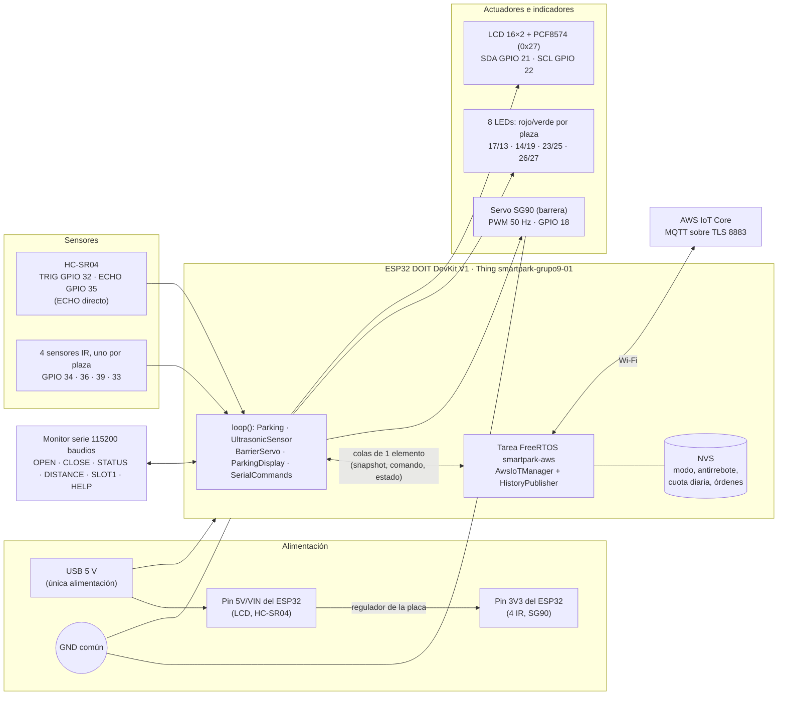

### 2.2 Diagrama de arquitectura

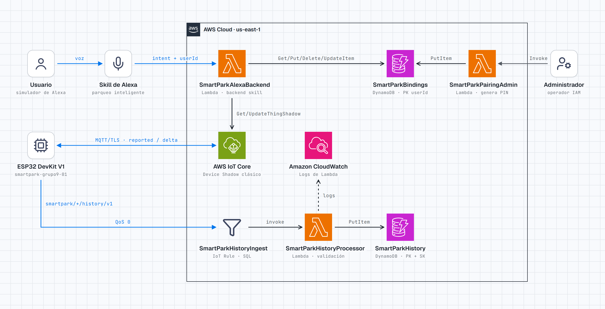

Fuente: [`diagrams/02-arquitectura.html`](diagrams/02-arquitectura.html). Hay dos flujos independientes que se encuentran solo en AWS IoT Core: el de **control** (Alexa → `SmartParkAlexaBackend` → Shadow → ESP32) y el de **histórico** (ESP32 → `smartpark/+/history/v1` → `SmartParkHistoryIngest` → `SmartParkHistoryProcessor` → `SmartParkHistory`). Las etiquetas de las flechas son las acciones IAM del rol de origen (3.2). Ni Alexa ni las Lambdas hablan con el ESP32: solo escriben `desired`.

### 2.3 Diagrama de circuito

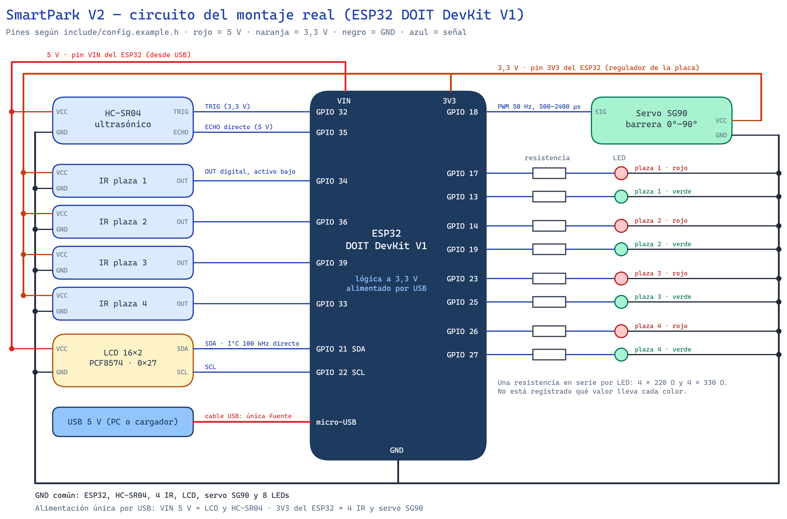

Fuente editable: [`diagrams/03-circuito.excalidraw`](diagrams/03-circuito.excalidraw) · SVG: [`diagrams/03-circuito.svg`](diagrams/03-circuito.svg).

El montaje está en una protoboard y se alimenta solo por el USB del ESP32. El pin 5V/VIN alimenta la LCD y el HC-SR04; el pin 3V3, del regulador de la placa, alimenta los cuatro IR y el servo. Todos los módulos se conectan directamente a los GPIO, y todas las masas están unidas al GND del ESP32. Las mejoras eléctricas para una versión real están en 7.5.

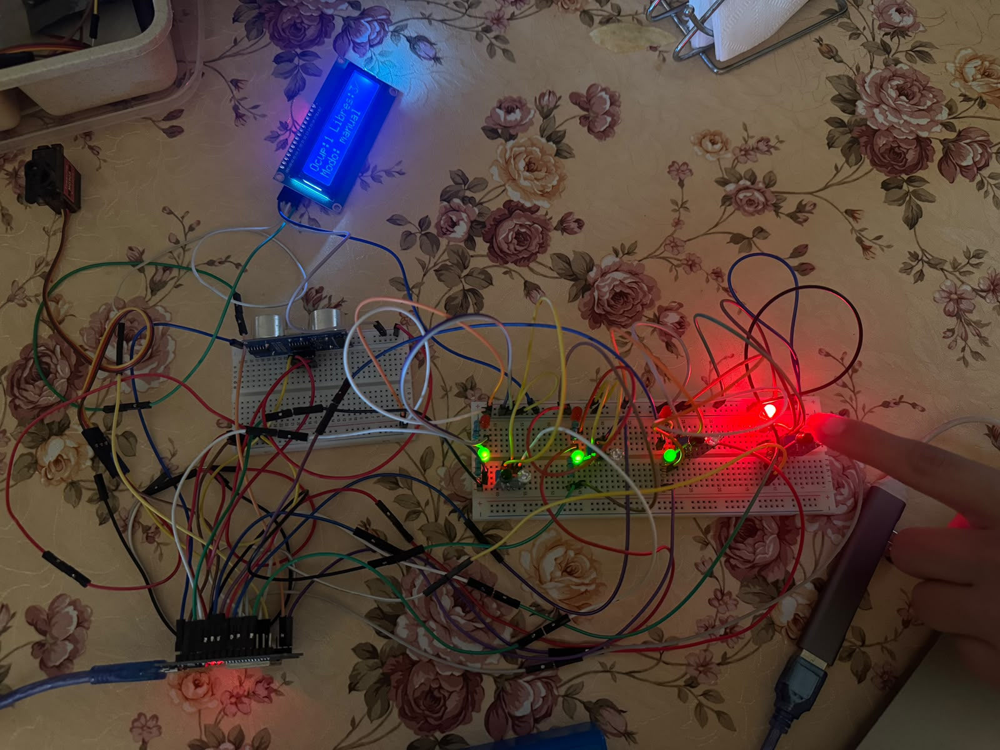

*Montaje real en protoboard: ESP32, HC-SR04, 4 IR, 8 LEDs, servo SG90 y LCD 16×2, alimentados por USB. La LCD muestra el texto del firmware anterior a la adaptación a 16×2 (3.1), con la fila 0 cortada.*

| Pin ESP32 | Componente | Alimentación | Conexión en el montaje |
|---|---|---|---|
| GPIO 32 | HC-SR04 TRIG | 5 V (pin 5V/VIN) | Directa. La salida de 3,3 V del GPIO es nivel alto para el HC-SR04. |
| GPIO 35 | HC-SR04 ECHO | 5 V (pin 5V/VIN) | Directa al pin. GPIO 35 solo admite entrada; el ECHO del módulo entrega pulsos de 5 V (7.5). |
| GPIO 34 / 36 / 39 / 33 | IR plazas 1 / 2 / 3 / 4 (OUT) | 3,3 V (pin 3V3) | Directa. Salida digital activa en bajo (`IR_OCCUPIED_LEVEL = LOW`). 34, 36 y 39 son solo entrada y sin pull-up interno. |
| GPIO 18 | SG90 señal | 3,3 V (pin 3V3) | PWM 50 Hz, 500–2400 µs (0° = 500 µs, 90° = 1450 µs). El servo toma su corriente del regulador de 3,3 V de la placa (7.5). |
| GPIO 17 / 13 | LED rojo / verde plaza 1 | GPIO | Una resistencia en serie por LED, con el cátodo a GND. |
| GPIO 14 / 19 | LED rojo / verde plaza 2 | GPIO | Ídem. |
| GPIO 23 / 25 | LED rojo / verde plaza 3 | GPIO | Ídem. |
| GPIO 26 / 27 | LED rojo / verde plaza 4 | GPIO | Ídem. |
| GPIO 21 / 22 | LCD 16×2 SDA / SCL (PCF8574, 0x27) | 5 V (pin 5V/VIN) | I²C a 100 kHz, SDA y SCL directos a los GPIO (7.5). |
| 5V/VIN · 3V3 · GND | Alimentación | USB 5 V | 5V/VIN: LCD y HC-SR04. 3V3: 4 IR y SG90. GND común a todos los componentes. |

Resistencias de los LEDs: 4 de 220 Ω y 4 de 330 Ω, una en serie con cada LED; no está registrado qué valor lleva cada color.

Fuente de los pines: [`config.example.h`](../include/config.example.h). Notas de cableado y presupuesto de corriente: [`firmware-v2.md`](firmware-v2.md#cableado-del-montaje).

### 2.4 Diagramas de clases

#### 2.4.1 Objeto inteligente (firmware ESP32)

Cada clase encapsula un periférico o una responsabilidad. `AwsIoTManager` contiene a `ShadowBudget` (cuota diaria en NVS) y a `HistoryPublisher` (colas del histórico); actúa sobre `Parking` y `BarrierServo` solo desde `applyPending()`, en el contexto de `loop()`. Copia: [`diagrams/04-clases-firmware.mmd`](diagrams/04-clases-firmware.mmd).

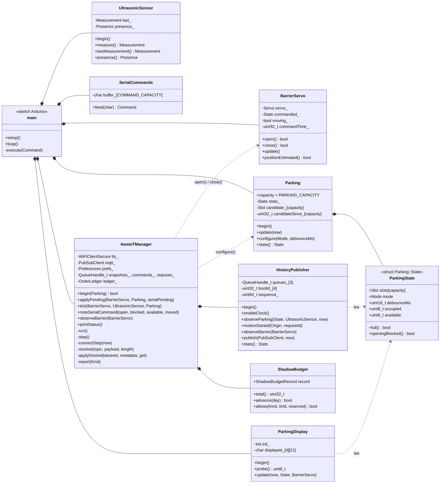

#### 2.4.2 Funciones Lambda

Tres paquetes de despliegue con responsabilidad única. El backend de la skill y la administración comparten solo `services.validation`; el procesador del histórico es un único archivo sin dependencias del SDK de Alexa, para que su ZIP sea mínimo. Copia: [`diagrams/05-clases-lambdas.mmd`](diagrams/05-clases-lambdas.mmd).

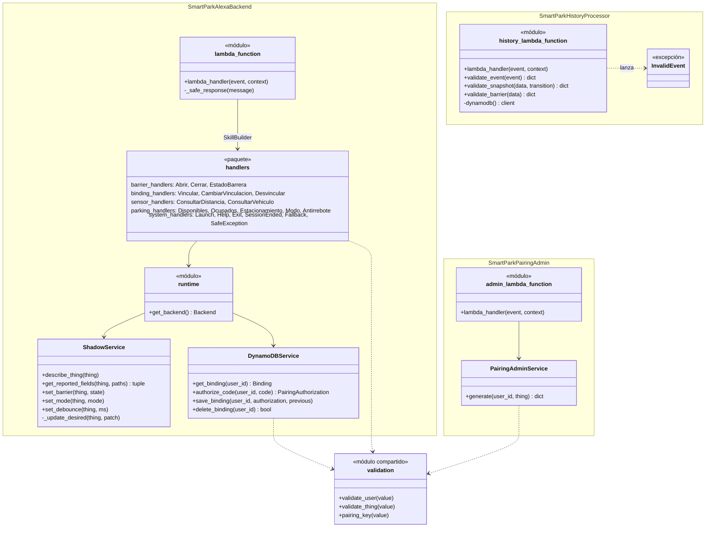

### 2.5 Diagramas de secuencia

#### 2.5.1 Consulta del sensor y comando sobre el actuador

**Consulta** (*"cuántos espacios hay disponibles"*). La Lambda no responde con un dato viejo: comprueba el `timestamp` de cada atributo usado en `metadata.reported` (≤ 180 s, `MAX_REPORTED_AGE_SECONDS`). Copia: [`06-secuencia-consulta.mmd`](diagrams/06-secuencia-consulta.mmd).

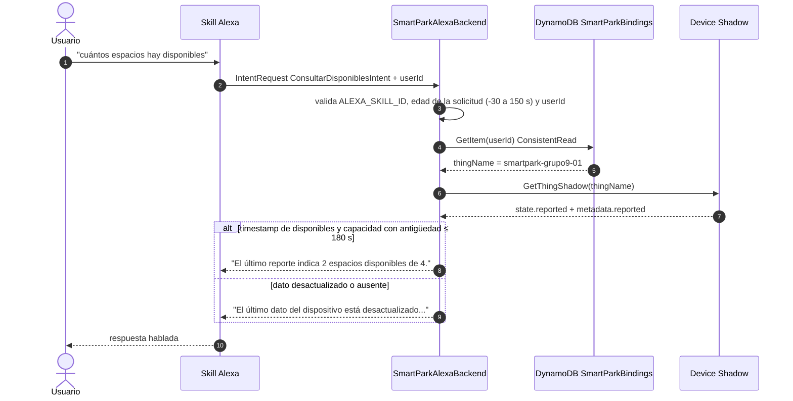

**Comando sobre el actuador** (*"abre la barrera"*). La Lambda solo escribe `desired.orden_barrera` (formato V2 con `origen = voz`); la decisión de mover o bloquear la toma el Edge y queda en `reported.ultima_orden`. Copia: [`07-secuencia-comando.mmd`](diagrams/07-secuencia-comando.mmd).

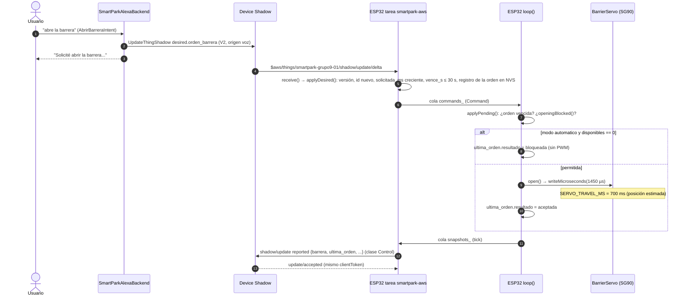

**Cambio de parámetro por voz (RF14).** La validación ocurre dos veces: en la Lambda (50–1000) y en el firmware, que además persiste el valor en NVS antes de aplicarlo. Copia: [`07b-secuencia-modo.mmd`](diagrams/07b-secuencia-modo.mmd).

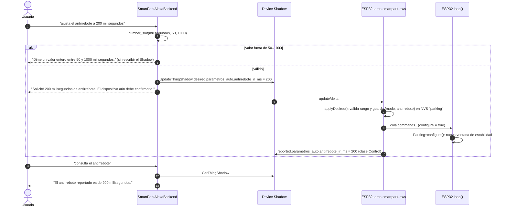

#### 2.5.2 Almacenamiento de un dato (objeto → regla de IoT → Lambda → DynamoDB)

Incluye el descarte de inválidos y la deduplicación por escritura condicional. Copia: [`08-secuencia-almacenamiento.mmd`](diagrams/08-secuencia-almacenamiento.mmd).

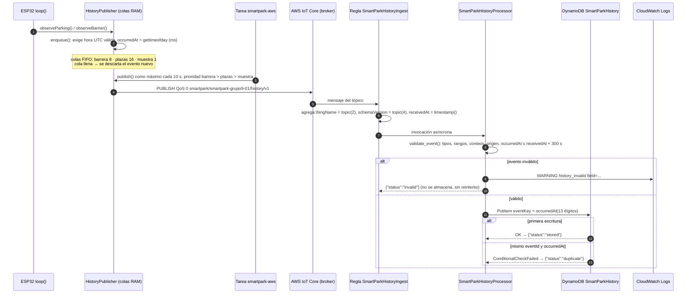

#### 2.5.3 Ejecución de la regla automática en el Edge

**E1 — indicación de plaza.** Copia: [`09-secuencia-edge-plaza.mmd`](diagrams/09-secuencia-edge-plaza.mmd).

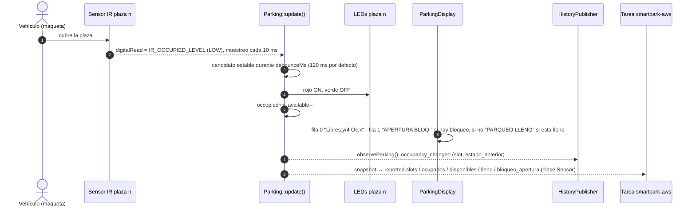

**E2, E3 y E4 — bloqueo de apertura, cierre siempre permitido y vencimiento de órdenes.** La misma regla se aplica a la orden por voz y a `OPEN` por Serial ([`main.cpp`](../src/main.cpp#L62)). Copia: [`10-secuencia-edge-bloqueo.mmd`](diagrams/10-secuencia-edge-bloqueo.mmd).

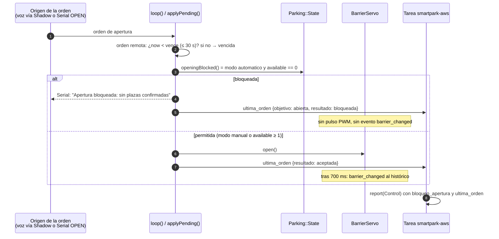

#### 2.5.4 Ejecución de las reglas automáticas en la Nube

No aplica: el repositorio no implementa reglas de control en la Nube. La única Lambda disparada por una regla de IoT, `SmartParkHistoryProcessor`, valida y almacena, y su rol no tiene permiso `iot:UpdateThingShadow` ([`processor-execution-policy.example.json`](../aws/history/processor-execution-policy.example.json)), por lo que no puede actuar sobre la barrera. La justificación está en 2.6 y las reglas de Nube recomendadas para una versión real en la sección 7.

### 2.6 Lógica de control (diagrama de estados y ubicación Edge / Nube)

**Modo de operación.** El valor por defecto es `manual`; el modo y el antirrebote se guardan en NVS y sobreviven a un reinicio. Copia: [`11-estados-control.mmd`](diagrams/11-estados-control.mmd).

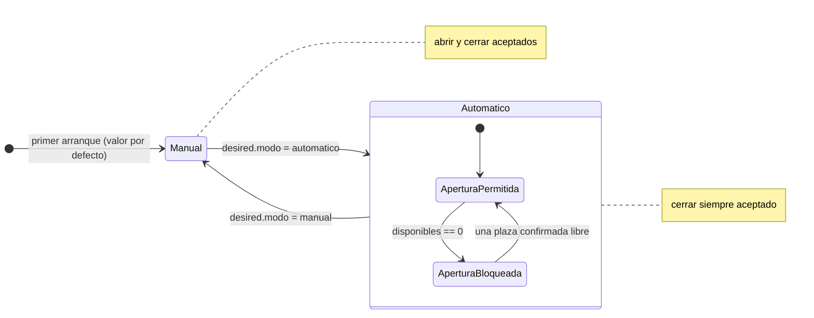

**Barrera (posición estimada).** Arranca sin estimar y sin PWM: ni el arranque, ni un cambio de modo, ni liberar una plaza mueven el servo. Copia: [`11b-estados-barrera.mmd`](diagrams/11b-estados-barrera.mmd).

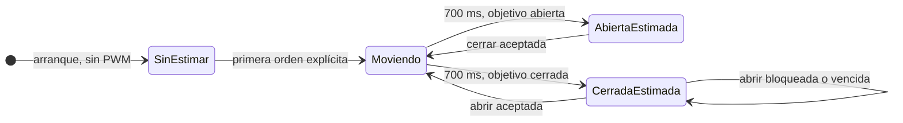

**Plaza.** Una lectura solo se acepta si se mantiene `debounceMs`; `desconocido` no cuenta como libre ni como ocupada. Copia: [`12-estados-plaza.mmd`](diagrams/12-estados-plaza.mmd).

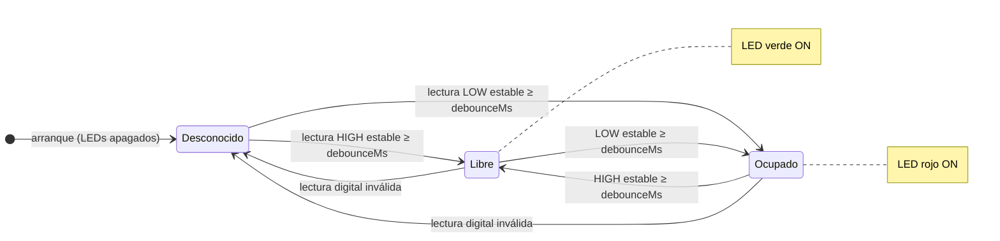

**Reglas y ubicación.**

| Regla | Condición → acción | Ubicación | Justificación |
|---|---|---|---|
| E1 Indicación de plaza | IR estable ≥ `debounceMs` → LED rojo/verde, conteos y fila 0 de la LCD (`Libres:x/4 Oc:y`) | Edge ([`Parking::update()`](../src/Parking.cpp#L27), [`ParkingDisplay::update()`](../src/ParkingDisplay.cpp#L35)) | Depende solo de datos locales; latencia de decenas de ms; debe funcionar sin red. Llevarla a la Nube costaría un mensaje por transición y dejaría el LED apagado sin conexión. |
| E2 Bloqueo de apertura | `modo == automatico` y `disponibles == 0` → apertura rechazada (`bloqueada`) y fila 1 de la LCD `APERTURA BLOQ.` | Edge ([`openingBlocked()`](../include/Parking.h#L15), [`applyPending()`](../src/AwsIoTManager.cpp#L42), [`main.cpp`](../src/main.cpp#L62)) | La decisión usa el estado de las plazas que solo el ESP32 conoce al instante; en la Nube habría una carrera entre el último `reported` y la orden. Sigue operando sin red. |
| E3 Cierre permitido | En `automatico`, `cerrar` siempre se acepta | Edge | Cerrar nunca empeora la ocupación; bloquearlo dejaría la barrera abierta. |
| E4 Vencimiento de orden remota | `now ≥ vence` (≤ `AWS_ORDER_TTL_S` = 30 s) → `vencida`, sin movimiento | Edge ([`applyPending()`](../src/AwsIoTManager.cpp#L40)) | Evita que una orden dada durante un corte abra la barrera minutos después, cuando nadie la espera. |

**Por qué ninguna regla está en la Nube.** Las cuatro reglas dependen solo del estado local y deben cumplirse sin conexión (RNF10). Una regla en la Nube añadiría un viaje Shadow → regla → Lambda → `desired` → `delta` por decisión, más invocaciones y mensajes (2.10), y fallaría justo cuando el objeto pierde la red. Las decisiones que sí requieren histórico, varios Things o detectar silencio del objeto (por ejemplo, alertar si el Thing deja de reportar o limitar aperturas diarias) no forman parte de RF1–RF15 de este caso de uso y se proponen en 7.2. La Nube se encarga del **almacenamiento validado** y de los **reportes** (2.8, 2.12).

**Convivencia entre voz y lógica automática** (según el código):

| Situación | Resultado |
|---|---|
| `manual` + *"abre la barrera"* | Se acepta y mueve el servo (`aceptada`). |
| `automatico` con ≥ 1 plaza libre + *"abre la barrera"* | Se acepta. |
| `automatico` con 0 libres (o plazas `desconocido`) + *"abre la barrera"* | Se rechaza en el Edge: `ultima_orden.resultado = "bloqueada"`, fila 1 de la LCD `APERTURA BLOQ.`. Alexa responde *"Solicité abrir la barrera…"* porque la Lambda no espera al dispositivo; *"consulta el estado de la barrera"* confirma que sigue cerrada. |
| Cualquier modo + *"cierra la barrera"* | Se acepta. |
| Orden Serial y orden remota en la misma vuelta de `loop()` | Prevalece la Serial (operador en sitio) y la remota se descarta ([`applyPending()`](../src/AwsIoTManager.cpp#L37)). |
| *"activa el modo manual"* | Desactiva el bloqueo: la voz no obliga a abrir, solo cambia el modo; la apertura requiere otra orden. |

### 2.7 Especificación del documento Shadow

Shadow clásico del Thing `smartpark-grupo9-01`. Lo escriben el ESP32 (`reported`, [`report()`](../src/AwsIoTManager.cpp#L409)) y `SmartParkAlexaBackend` (`desired`, [`_update_desired`](../lambda/services/shadow_service.py#L103)).

| Atributo | Tipo | Valores válidos | Sección | Escribe | Lee |
|---|---|---|---|---|---|
| `barrera` | string \| null | `abierta`, `cerrada`; `null` sin posición estimada | reported / desired | ESP32 / Lambda | Lambda (`EstadoBarreraIntent`) / ESP32 |
| `barrera_posicion_estimada` | bool | `true` tras un recorrido completo | reported | ESP32 | — |
| `distancia_cm` | number \| null | 2–400 (1 decimal); `null` si la lectura es inválida | reported | ESP32 | Lambda |
| `vehiculo_detectado` | bool \| null | `null` sin 3 muestras estables | reported | ESP32 | Lambda |
| `slots` | objeto `"1"`..`"4"` → string | `libre`, `ocupado`, `desconocido` | reported | ESP32 | Lambda (`ConsultarEstacionamientoIntent`) |
| `ocupados`, `disponibles` | int | 0–`capacidad` (`desconocido` no cuenta) | reported | ESP32 | Lambda |
| `capacidad` | int | 1–4 (`PARKING_CAPACITY`) | reported | ESP32 | Lambda |
| `lleno` | bool | `ocupados == capacidad` | reported | ESP32 | — |
| `bloqueo_apertura` | bool | `modo == automatico` y `disponibles == 0` | reported | ESP32 | — |
| `modo` | string | `manual`, `automatico` | reported / desired | ESP32 / Lambda | Lambda / ESP32 |
| `parametros_auto.antirrebote_ir_ms` | int | 50–1000 | reported / desired | ESP32 / Lambda | Lambda / ESP32 |
| `ultima_orden` | objeto | `id` (string \| null), `objetivo` (`abierta`/`cerrada`), `origen` (`voz`, `nube`, `edge`, `legado`), `resultado` (`aceptada`, `bloqueada`, `vencida`, `no_disponible`) | reported | ESP32 | consola / pruebas |
| `orden_barrera` | objeto | `id` 1–32 `[A-Za-z0-9_-]`, `objetivo`, `origen` (`voz`/`nube`), `solicitada_ms` (epoch ms), `vence_s` (epoch s, ≤ 30 s) | desired | Lambda ([`set_barrier`](../lambda/services/shadow_service.py#L79)) | ESP32 |

`desired` escrito por la skill (formato V2 para la barrera, RF14 para modo y parámetro; `barrera: null` elimina una orden V1 anterior):

```json
{"state": {"desired": {"barrera": null, "orden_barrera": {"id": "3f2b9c0e5d7a4e1f8a6b2c4d9e0f1a2b", "objetivo": "abierta", "origen": "voz", "solicitada_ms": 1795000000123, "vence_s": 1795000030}}}}
{"state": {"desired": {"modo": "automatico"}}}
{"state": {"desired": {"parametros_auto": {"antirrebote_ir_ms": 200}}}}
```

`reported` emitido por el ESP32 (forma de [`report()`](../src/AwsIoTManager.cpp#L409); valores ilustrativos):

```json
{
  "state": {
    "reported": {
      "barrera_posicion_estimada": true, "barrera": "cerrada",
      "slots": {"1": "ocupado", "2": "ocupado", "3": "ocupado", "4": "ocupado"},
      "ocupados": 4, "disponibles": 0, "capacidad": 4,
      "modo": "automatico", "lleno": true, "bloqueo_apertura": true,
      "parametros_auto": {"antirrebote_ir_ms": 120},
      "ultima_orden": {"id": "3f2b9c0e5d7a4e1f8a6b2c4d9e0f1a2b", "objetivo": "abierta", "origen": "voz", "resultado": "bloqueada"},
      "distancia_cm": 12.4, "vehiculo_detectado": true
    }
  }
}
```

`delta` que recibe el ESP32 tras *"activa el modo manual"* con `reported.modo = "automatico"`:

```json
{"version": 128, "timestamp": 1795000000, "state": {"modo": "manual"},
 "metadata": {"modo": {"timestamp": 1795000000}}}
```

El firmware ordena GET y deltas por `version` y correlaciona los acuses por `clientToken`. Una orden V2 se acepta solo si su `id` es nuevo, `solicitada_ms` crece respecto a la última orden y `vence_s` no ha pasado ni supera 30 s de vigencia ([`applyDesired()`](../src/AwsIoTManager.cpp#L281)); `origen` pasa a `ultima_orden` y al histórico. Las órdenes V1 de clientes antiguos se identifican por `metadata.barrera.timestamp`, se descartan con más de 30 s y se registran con `origen = legado` ([`applyDesired()`](../src/AwsIoTManager.cpp#L301)). Formato V2 completo: [`firmware-v2.md`](firmware-v2.md#device-shadow-clásico).

### 2.8 Modelo de datos de DynamoDB

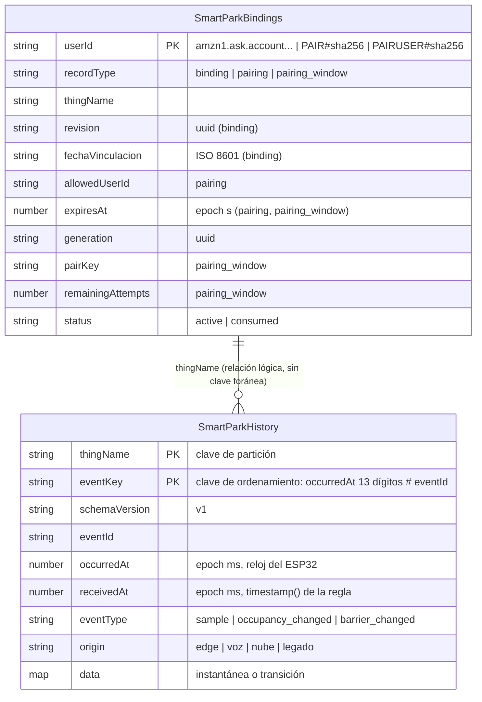

Copia: [`13-modelo-datos.mmd`](diagrams/13-modelo-datos.mmd). Las dos tablas son independientes: la relación por `thingName` es lógica.

**`SmartParkBindings`** (heredada de la P3, bajo demanda, PK `userId` String). Una sola tabla guarda tres tipos de registro distinguidos por el prefijo de la clave: `amzn1.ask.account…` (vinculación), `PAIR#<sha256(PIN)>` (autorización) y `PAIRUSER#<sha256(userId)>` (ventana de intentos). Sin índices; los registros de PIN tienen `expiresAt` (epoch s), pero el repositorio no documenta TTL activado en la tabla: la caducidad se aplica por condición en el código ([`dynamodb_service.py`](../lambda/services/dynamodb_service.py)).

**`SmartParkHistory`** ([`table.example.json`](../aws/history/table.example.json), `PAY_PER_REQUEST`):

| Atributo | Tipo DynamoDB | Origen | Ejemplo |
|---|---|---|---|
| `thingName` (PK) | S | regla: `topic(2)` | `smartpark-grupo9-01` |
| `eventKey` (SK) | S | Lambda: `f"{occurredAt:013d}#{eventId}"` | `1795000000000#b1982cbc…-0000000000000011` |
| `schemaVersion` | S | regla: `topic(4)` | `v1` |
| `eventId` | S | ESP32: 32 hex de arranque + `-` + 16 hex de secuencia | |
| `occurredAt` | N | ESP32 (epoch ms, NTP) | `1795000000000` |
| `receivedAt` | N | regla: `timestamp()` (epoch ms) | `1795000000412` |
| `eventType` | S | ESP32 | `sample`, `occupancy_changed`, `barrier_changed` |
| `origin` | S | ESP32 | `edge` (lecturas); `voz`, `edge`, `nube`, `legado` (barrera) |
| `data` | M | ESP32, validado | lectura: `slots`, `capacidad`, `ocupados`, `disponibles`, `modo`, `distancia_cm`, `vehiculo_detectado` (+ `slot`, `estado_anterior`); barrera: `anterior`, `actual`, `posicion_estimada`, `requestId` |

**Decisiones.** La SK empieza por la hora de ocurrencia con 13 dígitos fijos, así que el orden lexicográfico es el cronológico y un rango de fechas es un `BETWEEN`; el sufijo `#eventId` hace única la clave y permite deduplicar con `attribute_not_exists`. **Índices secundarios:** ninguno; todos los patrones de acceso de esta práctica son por Thing y rango de tiempo. **TTL:** no configurado; con la frecuencia del código la tabla crece ≈ 10 MB/mes por Thing (5.6), muy por debajo de 25 GB, y los reportes necesitan meses de histórico. Se recomienda un atributo `expiresAt` con TTL de 13 meses (7.1).

**Patrones de acceso.**

| # | Patrón | Operación | Clave / condición | Filtro |
|---|---|---|---|---|
| A1 | Guardar un evento sin duplicar | `PutItem` | `thingName`, `eventKey`; `attribute_not_exists(thingName) AND attribute_not_exists(eventKey)` | — |
| A2 | Eventos de un Thing en un rango | `Query` | `thingName = :t AND eventKey BETWEEN :desde13 + "#" AND :hasta13 + "#~"` | — |
| A3 | Transiciones de plazas en un rango (M1, M4) | `Query` A2 | ídem | `eventType = occupancy_changed` (M4: `AND data.slot = :n`) |
| A4 | Aperturas por origen (M2) | `Query` A2 | ídem | `eventType = barrier_changed AND data.actual = abierta` |
| A5 | Tiempo con parqueo lleno / bloqueado (M3) | `Query` A2 | ídem | `eventType IN (occupancy_changed, sample)` |
| A6 | Último estado conocido del objeto | `Query` | `thingName = :t`, `ScanIndexForward = false`, `Limit = 1` | — |
| A7 | Thing vinculado a un usuario | `GetItem` (`SmartParkBindings`) | `userId = :u`, lectura consistente | — |
| A8 | Eventos de todos los Things en un rango (panel multi-parqueo) | requiere índice | **cambio recomendado**: GSI `eventType` + `eventKey` (7.1) | — |

El filtro se aplica después de leer el rango: no reduce el costo de lectura, pero el volumen por Thing es pequeño (≈ 570 ítems/día, 2.10). Para rangos grandes se recorre `LastEvaluatedKey`.

### 2.9 Reglas de AWS IoT y funciones Lambda

**Regla `SmartParkHistoryIngest`** ([`iot-rule.example.json`](../aws/history/iot-rule.example.json)):

```sql
SELECT topic(2) AS thingName, topic(4) AS schemaVersion, eventId, occurredAt, eventType, origin, data,
       timestamp() AS receivedAt
FROM 'smartpark/+/history/v1'
```

| Campo | Valor |
|---|---|
| Tópico | `smartpark/+/history/v1` (el ESP32 publica en `smartpark/smartpark-grupo9-01/history/v1`) |
| Versión SQL | `2016-03-23` |
| Acción | `lambda` → `SmartParkHistoryProcessor` (invocación asíncrona) |
| Permiso | Política basada en recursos de la Lambda: `lambda:InvokeFunction` para `iot.amazonaws.com`, limitada por `SourceArn` (la regla) y `SourceAccount` ([`iot-invoke-permission.example.json`](../aws/history/iot-invoke-permission.example.json)). La acción Lambda no usa rol IAM de regla. |
| Identidad | `thingName` sale del tópico y no del cuerpo; la política del dispositivo solo le permite publicar en su propio tópico (3.2), así que un Thing no puede escribir el histórico de otro. |

La plantilla se crea con `"ruleDisabled": true` para habilitarla solo después de verificar la tabla y la Lambda ([`historial-aws-practica-4.md`](historial-aws-practica-4.md#despliegue-manual-posterior)).

**Funciones Lambda.**

| Lambda | Responsabilidad | Disparador | Recursos | Permisos (rol) |
|---|---|---|---|---|
| `SmartParkAlexaBackend` | Backend de la skill: consultas, comandos, modo/parámetros, vinculación | Alexa Skills Kit (Skill ID) | `SmartParkBindings`, Shadow del Thing | [`alexa-execution-policy.example.json`](../lambda/iam/alexa-execution-policy.example.json) |
| `SmartParkHistoryProcessor` | Validar, enriquecer y almacenar el histórico | Regla `SmartParkHistoryIngest` | `SmartParkHistory`, su grupo de logs | [`processor-execution-policy.example.json`](../aws/history/processor-execution-policy.example.json) |
| `SmartParkPairingAdmin` | Generar el PIN de vinculación | Invocación manual de un operador IAM | `SmartParkBindings` (claves `PAIR#`, `PAIRUSER#`), `DescribeThing` | [`admin-execution-policy.example.json`](../lambda/iam/admin-execution-policy.example.json) |

**Justificación de la separación.** *Responsabilidad única:* cada función tiene un disparador y un propósito. *Frecuencia:* el procesador del histórico se invoca por cada evento (cientos al día) y la skill solo cuando alguien habla; separarlas permite dimensionar memoria y concurrencia por separado. *Permisos:* el procesador solo necesita `dynamodb:PutItem` sobre una tabla y no puede leer vinculaciones ni tocar el Shadow; la skill no puede escribir el histórico; la administración no es invocable por Alexa. *Costo:* el ZIP del procesador es un solo archivo sin el SDK de Alexa (arranque en frío menor que el del backend, que pesa ≈ 18 MB).

### 2.10 Política de reporte

| Canal | Cuándo publica | Límite en el código | Razón |
|---|---|---|---|
| Shadow `update` clase `Control` | Tras ejecutar o rechazar una orden, o aplicar modo/antirrebote | Sin separación mínima; usa la reserva de 200 | El usuario espera la confirmación. |
| Shadow clase `Sensor` | Cambio de plaza, de presencia (3 muestras estables), de validez o Δ distancia ≥ 10 cm | Separación mínima 10 s (`AWS_MIN_PUBLISH_INTERVAL_MS`), salvo presencia | Refleja cambios sin saturar la cuota. |
| Shadow clase `Periodic` | Sin cambios durante 30 s (`AWS_REPORT_INTERVAL_MS`) | Total ordinario ≤ 800/día | Mantiene `reported` dentro de los 180 s que acepta la skill aun perdiendo 5 respaldos seguidos. |
| Shadow `get` (`Recovery`) | Al conectar o reconectar | Usa la reserva | Recupera el `desired` pendiente. |
| Histórico | Cada transición de plaza o barrera + muestra cada 300 s (`HISTORY_SAMPLE_INTERVAL_MS`) | ≤ 1 publicación cada 10 s (`HISTORY_PUBLISH_INTERVAL_MS`), presupuesto separado del Shadow | Los reportes necesitan transiciones exactas; las muestras detectan huecos de cobertura. |
| Sesión de demostración | — | La tarea se desconecta tras 60 min conectados (`AWS_DEMO_MAX_CONNECTED_MS`) hasta reiniciar | Límite académico de consumo. |

El Shadow refleja el **estado actual** (lo que consulta Alexa) y el tópico de histórico guarda la **secuencia de cambios** (lo que necesitan los reportes). Usar `update/accepted` del Shadow como fuente del histórico mezclaría ambos: perdería las transiciones intermedias entre dos reportes y dependería de la cuota del Shadow.

**Mensajes por día (un Thing).** Shadow: como máximo 1000 solicitudes (`AWS_MAX_SHADOW_UPDATES_PER_DAY`), cada una con su respuesta `accepted`. En una sesión de 60 min en reposo: 120 respaldos + eventos. Histórico: 288 muestras/día con conexión continua más las transiciones; con 30 ingresos por plaza al día (240 transiciones) y 40 movimientos de barrera, ≈ 570 eventos/día. Cota física: 8640 publicaciones/día por el intervalo de 10 s. Costo en 5.6.

**Reconexión (base de RNF6).** Tras una falla, el reintento espera 5 s y duplica la espera hasta 300 s (`AWS_RETRY_MAX_MS`), con *jitter* de 0–1 s y un máximo de 10 intentos consecutivos sin un GET válido ([`failedAttempt()`](../src/AwsIoTManager.cpp#L172), [`connectStep()`](../src/AwsIoTManager.cpp#L183)). Los intentos ocurren ≈ 5, 15, 35 y 75 s después de detectar la caída, así que con un corte de 45 s la red vuelve entre el intento de 35 s y el de 75 s: si la caída se detecta al iniciar el corte, la reconexión ocurre ≈ 30 s después de restaurar la red; una detección tardía desplaza los intentos y el peor caso queda en ≈ 40 s, más el saludo TLS. Un corte mayor a ≈ 20 min agota los 10 intentos y deja al objeto en modo local hasta reiniciar.

### 2.11 Diseño de la skill de Alexa

Nombre de invocación: **`parqueo inteligente`** (es-US). Modelo activo: [`alexa/es-US.smartpark-v2.final.json`](../alexa/es-US.smartpark-v2.final.json).

| Intent | Slot (tipo) | Frases de ejemplo (del modelo) | Acción en el Shadow |
|---|---|---|---|
| `ConsultarDisponiblesIntent` | — | cuántos espacios hay disponibles · consulta los espacios libres · cuántas plazas libres quedan | lee `reported.disponibles`, `capacidad` |
| `ConsultarOcupadosIntent` | — | cuántos espacios están ocupados · consulta los espacios ocupados · cuántas plazas están ocupadas | lee `reported.ocupados`, `capacidad` |
| `ConsultarEstacionamientoIntent` | `espacio` (`AMAZON.NUMBER`, 1–4) | cómo está el estacionamiento {espacio} · está libre la plaza {espacio} · consulta el espacio {espacio} | lee `reported.slots.<n>` |
| `ConsultarModoIntent` | — | consulta el modo del parqueo · en qué modo está el parqueo · cuál es el modo actual | lee `reported.modo` |
| `ActivarModoAutomaticoIntent` | — | activa el modo automático · pon el parqueo en modo automático · cambia a modo automático | `desired.modo = "automatico"` |
| `ActivarModoManualIntent` | — | activa el modo manual · pon el parqueo en modo manual · cambia a modo manual | `desired.modo = "manual"` |
| `ConsultarAntirreboteIntent` | — | consulta el antirrebote · cuántos milisegundos tiene el antirrebote · cuál es el valor del antirrebote | lee `reported.parametros_auto.antirrebote_ir_ms` |
| `CambiarAntirreboteIntent` | `milisegundos` (`AMAZON.NUMBER`, 50–1000) | ajusta el antirrebote a {milisegundos} milisegundos · cambia el antirrebote a {milisegundos} · configura {milisegundos} milisegundos de antirrebote | `desired.parametros_auto.antirrebote_ir_ms` |
| `AbrirBarreraIntent` / `CerrarBarreraIntent` | — | abre la barrera · levanta la barrera · abrir … / cierra la barrera · baja la barrera · cerrar … (7 frases cada uno) | `desired.orden_barrera` (`origen = voz`) |
| `EstadoBarreraIntent` | — | consulta el estado de la barrera · dime el estado de la barrera … | lee `reported.barrera` |
| `ConsultarDistanciaIntent` / `ConsultarVehiculoIntent` | — | consulta la distancia … / hay un auto esperando … | lee `distancia_cm` / `vehiculo_detectado` |
| `VincularParqueoIntent` / `CambiarVinculacionIntent` | `codigo` (`AMAZON.FOUR_DIGIT_NUMBER`) | vincula mi parqueo con el codigo {codigo} … / cambia mi vinculacion con el código {codigo} … | `SmartParkBindings` |
| `DesvincularParqueoIntent` | — | desvincula mi parqueo · elimina mi vinculacion … | `SmartParkBindings` |
| `AMAZON.HelpIntent`, `CancelIntent`, `StopIntent`, `NavigateHomeIntent` | — | integrados | — |

Los valores fuera de rango del slot se rechazan en la Lambda sin escribir el Shadow ([`number_slot()`](../lambda/handlers/parking_handlers.py#L9)). Las respuestas de los cambios dicen *"Solicité…; el dispositivo aún debe confirmarlo"*, porque la escritura en `desired` no garantiza su aplicación.

### 2.12 Diseño de reportes (mockups)

Cuatro reportes para el administrador del parqueo. Los valores dibujados son ilustrativos; lo que se diseña es **qué** se muestra y **de qué consulta** sale. Todos parten del patrón A2 (2.8) sobre `SmartParkHistory`. Fuentes editables `.excalidraw` y exportaciones SVG/PNG en [`docs/mockups/`](mockups/).

**M1 — Ocupación por plaza y franja horaria.** Decisión: horarios de mayor demanda (personal, tarifas por hora).


| Elemento | Atributos | Consulta |
|---|---|---|
| Mapa de calor plaza × hora | `occurredAt`, `data.slot`, `data.estado_anterior`, `data.slots` | `Query` `SmartParkHistory`: `thingName = :t AND eventKey BETWEEN :desde13# AND :hasta13#~`; filtro `eventType IN (occupancy_changed, sample)`; tiempo ocupado = diferencias de `occurredAt` entre transiciones, repartidas por hora |
| Ocupación media, hora pico, plaza más usada | derivados del mapa | misma consulta |
| Cobertura | intervalos con `desconocido` o sin muestras de 300 s | misma consulta, `eventType = sample` |

**M2 — Aperturas de barrera por origen.** Decisión: cuánto se usa la voz frente a la operación local.

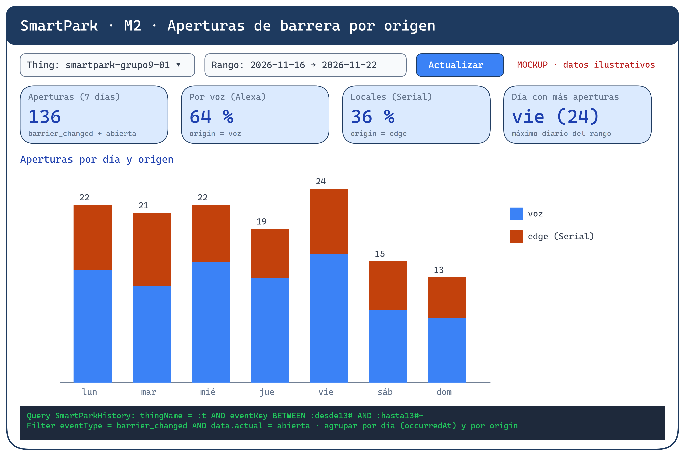

| Elemento | Atributos | Consulta |
|---|---|---|
| Barras apiladas por día y origen | `occurredAt`, `origin`, `data.actual` | `Query` A2; filtro `eventType = barrier_changed AND data.actual = abierta`; agrupar por día y `origin` |
| KPIs (total, % voz y % `edge`, día con más aperturas) | `origin`, `occurredAt` | misma consulta |

Las órdenes de la skill usan el formato V2 (`desired.orden_barrera`) y se registran con `origin = voz`; `legado` solo aparece para órdenes V1 de clientes antiguos (por ejemplo, una edición manual de `desired.barrera` en la consola). El mockup muestra los orígenes `voz` y `edge`: el diseño no tiene lógica de control en la Nube (2.6), por lo que no hay aperturas con `origin = nube`. Si se agregara una regla de Nube (7.2), sus aperturas formarían una tercera serie.

**M3 — Saturación: parqueo lleno y aperturas bloqueadas.** Decisión: si la capacidad es insuficiente.


| Elemento | Atributos | Consulta |
|---|---|---|
| Minutos por día con parqueo lleno | `occurredAt`, `data.disponibles`, `data.capacidad` | `Query` A2; filtro `eventType IN (occupancy_changed, sample)`; lleno = `disponibles = 0` y `ocupados = capacidad` |
| Minutos con apertura bloqueada | + `data.modo` | misma consulta; bloqueado = lleno y `modo = automatico` |
| Episodios de lleno | transiciones a `disponibles = 0` | misma consulta |
| Aperturas rechazadas | — | **Cambio recomendado:** el firmware no publica las órdenes bloqueadas (solo `reported.ultima_orden`). Requiere un evento nuevo `order_rejected` en el histórico y su validación en la Lambda (7.1). |

**M4 — Tiempo de permanencia por plaza.** Decisión: rotación de plazas y tiempo máximo de estadía.

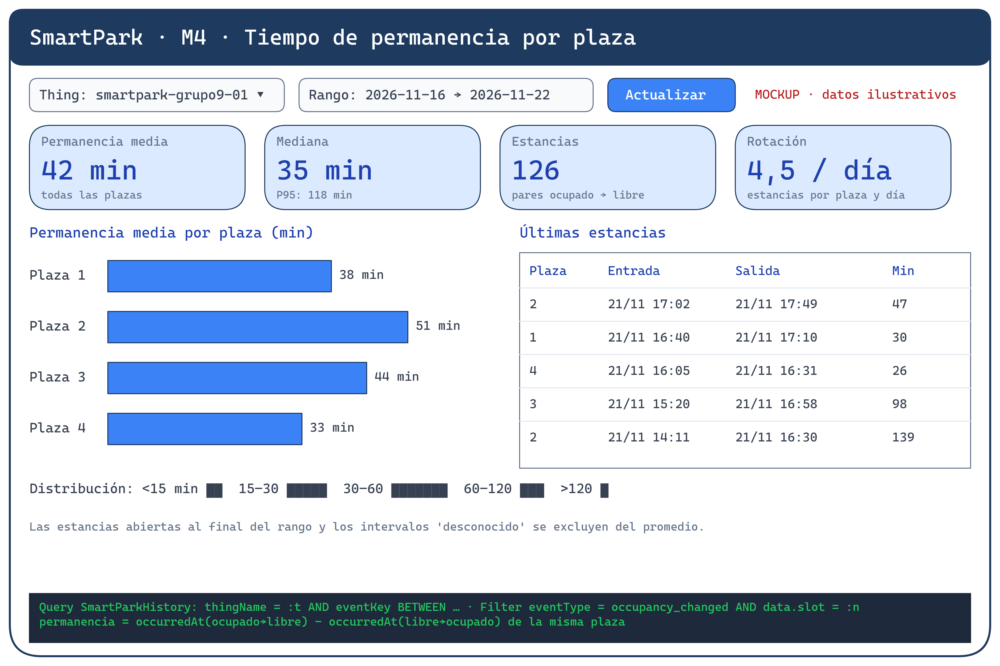

| Elemento | Atributos | Consulta |
|---|---|---|
| Permanencia media por plaza, mediana, P95 | `occurredAt`, `data.slot`, `data.estado_anterior` | `Query` A2; filtro `eventType = occupancy_changed AND data.slot = :n`; permanencia = `occurredAt` (ocupado → libre) − `occurredAt` (libre → ocupado) |
| Últimas estancias | ídem | misma consulta con `ScanIndexForward = false` |
| Estancias y rotación | conteo de pares | misma consulta |

Ningún mockup requiere un índice nuevo para un Thing; un panel que compare varios Things necesita el GSI de A8.

---

## 3. Desarrollo e Implementación

### 3.1 Estructura del código

**Firmware (C++, PlatformIO, `esp32doit-devkit-v1`, Arduino; bibliotecas fijadas en [`platformio.ini`](../platformio.ini): ESP32Servo 1.1.2, PubSubClient 2.8, ArduinoJson 6.21.5).**

| Archivo | Responsabilidad |
|---|---|
| [`src/main.cpp`](../src/main.cpp) | `setup()`/`loop()`: orden de ejecución, comandos Serial y regla E2 para órdenes Serial |
| [`include/Parking.h`](../include/Parking.h), [`src/Parking.cpp`](../src/Parking.cpp) | IR, antirrebote, conteos, LEDs, modo (reglas E1 y E2) |
| [`src/BarrierServo.cpp`](../src/BarrierServo.cpp) | SG90, PWM perezoso y posición estimada por tiempo |
| [`src/UltrasonicSensor.cpp`](../src/UltrasonicSensor.cpp) | HC-SR04 con espera acotada e histéresis de presencia |
| [`src/ParkingDisplay.cpp`](../src/ParkingDisplay.cpp) | LCD 16×2 por PCF8574 (HD44780 en 4 bits, filas en DDRAM 0x00 y 0x40), sin bloqueos: escribe una fila por llamada y solo si su texto cambió; ante un error I²C reinicia la inicialización y reescribe ambas filas. Fila 0: `Libres:x/4 Oc:y`. Fila 1, por prioridad: `APERTURA BLOQ.`, `PARQUEO LLENO` o, cada 2 s, `Modo: manual`/`Modo: automatico` y `Barrera: abierta`/`cerrada`/`mueve`/`---`. |
| [`include/SerialCommands.h`](../include/SerialCommands.h) | Analizador acotado de `OPEN`, `CLOSE`, `STATUS`, `DISTANCE`, `SLOT1`, `HELP` |
| [`src/AwsIoTManager.cpp`](../src/AwsIoTManager.cpp) | Tarea de red: Wi-Fi, NTP, MQTT/TLS, Shadow, cuota, órdenes |
| [`include/ShadowBudget.h`](../include/ShadowBudget.h) | Cuota diaria persistente por clase de solicitud |
| [`src/HistoryPublisher.cpp`](../src/HistoryPublisher.cpp) | Colas y publicación del histórico |
| [`include/config.example.h`](../include/config.example.h), [`include/secrets.example.h`](../include/secrets.example.h) | Plantillas de configuración sin secretos |

**Fragmentos clave.**

- **Tarea FreeRTOS.** [`AwsIoTManager::begin()`](../src/AwsIoTManager.cpp#L27) crea `smartpark-aws` (pila de 12 288 B, prioridad 1) y tres colas de un elemento. `loop()` publica su instantánea con `xQueueOverwrite` y nunca espera a la red: si TLS tarda, se pierde una instantánea intermedia, no el control local.
- **Antirrebote de los IR.** [`Parking::update()`](../src/Parking.cpp#L27) muestrea cada 10 ms; una lectura nueva reinicia `candidateSince_` y el estado solo cambia cuando el candidato se mantiene `debounceMs`. Si `loop()` se atrasa más de 3 muestras, la ventana se reinicia (`interrupted`) para no confirmar con datos viejos. Cambiar el antirrebote reinicia los candidatos ([`configure()`](../src/Parking.cpp#L18)).
- **Regla de bloqueo.** Una sola expresión, [`openingBlocked()`](../include/Parking.h#L15): `mode == Automatic && available == 0`. La usan la orden remota ([`applyPending()`](../src/AwsIoTManager.cpp#L42)), la Serial ([`main.cpp`](../src/main.cpp#L62)), la LCD y `reported.bloqueo_apertura`, de modo que no hay dos versiones de la regla.
- **Manejo del Shadow.** [`receive()`](../src/AwsIoTManager.cpp#L329) filtra el JSON con un `StaticJsonDocument` de 2048 B, ignora deltas con `version` vieja y respuestas sin el `clientToken` propio. [`applyDesired()`](../src/AwsIoTManager.cpp#L241) valida modo y antirrebote, los guarda en NVS **antes** de aplicarlos y registra la orden en NVS para no repetirla tras un reinicio.
- **Cuota de solicitudes.** [`reserve()`](../src/AwsIoTManager.cpp#L160) cuenta cada intento en NVS antes de publicar; [`ShadowBudget::allows()`](../include/ShadowBudget.h#L22) deja 200 de las 1000 diarias para `Control` y `Recovery`. El día UTC solo avanza: un reinicio no repone la cuota.
- **Publicador de histórico.** [`enqueue()`](../src/HistoryPublisher.cpp#L34) exige hora UTC válida y usa `xQueueSend` sin espera: con la cola llena descarta el evento nuevo y lo cuenta. [`publish()`](../src/HistoryPublisher.cpp#L135) envía uno cada ≥ 10 s, con prioridad barrera > plazas > muestra y hasta 3 intentos con los mismos bytes (mismo `eventId` y `occurredAt`, por lo que un reintento no duplica filas).

**Lambdas (Python 3.13, estilo funcional por responsabilidad).**

| Paquete | Archivos | Responsabilidad |
|---|---|---|
| `SmartParkAlexaBackend` | [`lambda_function.py`](../lambda/lambda_function.py), [`handlers/`](../lambda/handlers/), [`services/`](../lambda/services/) | Validación del sobre de Alexa, intents, Shadow y vinculación |
| `SmartParkHistoryProcessor` | [`history_lambda_function.py`](../lambda/history_lambda_function.py) | Validación y `PutItem` condicional |
| `SmartParkPairingAdmin` | [`admin_lambda_function.py`](../lambda/admin_lambda_function.py), [`administration/`](../lambda/administration/) | Generación de PIN |

- **Validación y enriquecimiento del histórico.** [`validate_event()`](../lambda/history_lambda_function.py#L87) exige `schemaVersion = "v1"`, `thingName` y `eventId` con patrón, `receivedAt` entero y `occurredAt` no más de 300 s por delante de `receivedAt`. [`validate_snapshot()`](../lambda/history_lambda_function.py#L39) exige exactamente las claves esperadas, plazas 1..`capacidad`, conteos coherentes con `slots`, distancia 2–400 cm y presencia solo con distancia; [`validate_barrier()`](../lambda/history_lambda_function.py#L74) exige una transición real. Un inválido se registra como `history_invalid field=<campo>` y devuelve `invalid` sin reintento; un error de DynamoDB se propaga para que la invocación asíncrona reintente.
- **Handlers de modo y parámetros.** [`parking_handlers.py`](../lambda/handlers/parking_handlers.py): las consultas leen `reported` con control de antigüedad por atributo; los cambios llaman a [`set_mode`/`set_debounce`](../lambda/services/shadow_service.py#L93), que escriben un parche mínimo en `desired` sin leer antes el Shadow. Los límites 50–1000 están declarados junto a la nota de sincronía con el firmware ([`shadow_service.py`](../lambda/services/shadow_service.py#L12)).
- **Sin credenciales.** Los clientes de boto3 se crean en la primera invocación y usan el rol de ejecución; ningún archivo contiene *access keys*. Una sola llamada por operación (`total_max_attempts: 1`) con tiempos de 0,5 s de conexión y 1 s de lectura ([`runtime.py`](../lambda/services/runtime.py)).

### 3.2 Configuraciones en AWS y permisos asignados

Las plantillas usan `<REGION>`/`<ACCOUNT_ID>` ([`aws/history/`](../aws/history/)) o `us-east-1`/`REEMPLAZAR_ACCOUNT_ID` ([`lambda/iam/`](../lambda/iam/), [`docs/aws-iot-policy.example.json`](aws-iot-policy.example.json)).

| Recurso | Configuración |
|---|---|
| Thing | `smartpark-grupo9-01` (`THING_NAME`); `clientId` MQTT = nombre del Thing |
| Certificados | X.509 del Thing y Amazon Root CA 1 en `include/secrets.h`, excluido por [`.gitignore`](../.gitignore); plantilla vacía en [`secrets.example.h`](../include/secrets.example.h). Se quedan fuera del repositorio porque quien tenga la clave privada puede suplantar al objeto. |
| Política IoT del dispositivo | [`aws-iot-policy.example.json`](aws-iot-policy.example.json) (Shadow) + [`device-publish-policy.example.json`](../aws/history/device-publish-policy.example.json) (histórico) |
| Regla | `SmartParkHistoryIngest` (2.9) |
| Lambda `SmartParkHistoryProcessor` | Python 3.13, handler `history_lambda_function.lambda_handler`, 128 MB (punto de partida), `HISTORY_TABLE_NAME=SmartParkHistory` ([`historial-aws-practica-4.md`](historial-aws-practica-4.md#despliegue-manual-posterior)) |
| Lambda `SmartParkAlexaBackend` | Python 3.13, handler `lambda_function.lambda_handler`, disparador Alexa Skills Kit con Skill ID; variables `ALEXA_SKILL_ID`, `TABLE_NAME=SmartParkBindings`, `IOT_DATA_ENDPOINT` (opcional), `MAX_REPORTED_AGE_SECONDS` (opcional, 180 por defecto) |
| Lambda `SmartParkPairingAdmin` | Python 3.13, handler `admin_lambda_function.lambda_handler`, sin disparador; `TABLE_NAME=SmartParkBindings` |
| Tablas | `SmartParkBindings` (PK `userId`), `SmartParkHistory` ([`table.example.json`](../aws/history/table.example.json)) |
| Roles | Confianza `lambda.amazonaws.com` ([`execution-role-trust.example.json`](../lambda/iam/execution-role-trust.example.json)) + una política por Lambda |
| Logs | `/aws/lambda/SmartParkHistoryProcessor` creado de antemano con retención (por ejemplo 14 días) |

`SmartParkAlexaBackend` y `SmartParkPairingAdmin` se configuran con x86_64, 128 MB y *timeout* de 10 s ([`lambda/README.md`](../lambda/README.md?plain=1#L122)); la captura de la consola en la sesión de despliegue confirma esos valores (8.4).

**Permisos.**

| Principal | Permiso asignado | Motivo | Mínimo en producción |
|---|---|---|---|
| Certificado del ESP32 | `iot:Connect` sobre `client/smartpark-grupo9-01` | Solo ese `clientId` | Igual, con `${iot:Connection.Thing.ThingName}` para no repetir la política por Thing |
| Certificado del ESP32 | `iot:Publish` en `shadow/get`, `shadow/update` del Thing | Pedir y reportar el Shadow | Igual |
| Certificado del ESP32 | `iot:Subscribe`/`iot:Receive` en los 5 tópicos de respuesta del Thing | Recibir `delta` y acuses | Igual |
| Certificado del ESP32 | `iot:Publish` en `smartpark/${iot:Connection.Thing.ThingName}/history/v1` con `iot:Connection.Thing.IsAttached = true` | Cada objeto solo escribe su histórico | Ya es mínimo |
| Regla `SmartParkHistoryIngest` | `lambda:InvokeFunction` en la política de recursos de la Lambda, con `SourceArn` y `SourceAccount` | Solo esa regla puede invocar el procesador | Ya es mínimo |
| `SmartParkHistoryProcessor` | `dynamodb:PutItem` en `table/SmartParkHistory`; `logs:CreateLogStream`, `logs:PutLogEvents` en su grupo | Escribir eventos y sus logs | Ya es mínimo (no necesita `logs:CreateLogGroup` porque el grupo se crea antes) |
| `SmartParkAlexaBackend` | `dynamodb:GetItem/PutItem/DeleteItem/UpdateItem` en `SmartParkBindings` con `dynamodb:LeadingKeys` por prefijo | Vincular sin poder tocar registros de otro tipo | Igual |
| `SmartParkAlexaBackend` | `iot:DescribeThing`, `iot:GetThingShadow`, `iot:UpdateThingShadow` en `thing/<Thing autorizado>` | Leer y escribir solo el Shadow de los Things registrados | Igual, con una entrada por Thing o etiquetas (`aws:ResourceTag`) |
| `SmartParkAlexaBackend` | `iot:DescribeEndpoint` en `*` | La acción no admite ARN de recurso | Eliminarla configurando `IOT_DATA_ENDPOINT` |
| `SmartParkPairingAdmin` | `dynamodb:PutItem` con `LeadingKeys` `PAIR#*`, `PAIRUSER#*`; `iot:DescribeThing` | Crear la ventana del PIN | Ya es mínimo |
| Operador | `lambda:InvokeFunction` sobre `SmartParkPairingAdmin` ([`admin-invoke-policy.example.json`](../lambda/iam/admin-invoke-policy.example.json)) | Solo un humano autorizado genera PIN | Ya es mínimo |

**Comodines.** El único `*` de recurso es `iot:DescribeEndpoint`, justificado arriba. No hay `iot:*` ni políticas administradas por AWS en las plantillas.

**Alerta de facturación.** No hay evidencia de una alerta de facturación en el repositorio; se recomienda un presupuesto de AWS Budgets de 1 USD/mes con aviso por correo (7.3).

### 3.3 Configuraciones en Alexa

| Elemento | Valor |
|---|---|
| Idioma | Spanish (US), `es-US` |
| Invocación | `parqueo inteligente` |
| Modelo de interacción | [`alexa/es-US.smartpark-v2.final.json`](../alexa/es-US.smartpark-v2.final.json) (modelo combinado P3 + RF14; se importa en **Build → JSON Editor**) |
| Endpoint | AWS Lambda ARN de `SmartParkAlexaBackend`, región `us-east-1` |
| Vinculación con la Lambda | Disparador Alexa Skills Kit con verificación de Skill ID en la Lambda y en el código (`ALEXA_SKILL_ID`, [`lambda_function.py`](../lambda/lambda_function.py#L39)) |
| Prueba | **Test → Development** en el simulador |

Procedimiento de despliegue y validación en consola: [`alexa-practica-4.md`](alexa-practica-4.md). El modelo final se valida con [`test_alexa_model.py`](../lambda/tests/test_alexa_model.py) (PA-03). El repositorio conserva también [`alexa/es-US.interaction-model.json`](../alexa/es-US.interaction-model.json) como modelo inicial; no es el que se carga en la consola.

---

## 4. Pruebas y Validaciones

### 4.1 Plan de pruebas y hojas de registro

**Enfoque.** Tres niveles: pruebas automáticas con dobles, ya ejecutadas (4.5); ocho pruebas funcionales en vivo que cubren RF1–RF15 (4.2); y seis pruebas no funcionales que miden cada valor declarado en 1.4 (4.3). Las pruebas comparten montajes y grabaciones, de modo que la sesión de banco dura ≈ 75 min. Si un resultado no cumple, se aplica 4.4 y se vuelve a medir.

| Exigencia del enunciado | Pruebas |
|---|---|
| Cada RF con una prueba en vivo | PF-01 a PF-08 (matriz en 5.1) |
| Frases de la skill: todos los intents del modelo [`es-US.smartpark-v2.final.json`](../alexa/es-US.smartpark-v2.final.json) | PF-02, PF-03, PF-06 y PF-07 |
| Almacenamiento en DynamoDB | PF-04, PF-05 y PNF-05 |
| Cada regla de control | E1–E3 en PF-06; E4 en PNF-06 |
| Cada valor declarado en los RNF | PNF-01 a PNF-06; RNF11 por cálculo (5.6); RNF12 con PA-03 (4.5) |

**Entorno.** ESP32 DOIT DevKit V1 con el circuito de 2.3; firmware del commit evaluado; recursos de AWS `us-east-1` desplegados antes de la sesión según 3.2; simulador de Alexa en **Test → Development**; PC con PlatformIO y Git Bash; celular que grabe a ≥ 30 fps sobre un trípode; regla; vehículo de maqueta; cronómetro. El ESP32 se conecta a un punto de acceso propio (por ejemplo, el de un celular) y el PC a otra red, para que en PNF-06 se corte solo la red del objeto.

**Roles.** Tres integrantes: *maqueta* (plazas, objeto frente al HC-SR04, punto de acceso), *consola* (monitor serie, simulador de Alexa, cliente MQTT) y *registro* (cámara, cronómetro, hojas de registro y consolas de DynamoDB y CloudWatch).

**Evidencia en texto.** Se prioriza la evidencia que se lee sin abrir videos. Todo se guarda en `docs/evidencias/pruebas/`, con una carpeta por prueba (`<ID>/`) ya creada; su `README.md` indica qué archivos guardar y cómo obtenerlos.

| Tipo | Cómo se obtiene | Archivo |
|---|---|---|
| Log completo del monitor serie | `pio device monitor -f time \| tee docs/evidencias/pruebas/serial-sesion.txt` en Git Bash, desde el bloque 0 hasta el final | `serial-sesion.txt` |
| Exportación CSV de DynamoDB | Consola → `SmartParkHistory` → *Query* (`thingName` y rango de `eventKey`) → *Download results to CSV* | `<ID>/*.csv` |
| Exportación de CloudWatch Logs | Logs Insights sobre `/aws/lambda/SmartParkHistoryProcessor` con `fields @timestamp, @message \| sort @timestamp asc` → *Export results* → CSV | `<ID>/cloudwatch.csv` |
| Capturas PNG | Simulador de Alexa (respuesta y **JSON Input**), cliente MQTT de prueba y consola de AWS | `<ID>/*.png` |
| Video ≥ 30 fps | Solo PNF-03 y PNF-04, donde el tiempo se mide por cuadros; si supera 100 MB, se guarda su enlace en `<ID>/video.md` | `<ID>/*.mp4` |

**Marcas de tiempo en el log.** El comando `STATUS` se envía en cada instante que debe quedar registrado (inicio y fin de la ventana de PNF-05, corte y restauración de la red en PNF-06). Su respuesta queda en el log con la hora del PC e incluye los contadores `reconexiones=` y `Historico: MQTT local=`.

**Orígenes de tiempo.**

| Código | Fuente | Resolución |
|---|---|---|
| S | Log serie con la hora del PC (`-f time`, PC sincronizado por NTP) | 1 ms (llegada al PC) |
| V | Video ≥ 30 fps contado por cuadros | 33 ms a 30 fps |
| R | `receivedAt` del ítem (`timestamp()` de la regla) | 1 ms |
| O | `occurredAt` del ítem (reloj NTP del ESP32) | 1 ms |
| C | `@timestamp` del registro `REPORT` en CloudWatch Logs (UTC) | 1 ms |

**Criterios de aceptación.** Una prueba funcional se aprueba si el valor observado coincide con el esperado en todas sus repeticiones. Una no funcional, si el indicador cumple el criterio de 4.3, que traduce el valor de 1.4.

**Hojas de registro** (se imprimen antes de medir): [`hoja-pruebas-funcionales.md`](evidencias/hojas-registro/hoja-pruebas-funcionales.md) y [`hoja-pruebas-no-funcionales.md`](evidencias/hojas-registro/hoja-pruebas-no-funcionales.md).

**Orden de ejecución (≈ 75 min).** Cada bloque reutiliza el montaje del anterior. PF-03 se reparte en tres partes porque la ventana de un PIN impide generar otro para el mismo usuario durante 300 s, aunque ya se haya consumido (`test_consumed_window_still_blocks_regeneration`).

| Bloque | Minutos | Pruebas | Montaje compartido |
|---|---|---|---|
| 0. Preparación | 0–8 | Inicio del log serie y `STATUS` (inicio de PNF-01); cliente MQTT suscrito a `$aws/things/smartpark-grupo9-01/shadow/update/accepted` y a `smartpark/+/history/v1`; consolas de DynamoDB, CloudWatch Logs Insights y simulador abiertas | PC y cliente MQTT |
| 1. Vinculación y voz | 8–23 | PF-03 parte A; PF-02 con el video de PNF-03; `OPEN` y `CLOSE` para PF-04 | Cámara con el simulador y el servo en el mismo cuadro |
| 2. Sensores e histórico | 23–38 | Ventana de PNF-05 (10 min) con PF-01 y PNF-02; al cerrar la ventana, PF-05 | Maqueta de plazas, regla y cliente MQTT |
| 3. Lógica Edge y skill | 38–53 | PF-06 con el video de PNF-04; PF-03 parte B; PF-07 | Cámara sobre plazas, LEDs, LCD y servo |
| 4. Sin conexión | 53–65 | PNF-06 (dos cortes de 45 s) | Punto de acceso del ESP32 y log serie |
| 5. Cierre | 65–75 | Reposo de ≥ 3 min (respaldos del Shadow para PNF-05); PF-04 (verificación y exportaciones); PF-08; PF-03 parte C; `STATUS` final (fin de PNF-01) | Consolas de DynamoDB y CloudWatch |

**Análisis posterior (PNF-05).** [`tools/analizar_pruebas.py`](../tools/analizar_pruebas.py) (Python 3.9+, solo biblioteca estándar) calcula los indicadores de PNF-05 a partir de las exportaciones y genera la tabla de 5.2:

```sh
python tools/analizar_pruebas.py docs/evidencias/pruebas/PF-04/historial-sesion.csv \
  --serial docs/evidencias/pruebas/serial-sesion.txt \
  --cloudwatch docs/evidencias/pruebas/PF-04/cloudwatch.csv \
  --inicio AAAA-MM-DDThh:mm:ss-04:00 --fin AAAA-MM-DDThh:mm:ss-04:00 \
  > docs/evidencias/pruebas/PNF-05/analisis.md
```

- `--inicio` y `--fin` son las horas de los dos `STATUS` que delimitan la ventana, con la zona del PC.
- **Integridad:** N es la diferencia del contador `Historico: MQTT local` entre esos dos `STATUS` (o `--n` si se cuenta a mano); M, los ítems con `receivedAt` dentro de la ventana más 5 s.
- **Latencia:** Δ0 = `receivedAt` − `occurredAt` de cada ítem de la ventana; Δ1 = `REPORT` − `receivedAt`, emparejando cada ítem con el primer `REPORT` libre posterior (los eventos llegan separados ≥ 10 s). Mínimo, promedio, máximo y P95 (P95 solo con n ≥ 20).
- **Frecuencia:** intervalo entre ítems `sample` de toda la sesión y entre líneas consecutivas `AWS UPDATE clase=0` (respaldo periódico del Shadow) del log serie.
- Con datos ficticios: `python tools/analizar_pruebas.py tools/ejemplo-historial.csv --inicio 2026-11-24T10:00:00-04:00 --fin 2026-11-24T10:10:00-04:00 --n 43` ([`ejemplo-historial.csv`](../tools/ejemplo-historial.csv) no contiene resultados de la sesión).

### 4.2 Pruebas funcionales

Las rutas de "Evidencia esperada" son relativas a `docs/evidencias/pruebas/`. "Resultado obtenido" y "Estado" se completan con la hoja de registro.

| ID | RF | Procedimiento | Resultado esperado | Evidencia esperada | Resultado obtenido | Estado |
|---|---|---|---|---|---|---|
| PF-01 | RF1, RF2 | Enviar `DISTANCE` y `SLOT1`; cubrir el IR de la plaza 1 y liberarlo; observar el cliente MQTT. | Serial: `Distancia: X cm` y `Slot 1: … estado=…`; `update/accepted` con `slots`, `ocupados`, `disponibles` y `distancia_cm` iguales a lo observado. | [`serial-sesion.txt`](evidencias/pruebas/); [`PF-01/update-accepted.png`](evidencias/pruebas/PF-01/) | Pendiente de ejecución | Pendiente de ejecución |
| PF-02 | RF3, RF4, RF5, RF6 | En `manual` (si no lo está, *"activa el modo manual"*): *"abre la barrera"* y *"cierra la barrera"* tres veces cada una (video de PNF-03); *"consulta la distancia"*, *"hay un auto esperando"* y *"consulta el estado de la barrera"*. | Un movimiento del servo por orden; `reported.barrera` igual al pedido; `ultima_orden.resultado = aceptada`; sin `delta` pendiente; las consultas repiten `distancia_cm`, `vehiculo_detectado` y `barrera` de `reported`. | [`PF-02/simulador-*.png`](evidencias/pruebas/PF-02/) (respuesta y JSON Input); [`PF-02/update-accepted.png`](evidencias/pruebas/PF-02/); [`serial-sesion.txt`](evidencias/pruebas/) | Pendiente de ejecución | Pendiente de ejecución |
| PF-03 | RF7, RF8, RF9 | **A** (bloque 1): abrir la skill sin vinculación; generar el PIN con `SmartParkPairingAdmin`; *"vincula mi parqueo con el codigo …"*; cerrar y reabrir la skill. **B** (bloque 3, ≥ 300 s después del primer PIN): generar otro PIN; *"cambia mi vinculacion con el código …"*. **C** (bloque 5): *"desvincula mi parqueo"*; *"consulta la distancia"*. | A: sin vinculación, la skill pide vincular; con el PIN, ítem `userId → smartpark-grupo9-01` en `SmartParkBindings` y bienvenida al reabrir. B: *"Ese parqueo ya está vinculado a tu usuario. El código fue consumido."* y `revision` nueva. C: *"Desvinculé tu parqueo."*, ítem eliminado y la consulta pide vincular. | [`PF-03/simulador-*.png`](evidencias/pruebas/PF-03/); [`PF-03/bindings-*.png`](evidencias/pruebas/PF-03/) (ítem en cada parte) | Pendiente de ejecución | Pendiente de ejecución |
| PF-04 | RF10, RF11, RF12 | Usa los eventos de los bloques 1–3 (aperturas y cierres por voz de PF-02, `OPEN`/`CLOSE`, transiciones de PNF-02). En el bloque 5: contar en CloudWatch los `START` de `SmartParkHistoryProcessor` dentro de la ventana de PNF-05; consultar `SmartParkHistory` por `thingName` y el rango de la sesión; exportar el CSV y los logs. | Una invocación por mensaje publicado (`START` = N de PNF-05); ítems con `thingName`, `eventKey`, `schemaVersion = v1`, `occurredAt`, `receivedAt` y `data` coherente; `barrier_changed` con `anterior`/`actual` correctos, `origin = voz` para la voz (formato V2) y `edge` para `OPEN`/`CLOSE`. | [`PF-04/historial-sesion.csv`](evidencias/pruebas/PF-04/); [`PF-04/cloudwatch.csv`](evidencias/pruebas/PF-04/) | Pendiente de ejecución | Pendiente de ejecución |
| PF-05 | RF11 | Copiar del cliente MQTT un mensaje `sample` real de la sesión y publicarlo en `smartpark/smartpark-grupo9-01/history/v1` cuatro veces, cada una con un campo inválido: `distancia_cm: 999`, `capacidad: 5`, `eventType: "door_opened"` y `origin: "voz"`. Publicar dos veces el mensaje real sin cambios (duplicado). | 4 líneas `history_invalid field=…` y ningún ítem nuevo por los inválidos; el duplicado no crea un segundo ítem (escritura condicional). | [`PF-05/mensajes.txt`](evidencias/pruebas/PF-05/) (cuerpos publicados); [`PF-04/cloudwatch.csv`](evidencias/pruebas/PF-04/); [`PF-04/historial-sesion.csv`](evidencias/pruebas/PF-04/) | Pendiente de ejecución | Pendiente de ejecución |
| PF-06 | RF13 (E1–E3), RF14, convivencia con la voz | Con la barrera cerrada y las 4 plazas libres: *"activa el modo automático"*; ocupar las plazas 1 a 4; *"abre la barrera"* y `OPEN`; *"cierra la barrera"*; liberar la plaza 4 y *"abre la barrera"*; `CLOSE`; volver a ocupar la plaza 4; *"activa el modo manual"* y *"abre la barrera"*. Video para PNF-04. | E1: LED, `reported.slots` y fila 0 de la LCD siguen a cada plaza (`Libres:4/4 Oc:0` … `Libres:0/4 Oc:4`). E2: con 4 ocupadas en `automatico`, barrera inmóvil, `ultima_orden.resultado = bloqueada`, `bloqueo_apertura: true`, LCD `Libres:0/4 Oc:4` / `APERTURA BLOQ.` y Serial *"Apertura bloqueada: sin plazas confirmadas"*. E3: cierre `aceptada`; la LCD sigue en `APERTURA BLOQ.`. Con una plaza libre, apertura `aceptada`; LCD `Libres:1/4 Oc:3` y la fila 1 alterna cada 2 s entre `Modo: automatico` y `Barrera: abierta`. En `manual`, apertura `aceptada` con el parqueo lleno; LCD `Libres:0/4 Oc:4` / `PARQUEO LLENO`. | [`serial-sesion.txt`](evidencias/pruebas/); [`PF-06/update-accepted-*.png`](evidencias/pruebas/PF-06/); [`PF-06/simulador-*.png`](evidencias/pruebas/PF-06/) | Pendiente de ejecución | Pendiente de ejecución |
| PF-07 | RF14, RF3 | Con el estado final de PF-06 (`manual`, 4 plazas ocupadas): *"cuántos espacios hay disponibles"*, *"cuántas plazas están ocupadas"*, *"está libre la plaza 2"*, *"está libre la plaza 5"*, *"en qué modo está el parqueo"*, *"consulta el antirrebote"*, *"ajusta el antirrebote a 200 milisegundos"*, *"ajusta el antirrebote a 1001 milisegundos"*, *"ajusta el antirrebote a 120 milisegundos"*, *"ayuda"* y *"cancela"*; reabrir la skill y *"detente"*. Revisar el intent y el slot en **JSON Input**. | Consultas iguales a `reported` (0 disponibles, 4 ocupadas, plaza 2 ocupada, modo manual, 120 ms). 200 y 120 pasan por `desired` y luego por `reported.parametros_auto.antirrebote_ir_ms`. Plaza 5: *"Dime un número de estacionamiento del uno al cuatro."*; 1001: *"Dime un valor entero entre 50 y 1000 milisegundos."*; ninguno de los dos escribe el Shadow. Ayuda mantiene la sesión; cancelar y detener responden *"Hasta luego."*. | [`PF-07/simulador-*.png`](evidencias/pruebas/PF-07/); [`PF-07/update-accepted.png`](evidencias/pruebas/PF-07/) | Pendiente de ejecución | Pendiente de ejecución |
| PF-08 | RF15 | Ejecutar en la consola de DynamoDB las consultas de M1–M4 (2.12) sobre el rango de la sesión. | Cada consulta devuelve los ítems y atributos que necesita su mockup. | [`PF-08/M1.csv`](evidencias/pruebas/PF-08/) a [`PF-08/M4.csv`](evidencias/pruebas/PF-08/) | Pendiente de ejecución | Pendiente de ejecución |

**Intents cubiertos.** PF-02: `AbrirBarreraIntent`, `CerrarBarreraIntent`, `ConsultarDistanciaIntent`, `ConsultarVehiculoIntent`, `EstadoBarreraIntent`. PF-03: `VincularParqueoIntent`, `CambiarVinculacionIntent`, `DesvincularParqueoIntent`. PF-06: `ActivarModoAutomaticoIntent`, `ActivarModoManualIntent`. PF-07: `ConsultarDisponiblesIntent`, `ConsultarOcupadosIntent`, `ConsultarEstacionamientoIntent`, `ConsultarModoIntent`, `ConsultarAntirreboteIntent`, `CambiarAntirreboteIntent`, `AMAZON.HelpIntent`, `AMAZON.CancelIntent` y `AMAZON.StopIntent`. `AMAZON.NavigateHomeIntent` está declarado en el modelo sin frases propias y no se prueba por voz.

**Respaldo automático de PF-03 (PA-03, 4.5).** Thing inexistente: `test_admin.AdminTests.test_existing_thing_required` y `test_backend.BackendTests.test_thing_not_found`. Datos de más de 180 s (RF4): `test_backend.BackendTests.test_stale_per_field_even_when_document_is_new` y `test_session.SessionTests.test_stale_or_invalid_data_closes_without_reprompt`. Separación entre usuarios: `test_backend.BackendTests.test_v2_writes_precise_patches_and_uses_each_users_binding` y las pruebas de aislamiento.

### 4.3 Pruebas no funcionales

Las rutas de "Evidencia esperada" son relativas a `docs/evidencias/pruebas/`.

| ID | RNF | Procedimiento | Rep. | Indicador | Criterio (1.4) | Evidencia esperada | Resultado obtenido | Estado |
|---|---|---|---|---|---|---|---|---|
| PNF-01 | RNF1 | Log serie de toda la sesión (≈ 75 min, ≥ 15 min conectado); `STATUS` en el bloque 0 y al final del bloque 5. | 1 | Reinicios (banner `=== SmartPark V2`), reconexiones no provocadas (`reconexiones=` y `AWS: conexion perdida` fuera de PNF-06), bloqueos (`STATUS` sin respuesta) | 0 / 0 / 0 | [`serial-sesion.txt`](evidencias/pruebas/) | Pendiente de ejecución | Pendiente de ejecución |
| PNF-02 | RNF2, RNF3 | HC-SR04: objeto plano a 10, 20 y 30 cm medidos con regla; 5 lecturas `DISTANCE` por distancia. IR: 5 entradas y 5 salidas por plaza con el vehículo de maqueta, una transición cada 15 s dentro de la ventana de PNF-05; anotar si el LED y el estado coinciden con la realidad. | 15 + 40 | e = max\|dᵢ − d_real\|; aciertos IR / 40 | e ≤ 1 cm; ≥ 38/40 (95 %) | [`serial-sesion.txt`](evidencias/pruebas/) (líneas `Distancia:`); [`PF-04/historial-sesion.csv`](evidencias/pruebas/PF-04/) (ítems `occupancy_changed`) | Pendiente de ejecución | Pendiente de ejecución |
| PNF-03 | RNF4 | Video durante PF-02 con el simulador y el servo en el mismo cuadro; 3 *"abre"* y 3 *"cierra"*; desde el cuadro en que la frase aparece enviada en el simulador hasta el cuadro en que la barrera se detiene. | 6 | t = Δcuadros / fps; máximo y promedio | máx ≤ 3,0 s | [`PNF-03/voz-servo.mp4`](evidencias/pruebas/PNF-03/); [`PNF-03/cuadros.md`](evidencias/pruebas/PNF-03/) (cuadros anotados) | Pendiente de ejecución | Pendiente de ejecución |
| PNF-04 | RNF9 (Edge) | Video durante PF-06: desde el cuadro en que el vehículo cubre el IR hasta el cambio del LED (4 ocupaciones y la nueva ocupación de la plaza 4). El mismo video registra la LCD: con la 4.ª ocupación en `automatico`, fila 0 `Libres:0/4 Oc:4` y fila 1 `APERTURA BLOQ.`. | 5 | t = Δcuadros / fps | máx ≤ 0,3 s | [`PNF-04/ir-led.mp4`](evidencias/pruebas/PNF-04/); [`PNF-04/cuadros.md`](evidencias/pruebas/PNF-04/) | Pendiente de ejecución | Pendiente de ejecución |
| PNF-05 | RNF5, RNF7, RNF8 | Ventana de 10 min (bloque 2) entre dos `STATUS`, con las 40 transiciones IR de PNF-02 (≥ 20 eventos). El reposo del bloque 5 aporta los respaldos del Shadow. Cálculo después de la sesión con `analizar_pruebas.py` (4.1). | 1 ventana | M / N; Δ1 y Δ0 (mín, promedio, máx, P95); mediana del intervalo entre `sample` y entre `AWS UPDATE clase=0` | ≥ 99 %; Δ1 máx ≤ 5 s; Δ0 máx ≤ 15 s; 300 ± 10 s; 30 ± 1 s | [`PNF-05/analisis.md`](evidencias/pruebas/PNF-05/) (salida del script) | Pendiente de ejecución | Pendiente de ejecución |
| PNF-06 | RNF6, RNF10, RF13 (E4) | Antes del primer corte: barrera cerrada, modo `automatico`, plazas libres. En cada corte: `STATUS` y apagar el punto de acceso del ESP32; en los primeros 10 s, *"activa el modo manual"* (segundo corte: *"activa el modo automático"*) y *"abre la barrera"*. Primer corte: ocupar las 4 plazas, `OPEN` y `CLOSE`, liberar las 4. Segundo corte: ocupar y liberar las plazas 1 y 2. A los 45 s, `STATUS` y encender. | 2 | t_rec = `AWS MQTT/TLS conectado` − `STATUS` de restauración; t_sinc = primer `AWS UPDATE` posterior con el nuevo `modo` (confirmado en `update/accepted`) − restauración; movimiento de la barrera; ítems / transiciones | t_rec ≤ 60 s; t_sinc ≤ 70 s; barrera inmóvil (orden de más de 30 s, E4); E1 y E2 operan sin red; ítems = transiciones (8 y 4) | [`serial-sesion.txt`](evidencias/pruebas/); [`PNF-06/update-accepted-*.png`](evidencias/pruebas/PNF-06/); [`PF-04/historial-sesion.csv`](evidencias/pruebas/PF-04/) | Pendiente de ejecución | Pendiente de ejecución |
| — | RNF9 (Nube) | No aplica: el enunciado pide medir Edge y Nube por separado; toda la lógica de control está en el Edge (2.6). | — | — | — | — | No aplica | No aplica |
| — | RNF11 | Cálculo (5.6). | — | — | — | — | Con la capa gratuita ≈ 0,01 USD/mes (< 0,05), que corresponde a las escrituras bajo demanda de DynamoDB; sin capa gratuita ≈ 0,15 USD/mes en el caso base y ≈ 0,23 USD/mes en el peor caso, con el Shadow por bloques de 1 KB (< 0,30), con tarifas verificadas de `us-east-1` (5.6). | ✅ Cumple por cálculo |
| — | RNF12 | PA-03 (4.5) y revisión de `.gitignore` y de las plantillas. | — | — | — | — | PA-03: 109/109 OK, incluidas las pruebas de aislamiento entre usuarios (`test_v2_writes_precise_patches_and_uses_each_users_binding`, `test_control_ignores_arbitrary_thing_slot`) y de vinculación (`test_admin`, `test_pin_public`, `test_isolation`). Revisión del 2026-11-22: `git ls-files` no incluye `include/secrets.h`, `include/config.h`, `.env` ni archivos `.pem`, `.key` o `.crt` (excluidos en `.gitignore`); los únicos PEM versionados son las cabeceras vacías de `secrets.example.h`, el `secrets.h` de `test/host/aws_fakes/` solo contiene marcadores `test` y no hay claves de acceso de AWS. | ✅ |

**Fórmulas.** Promedio x̄ = Σxᵢ/n; P95 = valor en la posición ⌈0,95·n⌉ de la muestra ordenada (solo con n ≥ 20); integridad = M/N·100.

**Operación sin conexión según el código.** Siguen activos E1–E4, LEDs, LCD, comandos Serial y el modo guardado en NVS. Los eventos del histórico se siguen capturando si el reloj ya se sincronizó antes del corte, en colas de 8 (barrera), 16 (plazas) y 1 (muestra); con la cola llena se descarta el evento nuevo (`cola_llena`). Al volver MQTT y sincronizar el Shadow se drenan a razón de uno cada 10 s (25 eventos como máximo ≈ 250 s). El Shadow no encola estados intermedios: al reconectar publica el estado actual. Un reinicio pierde las colas ([`historial-aws-practica-4.md`](historial-aws-practica-4.md#publicador-integrado-en-el-firmware)). Las 8 transiciones del primer corte de PNF-06 caben en la cola de plazas.

### 4.4 Análisis de fallas y correcciones

Formato para cada prueba que no cumpla. El diagnóstico usa `STATUS` (contadores de Shadow, histórico, NVS, hora y reintentos), los logs de CloudWatch y la tensión del pin 3V3, que alimenta el servo.

| ID prueba | Síntoma | Datos de diagnóstico | Causa probable | Acción correctiva | Nueva medición | Estado |
|---|---|---|---|---|---|---|
| Pendiente de ejecución | Pendiente de ejecución | Pendiente de ejecución | Pendiente de ejecución | Pendiente de ejecución | Pendiente de ejecución | Pendiente de ejecución |

Guía de diagnóstico preparada a partir del código:

| Síntoma | Qué revisar | Causa probable |
|---|---|---|
| Reinicio (reaparece el banner) | Tensión del pin 3V3 al mover el servo; causa de reinicio (el firmware no la imprime hoy, 5.5) | Caída de tensión del regulador de 3,3 V por la corriente del SG90; *brownout* |
| La barrera no completa el recorrido o termina después de `SERVO_TRAVEL_MS` | Duración del movimiento en el video de PNF-03 frente a 700 ms; tensión del pin 3V3 durante el movimiento | SG90 alimentado a 3,3 V, por debajo de su rango nominal: menos torque y más tiempo de recorrido (7.5) |
| `reported` no se actualiza | `Presupuesto ordinario=agotado`, `UPDATE rechazado` en serie | Cuota de 800 ordinarias agotada; política IoT incorrecta |
| `MQTT local` sube pero no hay ítems | Regla deshabilitada; `history_invalid` en CloudWatch; `Errors` de la Lambda | Regla en `ruleDisabled: true`; esquema distinto; permiso de invocación |
| `sin_hora` crece | `horaUTC=INVALIDA` | NTP sin respuesta |
| La barrera no responde a la voz tras un corte | `ultima_orden` ausente | Orden con más de 30 s de antigüedad (`vence_s` cumplido en V2; E4, comportamiento esperado) |

### 4.5 Pruebas automáticas

PA-03 se ejecutó el 2026-11-22 en la rama `fix/alexa-barrier-order-v2` (base `304a5`, con el formato V2 de la orden de barrera). PA-01 y PA-02 se ejecutaron el 2026-11-22 en la rama `docs/circuit-and-evidence-folders`, tras adaptar `ParkingDisplay` a la LCD 16×2, en Windows 11 con PlatformIO (`pio run -t clean` y luego `pio run`) y MSYS2 (g++ 16.2.0), con `include/config.h` e `include/secrets.h` locales, no versionados. Salidas completas, con fecha y comando, en [`docs/evidencias/pruebas-automaticas/`](evidencias/pruebas-automaticas/).

| ID | Suite | Comando | Pruebas | Resultado | Evidencia |
|---|---|---|---|---|---|
| PA-01 | Compilación del firmware | `pio run` | — | **SUCCESS** en 30,8 s (`espressif32@7.1.0`, `toolchain-xtensa-esp32` 8.4.0), sin avisos: compila las 7 unidades de `src/`, enlaza `firmware.elf` y genera `firmware.bin`. **RAM 49 912 / 327 680 B (15,2 %)**; **Flash 964 365 / 1 310 720 B (73,6 %)**. | [`pio-run.txt`](evidencias/pruebas-automaticas/pio-run.txt) |
| PA-02 | Firmware con dobles (host) + contrato del histórico | `SMARTPARK_HISTORY_PYTHON=lambda/.venv/Scripts/python.exe sh test/run_host_tests.sh` | 6 suites (5 + contrato) | **6/6 PASS**: IR, rebotes, conteos, LEDs y LCD 16×2 (texto exacto de cada fila, prioridad bloqueo > lleno > alternancia, alternancia cada 2 s, máximo 16 columnas, solo direcciones 0x00/0x40 y recuperación tras un fallo I²C); sensor, histéresis, servo, parser y `loop`; AWS con dobles (GET, comandos, `reported`, versiones, cuota/NVS, *backoff*, demo); modos, lleno y deduplicación V1/V2 tras reconexión o reinicio; publicación del histórico (reloj, prioridad, reintentos, desborde). Tamaños medidos: Shadow reporte/GET/delta/accepted 476/2458/672/1887 B, GET MQTT 2518 B; histórico máx. 347 B (MQTT 394 B). Contrato firmware → Lambda ([`check_history_contract.py`](../test/check_history_contract.py)): **12 cargas MQTT generadas por el firmware aceptadas por `SmartParkHistoryProcessor`**, y el reintento conserva la misma clave (`eventKey`). | [`host-tests.txt`](evidencias/pruebas-automaticas/host-tests.txt) |
| PA-03 | Lambdas | `AWS_EC2_METADATA_DISABLED=true python -m unittest discover -s tests` (en `lambda/`) | 109 | **109 OK**, incluidas las 4 del formato V2 de la orden de barrera ([`test_barrier_order.py`](../lambda/tests/test_barrier_order.py)) y las 3 del modelo final de Alexa ([`test_alexa_model.py`](../lambda/tests/test_alexa_model.py)) (con `PYTHONUTF8=1`; sin esa variable, Windows cp1252 provoca 1 error de lectura del modelo de Alexa) | [`lambda-unittest.txt`](evidencias/pruebas-automaticas/lambda-unittest.txt) |

Cobertura de PA-03: vinculación y PIN (`test_admin`, `test_pin_public`, `test_isolation`), backend de la skill incluido RF14 (`test_backend`, `test_v2_*`), formato V2 de la orden de barrera con `origen = voz` (`test_barrier_order`: id válido, vigencia ≤ 30 s, `solicitada_ms` creciente, objetivo inválido sin escritura), modelo final de Alexa (`test_alexa_model`: invocación, handler de cada intent propio, frases únicas con slots declarados), sesión (`test_session`) e histórico (`test_history`: lectura y capacidad reducida, orígenes y transiciones de barrera, inválidos sin inicializar el SDK, duplicado y reintento, coherencia de plantillas). PA-02 cubre `Parking`, la LCD, la cuota, la reconexión con `desired` pendiente, la prioridad de control, la publicación del histórico y el contrato firmware → Lambda ([`test/README`](../test/README)). Los tamaños de PA-02 confirman que el GET del Shadow cabe en `MQTT_BUFFER_SIZE = 3072` y que cada mensaje se factura como uno solo en IoT Core (< 5 KB) y cada ítem del histórico como 1 WRU en DynamoDB (< 1 KB) (5.6).

---

## 5. Resultados

### 5.1 Resumen de cumplimiento

**Pruebas automáticas (ejecutadas, 4.5).**

| ID | Suite | Resultado | Detalle | Evidencia | Estado |
|---|---|---|---|---|---|
| PA-01 | Compilación del firmware (`pio run`) | SUCCESS | RAM 49 912 / 327 680 B (15,2 %); Flash 964 365 / 1 310 720 B (73,6 %) | [`pio-run.txt`](evidencias/pruebas-automaticas/pio-run.txt) | ✅ |
| PA-02 | Firmware con dobles y contrato del histórico (`sh test/run_host_tests.sh`) | 6/6 suites PASS | 5 suites del firmware (incluida la LCD 16×2) + contrato firmware → Lambda (12 cargas aceptadas) | [`host-tests.txt`](evidencias/pruebas-automaticas/host-tests.txt) | ✅ |
| PA-03 | Lambdas (`python -m unittest discover -s tests`) | 109/109 OK | Vinculación y PIN, skill (incluido RF14), orden de barrera V2, modelo final de Alexa, sesión e histórico | [`lambda-unittest.txt`](evidencias/pruebas-automaticas/lambda-unittest.txt) | ✅ |

**Requerimientos funcionales.**

| RF | Prueba en vivo | Prueba automática | Resultado | Estado |
|---|---|---|---|---|
| RF1 | PF-01, PNF-02 | PA-02 ✅ | Pendiente de ejecución | Pendiente de ejecución |
| RF2 | PF-01 | PA-02 ✅ | Pendiente de ejecución | Pendiente de ejecución |
| RF3 | PF-02, PF-07 | PA-02 ✅ | Pendiente de ejecución | Pendiente de ejecución |
| RF4 | PF-02 | PA-03 ✅ | Pendiente de ejecución | Pendiente de ejecución |
| RF5 | PF-02 | PA-03 ✅ | Pendiente de ejecución | Pendiente de ejecución |
| RF6 | PF-02 | PA-03 ✅ | Pendiente de ejecución | Pendiente de ejecución |
| RF7 | PF-03 | PA-03 ✅ | Pendiente de ejecución | Pendiente de ejecución |
| RF8 | PF-03 | PA-03 ✅ | Pendiente de ejecución | Pendiente de ejecución |
| RF9 | PF-03 | PA-03 ✅ | Pendiente de ejecución | Pendiente de ejecución |
| RF10 | PF-04 | PA-02 ✅, PA-03 ✅ | Pendiente de ejecución | Pendiente de ejecución |
| RF11 | PF-04, PF-05 | PA-03 ✅ | Pendiente de ejecución | Pendiente de ejecución |
| RF12 | PF-04 | PA-03 ✅ | Pendiente de ejecución | Pendiente de ejecución |
| RF13 | PF-06 (E1–E3), PNF-06 (E4) | PA-02 ✅ | Pendiente de ejecución | Pendiente de ejecución |
| RF14 | PF-06, PF-07 | PA-03 ✅ | Pendiente de ejecución | Pendiente de ejecución |
| RF15 | PF-08 | — | Pendiente de ejecución | Pendiente de ejecución |

**Requerimientos no funcionales.**

| RNF | Prueba | Valor declarado | Valor medido | Estado |
|---|---|---|---|---|
| RNF1 Estabilidad | PNF-01 | ≥ 15 min: 0 reinicios / 0 reconexiones no provocadas / 0 bloqueos | Pendiente de ejecución | Pendiente de ejecución |
| RNF2 Exactitud HC-SR04 | PNF-02 | ≤ 1 cm (10, 20 y 30 cm) | Pendiente de ejecución | Pendiente de ejecución |
| RNF3 Exactitud IR | PNF-02 | ≥ 95 % (≥ 38/40) | Pendiente de ejecución | Pendiente de ejecución |
| RNF4 Respuesta por voz | PNF-03 | ≤ 3,0 s | Pendiente de ejecución | Pendiente de ejecución |
| RNF5 Frecuencia de reporte | PNF-05 | Respaldo del Shadow cada 30 s; muestra cada 300 s | Pendiente de ejecución | Pendiente de ejecución |
| RNF6 Reconexión | PNF-06 | ≤ 60 s / ≤ 70 s (corte de 45 s) | Pendiente de ejecución | Pendiente de ejecución |
| RNF7 Integridad | PNF-05, PF-05 | ≥ 99 %; 4/4 inválidos descartados | Pendiente de ejecución | Pendiente de ejecución |
| RNF8 Latencia de almacenamiento | PNF-05 | Δ1 ≤ 5 s; Δ0 ≤ 15 s | Pendiente de ejecución | Pendiente de ejecución |
| RNF9 Lógica automática Edge | PNF-04 | ≤ 0,3 s | Pendiente de ejecución | Pendiente de ejecución |
| RNF9 Lógica automática Nube | — | No aplica | No aplica | No aplica |
| RNF10 Operación sin conexión | PNF-06 | E1–E4 operan; ítems = transiciones | Pendiente de ejecución | Pendiente de ejecución |
| RNF11 Costo | 5.6 | < 0,05 USD/mes con la capa gratuita (fuera de ella solo las escrituras bajo demanda de DynamoDB); < 0,30 USD/mes sin ella | Con la capa gratuita ≈ 0,01 USD/mes (< 0,05), que corresponde a las escrituras bajo demanda de DynamoDB; sin capa gratuita ≈ 0,15 USD/mes en el caso base y ≈ 0,23 USD/mes en el peor caso, con el Shadow por bloques de 1 KB (< 0,30), con tarifas verificadas de `us-east-1` (5.6) | ✅ Cumple por cálculo; se contrasta con la facturación de la sesión (8.4) |
| RNF12 Seguridad | PA-03 | Sin secretos; mínimo privilegio | PA-03: 109/109 OK, incluidas las pruebas de aislamiento entre usuarios (`test_v2_writes_precise_patches_and_uses_each_users_binding`, `test_control_ignores_arbitrary_thing_slot`) y de vinculación (`test_admin`, `test_pin_public`, `test_isolation`). Revisión del 2026-11-22: `git ls-files` no incluye `include/secrets.h`, `include/config.h`, `.env` ni archivos `.pem`, `.key` o `.crt` (excluidos en `.gitignore`); los únicos PEM versionados son las cabeceras vacías de `secrets.example.h`, el `secrets.h` de `test/host/aws_fakes/` solo contiene marcadores `test` y no hay claves de acceso de AWS; permisos de 3.2 | ✅ |

### 5.2 Resultados de las pruebas no funcionales

**PNF-05: almacenamiento y frecuencia de reporte.** Misma tabla que imprime [`analizar_pruebas.py`](../tools/analizar_pruebas.py) (4.1); salida completa en `docs/evidencias/pruebas/PNF-05/analisis.md`.

| Indicador | n | Mínimo (s) | Promedio (s) | Máximo (s) | P95 (s) | Criterio | Estado |
|---|---|---|---|---|---|---|---|
| Integridad M/N (RNF7) | Pendiente de ejecución | — | Pendiente de ejecución | — | — | ≥ 99 % | Pendiente de ejecución |
| Δ0 = receivedAt − occurredAt (RNF8) | Pendiente de ejecución | Pendiente de ejecución | Pendiente de ejecución | Pendiente de ejecución | Pendiente de ejecución | máx ≤ 15 s | Pendiente de ejecución |
| Δ1 = REPORT − receivedAt (RNF8) | Pendiente de ejecución | Pendiente de ejecución | Pendiente de ejecución | Pendiente de ejecución | Pendiente de ejecución | máx ≤ 5 s | Pendiente de ejecución |
| Intervalo entre `sample` (RNF5) | Pendiente de ejecución | Pendiente de ejecución | Pendiente de ejecución | Pendiente de ejecución | Pendiente de ejecución | mediana 300 ± 10 s | Pendiente de ejecución |
| Respaldo del Shadow, `AWS UPDATE clase=0` (RNF5) | Pendiente de ejecución | Pendiente de ejecución | Pendiente de ejecución | Pendiente de ejecución | Pendiente de ejecución | mediana 30 ± 1 s | Pendiente de ejecución |

**Tiempos medidos con video y con el log serie.**

| Medición | n | Mínimo (s) | Promedio (s) | Máximo (s) | Criterio | Estado |
|---|---|---|---|---|---|---|
| PNF-03 voz → fin de movimiento | 6 | Pendiente de ejecución | Pendiente de ejecución | Pendiente de ejecución | ≤ 3,0 s | Pendiente de ejecución |
| PNF-04 IR → LED | 5 | Pendiente de ejecución | Pendiente de ejecución | Pendiente de ejecución | ≤ 0,3 s | Pendiente de ejecución |
| PNF-06 t_rec (reconexión MQTT) | 2 | Pendiente de ejecución | Pendiente de ejecución | Pendiente de ejecución | ≤ 60 s | Pendiente de ejecución |
| PNF-06 t_sinc (`modo` en `reported`) | 2 | Pendiente de ejecución | Pendiente de ejecución | Pendiente de ejecución | ≤ 70 s | Pendiente de ejecución |

**Exactitud, estabilidad y operación sin conexión.**

| Medición | Resultado | Criterio | Estado |
|---|---|---|---|
| PNF-01 reinicios / reconexiones no provocadas / bloqueos | Pendiente de ejecución | 0 / 0 / 0 | Pendiente de ejecución |
| PNF-02 error máximo del HC-SR04 | Pendiente de ejecución | ≤ 1 cm | Pendiente de ejecución |
| PNF-02 aciertos IR | Pendiente de ejecución | ≥ 38 / 40 | Pendiente de ejecución |
| PF-05 inválidos descartados (RNF7) | Pendiente de ejecución | 4 / 4 | Pendiente de ejecución |
| PNF-06 barrera con orden vencida (E4) | Pendiente de ejecución | sin movimiento en 2 / 2 cortes | Pendiente de ejecución |
| PNF-06 E1 y E2 sin red | Pendiente de ejecución | operan | Pendiente de ejecución |
| PNF-06 ítems / transiciones de cada corte | Pendiente de ejecución | 8 / 8 y 4 / 4 | Pendiente de ejecución |

### 5.3 Datos almacenados en DynamoDB

**Muestra de ítems:** exportación de la sesión en `docs/evidencias/pruebas/PF-04/historial-sesion.csv` (Pendiente de ejecución).

**Consultas usadas** (consola de DynamoDB, *Query* sobre `SmartParkHistory`):

| Conteo | Partición / rango | Filtro |
|---|---|---|
| Por tipo de evento | `thingName = smartpark-grupo9-01`, `eventKey BETWEEN <inicio13># AND <fin13>#~` | `eventType = :tipo` (una vez por tipo) |
| Por origen (barrera) | ídem | `eventType = barrier_changed AND origin = :origen` |
| Por plaza | ídem | `eventType = occupancy_changed AND data.slot = :n` |

| Tipo de evento | Ítems | Origen (`barrier_changed`) | Ítems | Plaza (`occupancy_changed`) | Ítems |
|---|---|---|---|---|---|
| `sample` | Pendiente de ejecución | `voz` (skill, V2) | Pendiente de ejecución | 1 | Pendiente de ejecución |
| `occupancy_changed` | Pendiente de ejecución | `edge` (`OPEN`/`CLOSE`) | Pendiente de ejecución | 2 | Pendiente de ejecución |
| `barrier_changed` | Pendiente de ejecución | `legado` (V1 de clientes antiguos) | Pendiente de ejecución | 3 | Pendiente de ejecución |
| Total | Pendiente de ejecución | Total | Pendiente de ejecución | 4 | Pendiente de ejecución |

### 5.4 Análisis de la decisión Edge / Nube

**Diseño.** Las cuatro reglas de control (2.6) se ejecutan en el Edge porque solo dependen del estado de las plazas y de la orden recibida, que el ESP32 conoce sin latencia de red. La alternativa en la Nube —una regla sobre `update/accepted` que invoque una Lambda que lea las plazas y rechace o reescriba `desired`— tendría tres desventajas medibles: (1) el tiempo de decisión pasaría de decenas de milisegundos a un viaje completo por AWS, (2) habría una ventana de carrera entre el último `reported` y la orden, en la que una apertura podría ejecutarse con el parqueo ya lleno, y (3) dejaría de funcionar sin conexión, justo cuando el encargado depende del objeto. Además añadiría una invocación de Lambda y mensajes por cada cambio de plaza.

La Nube aporta lo que el Edge no puede: **persistencia validada** del histórico, **consulta** de meses de datos para los reportes y **aislamiento por Thing** (la identidad sale del tópico autorizado). La separación también limita el daño de un error: la Lambda del histórico no tiene permiso para mover la barrera.

**Costo de la decisión.** La lógica en el Edge exige reprogramar el ESP32 para cambiar una regla; por eso los parámetros que conviene ajustar en operación (modo y antirrebote) se exponen por el Shadow y la voz (RF14). Las reglas que requieren histórico o varios objetos son candidatas naturales a la Nube (7.2).

**Confirmación con datos.** <!-- PENDIENTE: completar con resultados de 4.3 (PNF-04 frente a PNF-03 y PNF-05, y PNF-06) --> Tiempo de respuesta del Edge (PNF-04) frente al de un viaje por AWS (PNF-03 y Δ1 de PNF-05) y comportamiento sin conexión (PNF-06): Pendiente de ejecución.

### 5.5 Desviaciones y observaciones

| # | Observación | Efecto | Tratamiento |
|---|---|---|---|
| 1 | Las órdenes rechazadas por E2 no se publican en el histórico. | M3 no puede contar aperturas rechazadas. | Evento `order_rejected` (7.1). |
| 2 | El firmware no imprime la causa del último reinicio ni la memoria libre. | Un reinicio en PNF-01 no se puede diagnosticar solo con el serie. | Cambio recomendado (7.1). |
| 3 | El repositorio tiene dos modelos de Alexa: el inicial (`alexa/es-US.interaction-model.json`) y el final desplegado (`es-US.smartpark-v2.final.json`). | Ninguno sobre la skill: el modelo final se valida con [`test_alexa_model.py`](../lambda/tests/test_alexa_model.py) (PA-03). | El modelo inicial se conserva como referencia (3.3). |
| 4 | El firmware no registra la hora de publicación de cada evento del histórico. | RNF8 se mide desde la llegada a AWS (`receivedAt`), no desde la publicación. | Cambio recomendado (7.1). |
| 5 | <!-- PENDIENTE: completar con resultados de 4.4 --> Desviaciones de la sesión de pruebas | Pendiente de ejecución | Pendiente de ejecución |

### 5.6 Costo mensual estimado

Escenario: un Thing, 30 días, **conexión continua** (cota superior; con el límite de demostración de 60 min por arranque el consumo real es mucho menor). Frecuencias del código: tope de 1000 solicitudes Shadow/día con su respuesta `accepted`; histórico de ≈ 570 eventos/día (288 muestras + 240 transiciones de plazas + 40 de barrera, 2.10); 50 interacciones de voz/día, 20 de ellas con escritura en `desired`. Lambda del histórico: 128 MB y 0,1 s supuestos; backend: 128 MB (configuración de [`lambda/README.md`](../lambda/README.md#L122)) y 1 s de duración supuesta.

| Servicio | Uso mensual | Capa gratuita | Costo sin capa gratuita (USD, tarifa `us-east-1` verificada) |
|---|---|---|---|
| IoT Core — mensajes | Shadow 30 000 + `accepted` 30 000 + histórico 17 100 + `delta` 600 ≈ 77 700 | 500 000/mes (12 meses) | 1,00/M → 0,078 |
| IoT Core — operaciones de Shadow | 30 000 (ESP32) + 1500 (Lambda) = 31 500 | 225 000/mes (registro + Shadow) | 1,25/M → 0,039 |
| IoT Core — conectividad | 43 200 min | 2 250 000 min/mes | 0,08/M min → 0,003 |
| IoT Core — reglas + acciones | 17 100 + 17 100 | 250 000 + 250 000/mes | 0,15/M + 0,15/M → 0,005 |
| Lambda — solicitudes | 17 100 + 1500 = 18 600 | 1 000 000/mes (siempre) | 0,20/M → 0,004 |
| Lambda — cómputo | 17 100 × 0,1 s × 0,125 GB + 1500 × 1 s × 0,125 GB ≈ 401 GB-s | 400 000 GB-s/mes (siempre) | 0,0000166667/GB-s → 0,007 |
| DynamoDB — escrituras bajo demanda | 17 100 WRU (ítems < 1 KB) | No cubiertas (la capa gratuita cubre capacidad aprovisionada) | 0,625/M → 0,011 |
| DynamoDB — lecturas | 1500 RRU (vinculación) + consultas de reportes | No cubiertas | 0,125/M → < 0,001 |
| DynamoDB — almacenamiento | ≈ 10 MB acumulados el primer mes (≈ 0,6 KB/ítem) | 25 GB (siempre) | < 0,01 |
| **Total** | | | **≈ 0,15 USD/mes** (peor caso ≈ 0,23 USD/mes, ver «Medición por tamaño»); con capa gratuita ≈ 0,01 USD/mes (escrituras bajo demanda) |

Cotas: aun en el máximo físico del histórico (8640 publicaciones/día = 259 200/mes) los mensajes siguen bajo 500 000, pero las reglas superarían por poco las 250 000 gratuitas. Las cuentas creadas desde el 15 de julio de 2025 reciben créditos de capa gratuita en lugar de la asignación de 12 meses de IoT Core.

**Verificación de tarifas.** Las tarifas por unidad se contrastaron el 2026-11-21 con la AWS Price List API para `us-east-1` (archivos publicados el 2026-10-03 para IoT Core, el 2026-11-20 para Lambda y el 2026-11-11 para DynamoDB) y con las páginas de precios (8.2). Coinciden todas: mensajes 1,00 USD/M (primeros 1000 M al mes), operaciones de Shadow y registro 1,25 USD/M, conectividad 0,08 USD/M min, reglas 0,15 USD/M y acciones 0,15 USD/M, Lambda 0,20 USD/M solicitudes y 0,0000166667 USD/GB-s (x86, primer tramo), DynamoDB bajo demanda 0,625 USD/M WRU y 0,125 USD/M RRU, y almacenamiento 0,25 USD/GB-mes más allá de los primeros 25 GB. No hubo que corregir ningún cálculo.

**Medición por tamaño.** IoT Core mide mensajes, reglas y acciones en incrementos de 5 KB, y el Shadow en incrementos de 1 KB del documento. Con los tamaños medidos en PA-02 (4.5), cada mensaje cuenta como uno y cada ítem del histórico como 1 WRU. El reporte del Shadow ocupa 476 B, pero el documento completo devuelto por GET ocupa 2458 B: si AWS factura cada actualización por el documento completo (3 operaciones), las operaciones de Shadow suben a 94 500/mes (0,118 USD) y el total sin capa gratuita a ≈ 0,23 USD/mes, aún dentro de las 225 000 operaciones gratuitas y bajo la cota de 0,30 USD/mes de RNF11 (1.4). La facturación de la sesión de pruebas (8.4) confirma cuál de los dos casos aplica.

---

## 6. Conclusiones

1. La ampliación responde a un caso de uso real y acotado: cuatro sensores IR dan la disponibilidad **por plaza**, que es la información que el encargado necesita, y el HC-SR04 se conserva solo para la pregunta distinta de si hay un vehículo en la barrera. Cada componente se usa en al menos una consulta, una regla o un reporte.
2. Colocar las cuatro reglas de control en el Edge es coherente con su naturaleza: dependen solo de datos locales, deben responder en decenas de milisegundos y deben seguir operando sin red. <!-- PENDIENTE: completar con resultados de 4.3 (PNF-04 y PNF-06) --> La verificación de ese tiempo y de la operación sin conexión depende de PNF-04 y PNF-06.
3. El Shadow y el tópico de histórico cumplen papeles distintos: el primero guarda el estado actual con cuota diaria y el segundo la secuencia de cambios con su propio presupuesto. Esa separación permite reportes exactos sin gastar la cuota de control.
4. La cadena de almacenamiento está diseñada para no aceptar datos falsos ni duplicados: la identidad sale del tópico autorizado, la Lambda valida tipos, rangos y coherencia, y la escritura condicional absorbe reintentos. <!-- PENDIENTE: completar con resultados de 4.3 (PNF-05) --> La integridad y la latencia en AWS se confirman con PNF-05.
5. La convivencia entre voz y lógica automática queda resuelta en un solo punto del firmware (`openingBlocked()`): la voz cambia el modo y pide movimientos, y el Edge decide. El costo es que Alexa no informa en la misma respuesta que una apertura fue bloqueada; el usuario lo confirma con una consulta.
6. El modelo de DynamoDB, con `thingName` y una clave de ordenamiento que empieza por la hora de ocurrencia, resuelve con una sola `Query` por rango todos los reportes diseñados para un Thing; solo un panel de varios Things o el conteo de aperturas rechazadas requieren cambios (7.1).
7. El costo estimado para un Thing, incluso con conexión continua, es del orden de céntimos de dólar al mes y queda dentro de la capa gratuita salvo las escrituras bajo demanda de DynamoDB.
8. La política del dispositivo, el permiso de invocación de la regla y los roles de las tres Lambdas están acotados a recursos concretos; el único comodín (`iot:DescribeEndpoint`) se puede eliminar configurando el endpoint.

---

## 7. Recomendaciones

### 7.1 Cambios técnicos sobre la implementación actual

- **Evento `order_rejected`:** publicar en el histórico las órdenes bloqueadas o vencidas y aceptarlas en `validate_event()`, para completar M3.
- **TTL en `SmartParkHistory`:** atributo numérico `expiresAt` (epoch s) calculado en la Lambda, con retención de 13 meses para permitir comparaciones interanuales.
- **Índice para varios Things:** GSI con PK `eventType` y SK `eventKey` (proyección de `thingName`, `origin` y `data`) para paneles de varios parqueos sin `Scan`.
- **Diagnóstico de reinicios:** imprimir `esp_reset_reason()` al arrancar y `ESP.getFreeHeap()`/`ESP.getMinFreeHeap()` en `STATUS`.
- **Medición fina:** imprimir en el serie `epoch_ms` y `eventId` de cada publicación del histórico y registrar `eventKey` en el log de la Lambda, para medir RNF8 desde la publicación y emparejar sin ambigüedad.
- **Respuesta de voz más informativa:** tras escribir `desired`, que la consulta de estado lea `reported.ultima_orden` y explique un bloqueo.
- **Reconexión más rápida:** limitar el *backoff* de Wi-Fi a 30 s mientras el corte sea corto y reiniciar el contador de intentos al reasociar, para no agotar los 10 intentos en cortes de ≈ 20 min.

### 7.2 Reglas de Nube para una versión real

| Regla | Implementación | Por qué en la Nube |
|---|---|---|
| Objeto sin reportar | Lambda programada con EventBridge cada 5 min: `Query` A6 por Thing; si el último `receivedAt` tiene > 15 min, registrar una alerta y notificar por SNS | El objeto no puede informar su propia desconexión |
| Límite diario de aperturas | Regla `SELECT … FROM 'smartpark/+/history/v1' WHERE eventType = 'barrier_changed'` → Lambda que cuenta las del día (`Query` A4) y, al superar el límite, escribe `desired.modo = "automatico"` | Necesita el histórico del día |
| Ocupación sostenida | Lambda programada que calcula la ocupación de la última hora y avisa al administrador si supera el 90 % | Agrega datos de varias horas o varios parqueos |

### 7.3 Seguridad y costo

- Configurar un presupuesto de AWS Budgets de 1 USD/mes con alerta por correo y revisar *Free Tier usage* en la consola.
- Eliminar `iot:DescribeEndpoint` fijando `IOT_DATA_ENDPOINT`.
- Usar variables de política (`${iot:Connection.Thing.ThingName}`) también en la política del Shadow, para que un único documento sirva a todos los Things.
- Agregar un destino de fallos asíncronos (cola SQS) a `SmartParkHistoryProcessor` para no perder eventos si DynamoDB falla tras los reintentos.
- Pasar `SmartParkHistory` a capacidad aprovisionada mínima (por ejemplo, 1 WCU y 1 RCU) para que quede dentro de la capa gratuita de DynamoDB (25 WCU y 25 RCU). A cambio se limita el ritmo de escritura: 1 WCU admite una escritura por segundo de hasta 1 KB, suficiente para un Thing que publica como máximo una vez cada 10 s, y un pico mayor sería rechazado por *throttling*.

### 7.4 Extensiones hacia un uso real

- Sensores de plaza robustos a la luz ambiente (ultrasónicos o magnéticos de piso) y barrera con final de carrera para confirmar la posición.
- Persistir la cola del histórico en memoria flash y publicar con QoS 1 con acuse de la Lambda, para no perder eventos en reinicios.
- Panel web con los reportes M1–M4 sobre las consultas de 2.12 y exportación mensual a S3 para análisis.
- Varios Things por cuenta (un ESP32 por zona del parqueo) con agregación en la Nube.

### 7.5 Montaje eléctrico para una versión real

El montaje de la maqueta (2.3) conecta los módulos directamente al ESP32 y se alimenta solo por USB. Para una instalación real:

- **Divisor de voltaje en el ECHO del HC-SR04:** el GPIO 35 trabaja a 3,3 V y el HC-SR04 alimentado a 5 V entrega pulsos de 5 V. Un divisor resistivo (por ejemplo, 1 kΩ en serie y 2 kΩ a GND) baja el pulso a ≈ 3,3 V.
- **SG90 a 5 V con una fuente aparte y GND común:** su rango nominal es 4,8–6 V. A 3,3 V tiene menos torque y puede tardar más que `SERVO_TRAVEL_MS` (700 ms), de modo que la posición estimada (`reported.barrera`) se adelantaría al movimiento real. Una fuente propia también evita que sus picos de corriente pasen por el regulador de 3,3 V del ESP32.
- **Traductor de nivel I²C para la LCD alimentada a 5 V:** un traductor bidireccional entre SDA/SCL (3,3 V, lado del ESP32) y el backpack PCF8574 (5 V), con resistencias de pull-up a la tensión de cada lado.

---

## 8. Anexos

### 8.1 Glosario

| Término | Significado en este informe |
|---|---|
| Edge | Lógica que corre en el ESP32 |
| Shadow | Documento JSON de AWS IoT con `desired`, `reported` y `delta` del Thing |
| `delta` | Diferencia entre `desired` y `reported` que AWS envía al dispositivo |
| Antirrebote | Tiempo mínimo que una lectura del IR debe mantenerse para aceptarse |
| V1 / V2 | Formatos de orden de barrera: `desired.barrera` / `desired.orden_barrera` |
| `legado` | Origen asignado a una orden V1 de un cliente antiguo, que no declara su procedencia; la skill usa V2 con `origen = voz` |
| WRU / RRU | Unidades de escritura y lectura bajo demanda de DynamoDB |
| P95 | Percentil 95 de una muestra |

### 8.2 Referencias

- Enunciado de la práctica: [`Práctica_4.md`](../Práctica_4.md).
- Repositorio de la Práctica 3: <https://github.com/HenryRiveraM/smartpark-practica-3>.
- Documentos técnicos de la V2: [`firmware-v2.md`](firmware-v2.md), [`historial-aws-practica-4.md`](historial-aws-practica-4.md), [`alexa-practica-4.md`](alexa-practica-4.md), [`lambda/README.md`](../lambda/README.md).
- AWS IoT Core, precios y capa gratuita (consultado el 2026-11-21): <https://aws.amazon.com/iot-core/pricing/>.
- AWS Lambda, precios (consultado el 2026-11-21): <https://aws.amazon.com/lambda/pricing/>.
- Amazon DynamoDB, precios bajo demanda (consultado el 2026-11-21): <https://aws.amazon.com/dynamodb/pricing/on-demand/>.
- AWS Price List API, ofertas vigentes para `us-east-1` (consultado el 2026-11-21): [AWS IoT](https://pricing.us-east-1.amazonaws.com/offers/v1.0/aws/AWSIoT/current/us-east-1/index.json), [AWS Lambda](https://pricing.us-east-1.amazonaws.com/offers/v1.0/aws/AWSLambda/current/us-east-1/index.json), [Amazon DynamoDB](https://pricing.us-east-1.amazonaws.com/offers/v1.0/aws/AmazonDynamoDB/current/us-east-1/index.json).
- Documento del Device Shadow: <https://docs.aws.amazon.com/iot/latest/developerguide/device-shadow-document.html>.
- Funciones SQL de AWS IoT: <https://docs.aws.amazon.com/iot/latest/developerguide/iot-sql-functions.html>.
- Variables de política del Thing: <https://docs.aws.amazon.com/iot/latest/developerguide/thing-policy-variables.html>.
- Escrituras condicionales de DynamoDB: <https://docs.aws.amazon.com/amazondynamodb/latest/developerguide/Expressions.ConditionExpressions.html>.
- Tipos de slot de Alexa: <https://developer.amazon.com/en-US/docs/alexa/custom-skills/slot-type-reference.html>.
- GPIO del ESP32: <https://docs.espressif.com/projects/esp-idf/en/latest/esp32/api-reference/peripherals/gpio.html>.

### 8.3 Evidencias de las pruebas

| Evidencia | Ubicación | Estado |
|---|---|---|
| Hojas de registro | [`evidencias/hojas-registro/`](evidencias/hojas-registro/) | Preparadas |
| Salidas de las pruebas automáticas | [`pio-run.txt`](evidencias/pruebas-automaticas/pio-run.txt), [`host-tests.txt`](evidencias/pruebas-automaticas/host-tests.txt), [`lambda-unittest.txt`](evidencias/pruebas-automaticas/lambda-unittest.txt) | PA-01 SUCCESS; PA-02 5/5 PASS y contrato PASS (12 cargas); PA-03 109 OK |
| Log serie de la sesión | `docs/evidencias/pruebas/serial-sesion.txt` | Pendiente de ejecución |
| Evidencia por prueba (CSV, logs, capturas y los videos de PNF-03 y PNF-04) | [`evidencias/pruebas/`](evidencias/pruebas/): una carpeta por prueba (PF-01 a PF-08, PNF-01 a PNF-06) con su `README.md` | Pendiente de ejecución |
| Muestra exportada de `SmartParkHistory` | `docs/evidencias/pruebas/PF-04/historial-sesion.csv` | Pendiente de ejecución |
| Indicadores de PNF-05 | `docs/evidencias/pruebas/PNF-05/analisis.md` ([`analizar_pruebas.py`](../tools/analizar_pruebas.py)) | Pendiente de ejecución |

### 8.4 Evidencias de arquitectura y configuración

| Evidencia | Estado |
|---|---|
| Capturas de la consola: Thing, certificado activo y políticas adjuntas | Pendiente de ejecución |
| Regla `SmartParkHistoryIngest` habilitada y su acción | Pendiente de ejecución |
| Configuración de las tres Lambdas (runtime, memoria, *timeout*, variables sin valores secretos) | Pendiente de ejecución |
| Tablas `SmartParkBindings` y `SmartParkHistory` en estado `ACTIVE` | Pendiente de ejecución |
| Modelo de interacción construido y endpoint en la Alexa Developer Console | Pendiente de ejecución |
| Fotografías del montaje | Pendiente de ejecución |
| Facturación del mes de la sesión (Billing o Cost Explorer: mensajes, operaciones de Shadow, reglas y escrituras de DynamoDB), para contrastar 5.6 | Pendiente de ejecución |

### 8.5 Configuraciones exportadas

| Configuración | Archivo |
|---|---|
| Política IoT del dispositivo (Shadow) | [`docs/aws-iot-policy.example.json`](aws-iot-policy.example.json) |
| Política IoT complementaria (histórico) | [`aws/history/device-publish-policy.example.json`](../aws/history/device-publish-policy.example.json) |
| Regla de AWS IoT (SQL y acción) | [`aws/history/iot-rule.example.json`](../aws/history/iot-rule.example.json) |
| Permiso de invocación de la regla | [`aws/history/iot-invoke-permission.example.json`](../aws/history/iot-invoke-permission.example.json) |
| Rol del procesador del histórico | [`aws/history/processor-execution-policy.example.json`](../aws/history/processor-execution-policy.example.json) |
| Tabla `SmartParkHistory` | [`aws/history/table.example.json`](../aws/history/table.example.json) |
| Rol de `SmartParkAlexaBackend` | [`lambda/iam/alexa-execution-policy.example.json`](../lambda/iam/alexa-execution-policy.example.json) |
| Rol de `SmartParkPairingAdmin` y política del operador | [`lambda/iam/admin-execution-policy.example.json`](../lambda/iam/admin-execution-policy.example.json), [`lambda/iam/admin-invoke-policy.example.json`](../lambda/iam/admin-invoke-policy.example.json) |
| Confianza de los roles de Lambda | [`lambda/iam/execution-role-trust.example.json`](../lambda/iam/execution-role-trust.example.json) |
| Modelo de interacción de la skill | [`alexa/es-US.smartpark-v2.final.json`](../alexa/es-US.smartpark-v2.final.json) |
| Plantillas de configuración del objeto (sin secretos) | [`include/config.example.h`](../include/config.example.h), [`include/secrets.example.h`](../include/secrets.example.h) |
| Eventos de prueba de la skill | [`lambda/events/`](../lambda/events/) |

### 8.6 Diagramas

Los bloques Mermaid de la sección 2 se renderizan en GitHub. Como respaldo, cada uno está exportado a PNG con mermaid-cli:

| Diagrama | Fuente | Imagen |
|---|---|---|
| Bloques (2.1) | [`01-bloques.mmd`](diagrams/01-bloques.mmd) | [`01-bloques.png`](diagrams/01-bloques.png) |
| Arquitectura (2.2) | [`02-arquitectura.html`](diagrams/02-arquitectura.html) | [`02-arquitectura.png`](diagrams/02-arquitectura.png) |
| Circuito (2.3) | [`03-circuito.excalidraw`](diagrams/03-circuito.excalidraw) | [`03-circuito.png`](diagrams/03-circuito.png), [`03-circuito.svg`](diagrams/03-circuito.svg) |
| Clases del firmware (2.4.1) | [`04-clases-firmware.mmd`](diagrams/04-clases-firmware.mmd) | [`04-clases-firmware.png`](diagrams/04-clases-firmware.png) |
| Clases de las Lambdas (2.4.2) | [`05-clases-lambdas.mmd`](diagrams/05-clases-lambdas.mmd) | [`05-clases-lambdas.png`](diagrams/05-clases-lambdas.png) |
| Secuencia de consulta (2.5.1) | [`06-secuencia-consulta.mmd`](diagrams/06-secuencia-consulta.mmd) | [`06-secuencia-consulta.png`](diagrams/06-secuencia-consulta.png) |
| Secuencia de comando (2.5.1) | [`07-secuencia-comando.mmd`](diagrams/07-secuencia-comando.mmd) | [`07-secuencia-comando.png`](diagrams/07-secuencia-comando.png) |
| Secuencia de cambio de parámetro (2.5.1) | [`07b-secuencia-modo.mmd`](diagrams/07b-secuencia-modo.mmd) | [`07b-secuencia-modo.png`](diagrams/07b-secuencia-modo.png) |
| Secuencia de almacenamiento (2.5.2) | [`08-secuencia-almacenamiento.mmd`](diagrams/08-secuencia-almacenamiento.mmd) | [`08-secuencia-almacenamiento.png`](diagrams/08-secuencia-almacenamiento.png) |
| Regla E1 (2.5.3) | [`09-secuencia-edge-plaza.mmd`](diagrams/09-secuencia-edge-plaza.mmd) | [`09-secuencia-edge-plaza.png`](diagrams/09-secuencia-edge-plaza.png) |
| Reglas E2–E4 (2.5.3) | [`10-secuencia-edge-bloqueo.mmd`](diagrams/10-secuencia-edge-bloqueo.mmd) | [`10-secuencia-edge-bloqueo.png`](diagrams/10-secuencia-edge-bloqueo.png) |
| Estados del modo (2.6) | [`11-estados-control.mmd`](diagrams/11-estados-control.mmd) | [`11-estados-control.png`](diagrams/11-estados-control.png) |
| Estados de la barrera (2.6) | [`11b-estados-barrera.mmd`](diagrams/11b-estados-barrera.mmd) | [`11b-estados-barrera.png`](diagrams/11b-estados-barrera.png) |
| Estados de una plaza (2.6) | [`12-estados-plaza.mmd`](diagrams/12-estados-plaza.mmd) | [`12-estados-plaza.png`](diagrams/12-estados-plaza.png) |
| Modelo de datos (2.8) | [`13-modelo-datos.mmd`](diagrams/13-modelo-datos.mmd) | [`13-modelo-datos.png`](diagrams/13-modelo-datos.png) |

### 8.7 Mockups

| Reporte | Fuente | Imagen |
|---|---|---|
| M1 Ocupación por plaza y franja horaria | [`M1-ocupacion-por-plaza.excalidraw`](mockups/M1-ocupacion-por-plaza.excalidraw) | [`PNG`](mockups/M1-ocupacion-por-plaza.png), [`SVG`](mockups/M1-ocupacion-por-plaza.svg) |
| M2 Aperturas de barrera por origen | [`M2-aperturas-por-origen.excalidraw`](mockups/M2-aperturas-por-origen.excalidraw) | [`PNG`](mockups/M2-aperturas-por-origen.png), [`SVG`](mockups/M2-aperturas-por-origen.svg) |
| M3 Saturación | [`M3-saturacion.excalidraw`](mockups/M3-saturacion.excalidraw) | [`PNG`](mockups/M3-saturacion.png), [`SVG`](mockups/M3-saturacion.svg) |
| M4 Permanencia por plaza | [`M4-permanencia.excalidraw`](mockups/M4-permanencia.excalidraw) | [`PNG`](mockups/M4-permanencia.png), [`SVG`](mockups/M4-permanencia.svg) |
